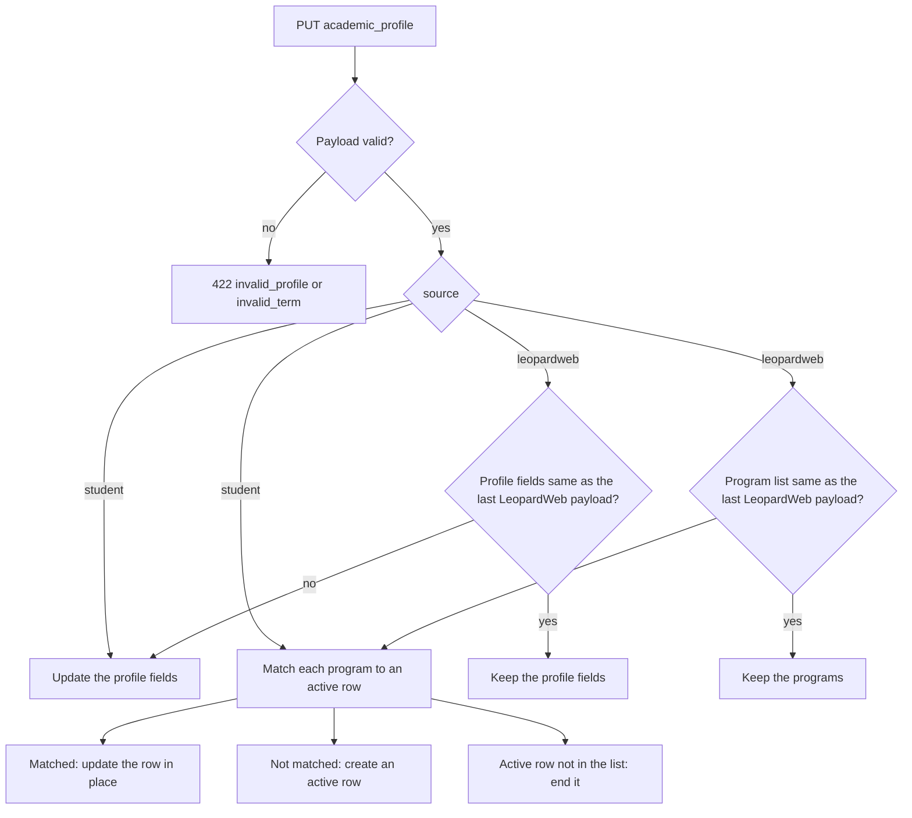

# Academic profile and course outcomes

The extension reads two LeopardWeb pages and sends what it finds to the backend (#529, calendar-extension#203). The degree requirement features use this data to find the requirements of each student (#526, #799).

| LeopardWeb page | Endpoint | Stored in |
|---|---|---|
| Student Profile | `PUT /api/user/academic_profile` | `AcademicProfile`, `StudentProgram` |
| Student Grades | `PUT /api/user/course_outcomes` | `CourseOutcome` |

`GET /api/user/academic_profile` returns the profile and the active programs. The full request and response shapes are in the [API contract](https://github.com/WITCodingClub/calendar-extension/issues/203#issuecomment-6354478653).

## What we do not store

We do not store letter grades, GPA, or W numbers. The extension converts each letter grade to one outcome before it sends it:

| Outcome | Grades | Meaning |
|---|---|---|
| `c_or_better` | A to C, and P | Passed. Meets a "minimum grade C" prerequisite. |
| `passed_below_c` | C-, D+, D, D- | Passed, so the credit counts. Does not meet a "minimum grade C" prerequisite. |
| `failed` | F | No credit. |
| `withdrawn` | W | No credit. |
| `incomplete` | I | No credit yet. |

## Terms

LeopardWeb shows a term as a label, for example "Fall 2025". `AcademicProfiles::TermCode` converts a label to a Banner term code (Fall 2025 is `202610`). The tables store the code as an integer, not a `terms` row, because a catalog term can be older than the first row in `terms`.

## Profile sync

- A program matches an active row when the role, code, name, concentration, study path, and catalog term are the same. A change in another field, such as the department, updates the row.
- A row is never deleted. A change of major ends the old row and creates a new one, so the history stays.
- The student can change a value in the extension settings (`source: "student"`). Each course sync sends the LeopardWeb profile again. The backend keeps a digest of the profile fields and a digest of the program list from the last LeopardWeb payload. It skips each part that has the same digest. So a student's change to a program stays until LeopardWeb shows a different program list, even when the class standing changes.

## Course outcomes

- Each term in a request replaces the outcomes of that term: a stored CRN that is not in the request is removed. A term that is not in the request does not change.
- A CRN must belong to a course the user is enrolled in. Other CRNs come back in `unknown_crns`, and the extension processes that term first. The stored outcome of an unknown CRN in the request does not change, because its enrollment can be missing for a short time.
- An outcome names its course by term code and CRN, not by course id. `Courses::Reprocessor` deletes and creates enrollments, and `rake catalog:refresh` deletes and imports the courses of a term again. The outcome stays through both.

## Links to the degree catalog

`AcademicProfiles::ProgramMatcher` links each `StudentProgram` to a `DegreeProgram` and a `CatalogYear` (`docs/degree-requirements.md`). `AcademicProfiles::Sync` runs it for each payload.

- LeopardWeb gives the subject ("Computer Science") and the degree apart. The catalog name has both ("Computer Science, B.S."). The matcher compares the subject only. The role picks the kind (a minor matches a `minor`), and the degree picks a bachelor or a master.
- A program with no match, or with more than one, keeps a null `degree_program_id`.
- The catalog year comes from the catalog term: Spring 2026 is in 2025-2026.
- `matched` in the response is `true` with a link, `false` when the catalog year is imported and has no such program, and `null` before the import.
- The degree catalog import (#527) must call `AcademicProfiles::ProgramMatcher.relink_active` when it finishes, so programs saved before the import get a link.
- LeopardWeb's `concentration` field on a major is not linked yet. A program with the `concentration` role is.
