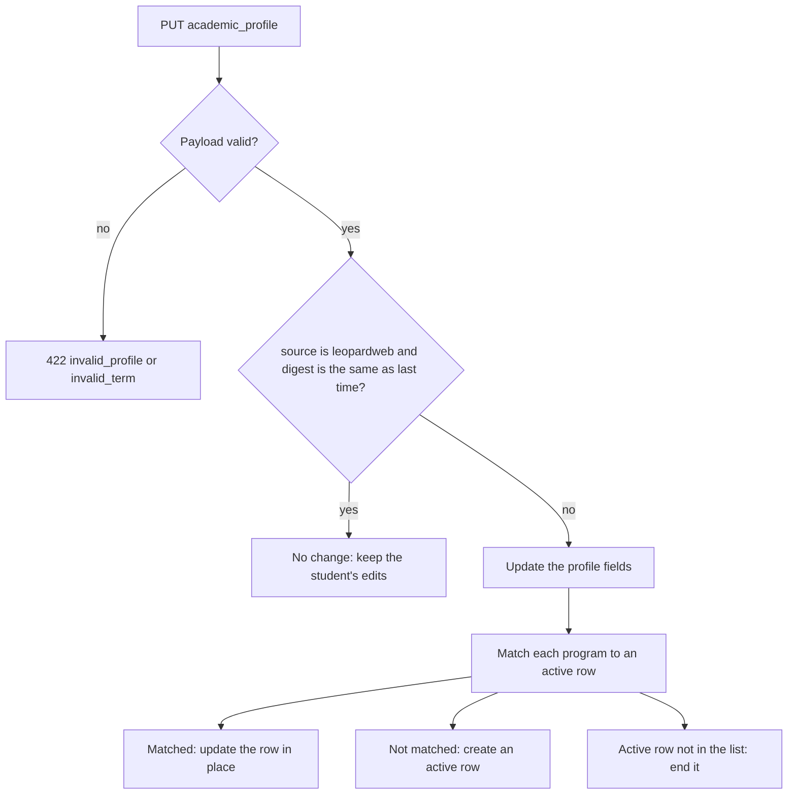

# Academic profile and course outcomes

The extension reads two LeopardWeb pages and sends what it finds to the backend (#529, calendar-extension#203). The degree requirement features use this data to find the requirements of each student (#526, #799).

| LeopardWeb page | Endpoint | Stored in |
|---|---|---|
| Student Profile | `PUT /api/user/academic_profile` | `AcademicProfile`, `StudentProgram` |
| Student Grades | `PUT /api/user/course_outcomes` | `CourseOutcome` |

`GET /api/user/academic_profile` returns the profile and the active programs. The full request and response shapes are in the [API contract](https://github.com/WITCodingClub/calendar-extension/issues/203#issuecomment-6354478653).

## What we do not store

We do not store letter grades, GPA, or W numbers. The extension converts each letter grade to one outcome before it sends it:

| Outcome | Grades | Meaning |
|---|---|---|
| `c_or_better` | A to C, and P | Passed. Meets a "minimum grade C" prerequisite. |
| `passed_below_c` | C-, D+, D, D- | Passed, so the credit counts. Does not meet a "minimum grade C" prerequisite. |
| `failed` | F | No credit. |
| `withdrawn` | W | No credit. |
| `incomplete` | I | No credit yet. |

## Terms

LeopardWeb shows a term as a label, for example "Fall 2025". `AcademicProfiles::TermCode` converts a label to a Banner term code (Fall 2025 is `202610`). The tables store the code as an integer, not a `terms` row, because a catalog term can be older than the first row in `terms`.

## Profile sync

- A program matches an active row when the role, code, name, concentration, study path, and catalog term are the same. A change in another field, such as the department, updates the row.
- A row is never deleted. A change of major ends the old row and creates a new one, so the history stays.
- The student can change a value in the extension settings (`source: "student"`). Each course sync sends the LeopardWeb profile again. The backend skips a LeopardWeb profile that is the same as the last one (`leopardweb_digest`), so the student's change stays until LeopardWeb shows a different profile.

## Course outcomes

- Each term in a request replaces the outcomes of that term. A term that is not in the request does not change.
- A CRN must belong to a course the user is enrolled in. Other CRNs come back in `unknown_crns`, and the extension processes that term first.
- An outcome belongs to the user and the course, not to the enrollment. `Courses::Reprocessor` deletes and creates enrollments, and the outcome stays.

## Next step

When the degree catalog models from #526 merge, each `StudentProgram` gets a `degree_program_id` and a `catalog_year_id`, and `matched` in the response shows if the link was found. Until then, `matched` is `null`.
