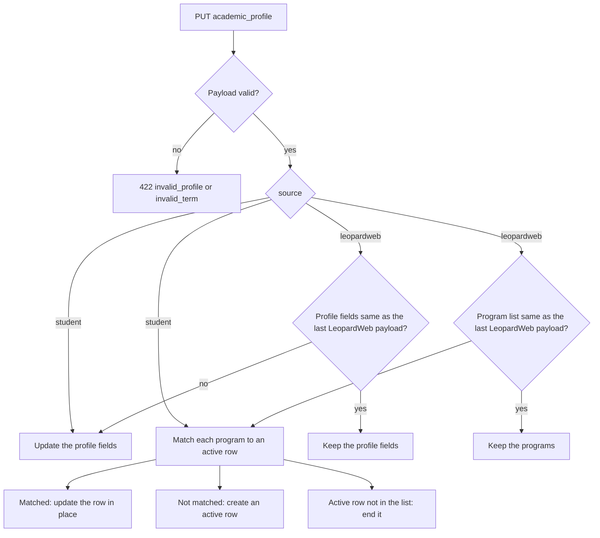
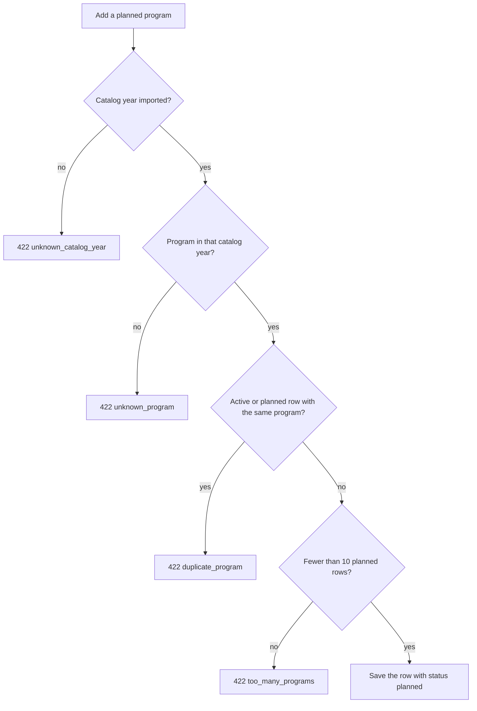
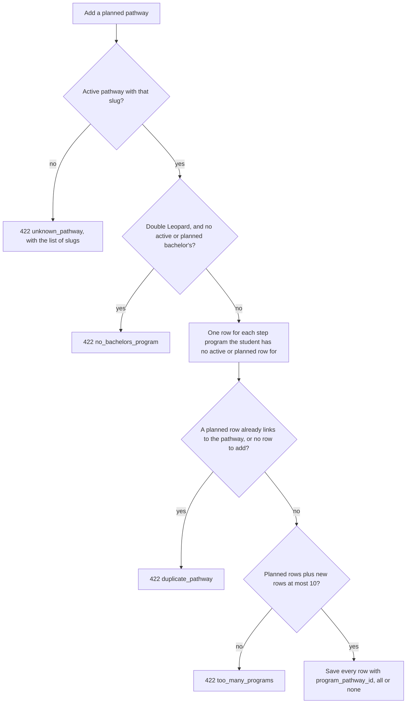
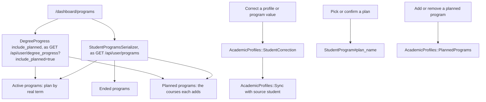
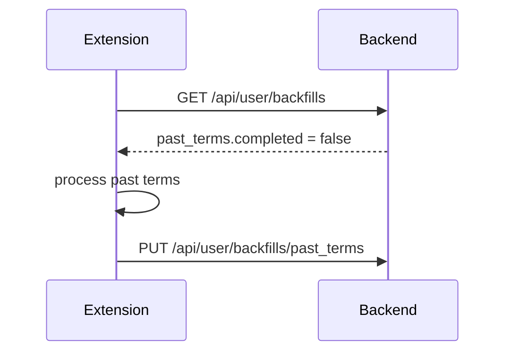

# Academic profile and course outcomes

The extension reads two LeopardWeb pages and sends what it finds to the backend (#529, calendar-extension#203). The degree requirement features use this data to find the requirements of each student (#526, #799).

| LeopardWeb page | Endpoint | Stored in |
|---|---|---|
| Student Profile | `PUT /api/user/academic_profile` | `AcademicProfile`, `StudentProgram` |
| Student Grades | `PUT /api/user/course_outcomes` | `CourseOutcome` |

`GET /api/user/academic_profile` returns the profile and the active programs. The full request and response shapes are in the [API contract](https://github.com/WITCodingClub/calendar-extension/issues/203#issuecomment-6354478653).

## What we do not store

We do not store letter grades, GPA, or W numbers. The extension converts each letter grade to one outcome before it sends it:

| Outcome | Grades | Meaning |
|---|---|---|
| `c_or_better` | A to C, and P | Passed. Meets a "minimum grade C" prerequisite. |
| `passed_below_c` | C-, D+, D, D- | Passed, so the credit counts. Does not meet a "minimum grade C" prerequisite. |
| `failed` | F | No credit. |
| `withdrawn` | W | No credit. |
| `incomplete` | I | No credit yet. |

## Terms

LeopardWeb shows a term as a label, for example "Fall 2025". `AcademicProfiles::TermCode` converts a label to a Banner term code (Fall 2025 is `202610`). The tables store the code as an integer, not a `terms` row, because a catalog term can be older than the first row in `terms`.

## Profile sync

- A program matches an active row when the role, code, name, concentration, study path, and catalog term are the same. A change in another field, such as the department, updates the row.
- A row is never deleted. A change of major ends the old row and creates a new one, so the history stays.
- The student can change a value in the extension settings (`source: "student"`). Each course sync sends the LeopardWeb profile again. The backend keeps a digest of the profile fields and a digest of the program list from the last LeopardWeb payload. It skips each part that has the same digest. So a student's change to a program stays until LeopardWeb shows a different program list, even when the class standing changes.

## Planned programs

A student can add a program from the degree catalog that they think about taking, such as a minor or a master's degree (#868). The row is a `StudentProgram` with `status: planned` and `source: student`. It is only a plan in WIT Calendar: it does not declare the program at Wentworth.

| Endpoint | MCP tool | Does |
|---|---|---|
| `GET /api/user/programs` | `my_programs` | Lists the profile fields, the active programs, the planned programs, and the ended programs (newest end first) |
| `POST /api/user/planned_programs` | `update_my_planned_programs` (`action: add`) | Adds a planned program. Params: `program` (a slug from `GET /api/v1/catalog/programs`), `catalog_year` (optional, the newest catalog year when blank) |
| `DELETE /api/user/planned_programs/:id` | `update_my_planned_programs` (`action: remove`) | Removes a planned program. `id` is its public id or its program slug |

- `AcademicProfiles::PlannedPrograms` does the checks. A planned row always has a `DegreeProgram` and a `CatalogYear`, and no catalog term. The role comes from the program kind: a `minor` program gives a `minor` row, and a bachelor's or master's program gives a `major` row.
- `AcademicProfiles::Sync` and `ProgramMatcher.relink_active` read only active rows, so a LeopardWeb sync never changes or ends a planned row.
- A planned row is deleted when the student removes it. A LeopardWeb row is never deleted.
- An ended program can be planned again, for example a major the student changed.
- A planned program stays when LeopardWeb later shows the same program, because a sync never changes a planned row. The student removes it. The duplicate check finds an active row only when it links to the same `DegreeProgram`.
- `save!` runs the duplicate and limit checks again under a lock on the user, so two adds at the same time cannot save the same program twice.

### Planned pathways

A student can also plan a pathway: a Double Leopard master's (3+1 or 4+1), or a combined program such as the 5-year B.S. plus M.Arch. `ProgramPathway` has the list (`docs/degree-requirements.md`).

| Endpoint | MCP tool | Does |
|---|---|---|
| `POST /api/user/planned_pathways` | `update_my_planned_programs` (`action: add`, `pathway`) | Adds a planned row for each program of the pathway that the student does not have yet. Params: `pathway` (a pathway slug), `catalog_year` (optional). Returns the pathway and the new rows |
| `DELETE /api/user/planned_pathways/:id` | `update_my_planned_programs` (`action: remove`, `pathway`) | Removes the planned rows of the pathway. `id` is the pathway slug |

- A row that the pathway adds has `program_pathway_id`. `pathway` in each planned program is its slug. `planned_pathways` in `GET /api/user/programs` lists the pathways of the planned rows, with their steps and `max_shared_courses`.
- A program the student already has stays as it is and does not link to the pathway. So removing the pathway never removes a LeopardWeb row or a program the student planned alone.
- A student can still remove one row of a pathway with `DELETE /api/user/planned_programs/:id`. The pathway stays in `planned_pathways` while one of its rows is planned.
- Every step uses the same catalog year, the newest one when `catalog_year` is blank.
- A Double Leopard pathway adds only the master's programs. It follows the student's own bachelor's: a row whose program is a bachelor's, or a LeopardWeb row with no catalog program and a bachelor's degree.

## Plan of study and start term

`AcademicProfiles::ProgramTimeline` gives each program its plan of study and its start term (#867). `GET /api/user/programs` and `my_programs` send them in each program:

| Field | Value |
|---|---|
| `plan` | The plan the student picked (`StudentProgram#plan_name`), or the standard plan of the catalog year. Null for a program with no plan of study, such as a minor, or with no link to the degree catalog. |
| `plan_source` | `student` when the student picked or confirmed the plan, `assumed` for the standard plan, null with no plan. |
| `plans` | The names of the plans of the program in its catalog year. |
| `start_term` | The catalog term from LeopardWeb, the term the student started the program. Without one, the admit term of the profile. Null for a planned program. |
| `start_term_source` | `catalog_term` or `admit_term`. |

- A semester of a plan maps to a real term from the start term. Year 1 is the academic year of the start term. With a Fall 2025 start, "Year 3, fall" is Fall 2027. With a Spring 2026 start, "Year 1, fall" is Fall 2025. A summer start counts as the start of the next academic year: with Summer 2026, "Year 1, fall" is Fall 2026.
- A picked plan that a later import renamed falls back to the standard plan, with `plan_source: assumed`.
- `AcademicProfiles::Sync` updates a matched row in place, so a LeopardWeb sync keeps the picked plan. A row that Sync ends and creates again (a change to a field that names the program) loses it.

## My programs dashboard page

`/dashboard/programs` (#867) shows the profile, the active programs, the planned programs, and the ended programs. It is a help for planning, not a degree audit, and the page says so. The official audit is Stellic.

- **Corrections.** `AcademicProfiles::StudentCorrection` sends the stored profile and every active program to `Sync` with `source: "student"`, with the student's change. It is the same path as the extension settings. Sync does not change the LeopardWeb digests, so the change stays until LeopardWeb shows a different profile or program list. A change to the role, code, name, concentration, study path, or catalog term ends the row and creates a new one, so the old values show in the ended programs.
- **Plans.** `PATCH /dashboard/programs/:id/plan` saves a plan of an active or a planned program. A student confirms an assumed plan with the same form.
- **What if.** The planned programs show their open requirements: the courses each one adds. A course that an active program also needs is marked "also in your programs". The planned rows use `AcademicProfiles::PlannedPrograms`, as the API does. Pathways are not on the page yet.

## Course outcomes

- Each term in a request replaces the outcomes of that term: a stored CRN that is not in the request is removed. A term that is not in the request does not change.
- A CRN must belong to a course the user is enrolled in. Other CRNs come back in `unknown_crns`, and the extension processes that term first. The stored outcome of an unknown CRN in the request does not change, because its enrollment can be missing for a short time.
- An outcome names its course by term code and CRN, not by course id. `Courses::Reprocessor` deletes and creates enrollments, and `rake catalog:refresh` deletes and imports the courses of a term again. The outcome stays through both.

## One-time backfills

Some students processed their current term before the extension read past terms or academic data. The extension runs each missing part one time for them (WITCodingClub/calendar-extension#215), and the backend keeps the record of each run in `UserBackfill`.

| Name | The run |
|---|---|
| `past_terms` | Process every past LeopardWeb term |
| `academic_data` | Send the academic profile and the course outcomes |

- `GET /api/user/backfills` returns each name with `completed` and `completed_at`.
- `PUT /api/user/backfills/:name` marks the run done and returns the same body. Call it only after the run finishes, so a failed run starts again on the next panel load.
- The backend does not know if a run was ever needed. A new student starts with every run not completed, so the extension marks each run done after its first full sync too.
- An unknown name answers 404. Add a new run to `UserBackfill::NAMES`. To run a finished backfill again for every student, add a new name (for example `past_terms_v2`).

## Links to the degree catalog

`AcademicProfiles::ProgramMatcher` links each `StudentProgram` to a `DegreeProgram` and a `CatalogYear` (`docs/degree-requirements.md`). `AcademicProfiles::Sync` runs it for each payload.

- LeopardWeb gives the subject ("Computer Science") and the degree apart. The catalog name has both ("Computer Science, B.S."). The matcher compares the subject only. The role picks the kind (a minor matches a `minor`), and the degree picks a bachelor or a master.
- A program with no match, or with more than one, keeps a null `degree_program_id`.
- The catalog year comes from the catalog term: Spring 2026 is in 2025-2026.
- `matched` in the response is `true` with a link, `false` when the catalog year is imported and has no such program, and `null` before the import.
- The degree catalog import (#527) must call `AcademicProfiles::ProgramMatcher.relink_active` when it finishes, so programs saved before the import get a link.
- LeopardWeb's `concentration` field on a major is not linked yet. A program with the `concentration` role is.
