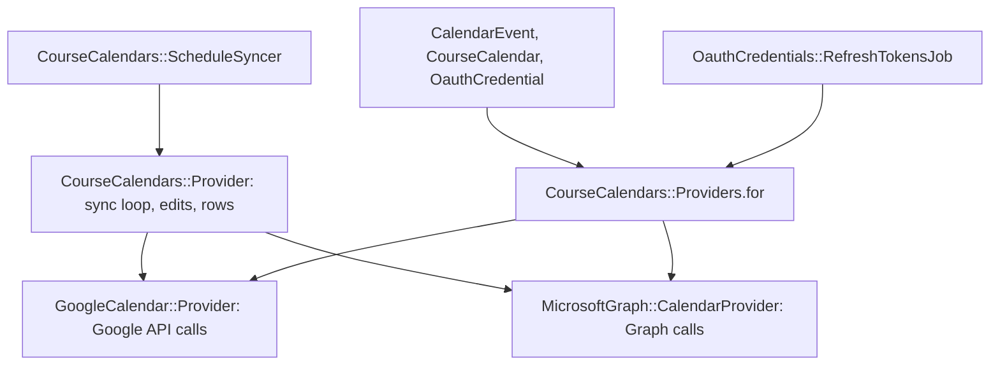
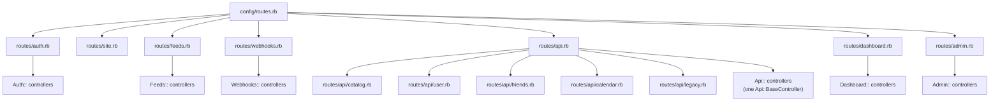
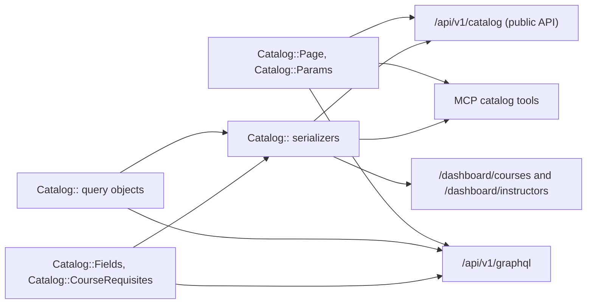
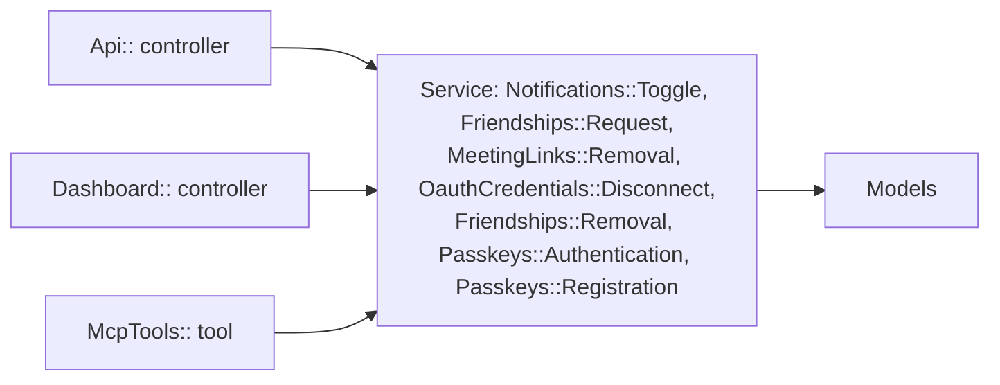

# Code organization

This page gives the rules for where code goes. Issue #710 set them. Follow them for new code.

## Rules

1. **Group by domain.** A domain's services, jobs, value objects, and errors share one module in every folder. For example, `FriendMeetings::Creator` is in `app/services/friend_meetings/creator.rb`, and `FriendMeetings::PublishJob` is in `app/jobs/friend_meetings/publish_job.rb`.
2. **Keep models, policies, and mailers flat.** The database stores model class names (polymorphic types, Solid Queue job arguments), and Pundit finds a policy from the model name. `Course::MeetingTime` and `TwentyFiveLive::*` are the only nested models.
3. **Use the plural for a domain namespace:** `Courses::`, `Faculties::`, `Friendships::`. A singular name such as `Faculty::` makes the `Faculty` model a namespace.
4. **Do not use a namespace that a gem owns.** The Google gems define `Google::Auth` and `Google::Apis`, so the app uses `GoogleSignIn::` and `GoogleCalendar::`. Flipper owns `Flipper::`, so the app uses `FeatureFlags::`. PgHero owns `PgHero::`, so its jobs are in `Database::`.
5. **Name a class after what it does.** Inside a namespace, a service has no `Service` suffix: `Courses::Processor`, not `CourseProcessorService`. A class that only sends HTTP requests to an outside system is a `Client`.
6. **Keep an error in the namespace that raises it:** `Courses::InvalidTermError`, `Catalog::FilterError`.
7. **Define a namespaced class inside its modules:** `module Admin` and then `class UsersController`, not `class Admin::UsersController`. RuboCop checks this with `Style/ClassAndModuleChildren`.

## Domains

| Namespace | What it holds |
|---|---|
| `Catalog` | The course catalog: import, snapshot, LeopardWeb client, queries, serializers, semantic search (upkeep: `docs/catalog-maintenance.md`) |
| `DegreeRequirements` | The academic catalog import: programs, plans of study, elective lists, and course descriptions for each catalog year (`docs/degree-requirements.md`) |
| `TermElectives` | The elective list PDFs that each school publishes for a term (`docs/term-electives.md`) |
| `Courses` | A user's course list: enrollments, processed events |
| `AcademicProfiles` | A student's level, class standing, and programs from LeopardWeb (`docs/academic-profile.md`) |
| `CourseOutcomes` | The outcome of each finished course, without the letter grade (`docs/academic-profile.md`) |
| `CourseCalendars` | Calendar sync for every provider: the provider base class with the sync loop, the provider registry, the per-user lock and retry rules of the jobs, sync markers, the ICS feed (`docs/ics-feed.md`) |
| `GoogleCalendar` | Google Calendar: the remote calls of the provider, event labels, rate limits, calendar jobs |
| `MicrosoftGraph` | Microsoft Graph: the HTTP client, the remote calls of the provider, calendar jobs |
| `GoogleSignIn` | Google sign-in and account linking: token checks, code exchange, OAuth state |
| `MicrosoftSignIn` | Sign-in with a WIT Microsoft account |
| `OauthCredentials` | Token refresh and revoke jobs for every provider, and the signed OAuth state. `OauthCredential#refresh!` and `#mark_revoked!` hold the token rules |
| `Oauth` | The OAuth 2.1 server for MCP clients: consent page, client registration, metadata (`docs/mcp.md`) |
| `McpTools` | The MCP server, its tools, prompts, and apps (`docs/mcp.md`) |
| `McpPlatforms` | The addresses of hosted MCP clients, which skip the per-IP rate limits (`docs/mcp.md`) |
| `Risc` | Google RISC security events: the token check, the event handler, and the stream management client (`Risc::StreamClient`, used by the `risc:*` rake tasks) |
| `FriendMeetings`, `Friendships`, `FriendGroups`, `MeetingLinks` | Friends features |
| `Notifications` | Turning the reminders of every calendar event off and on |
| `Passkeys` | The passkey sign-in and registration ceremonies, and their `Passkeys::Failed` messages |
| `Faculties` | The faculty directory and RateMyProfessor |
| `FinalsSchedules` | Finals schedule PDFs, their parsers, and the rooms that an exam location names (`ExamRooms`) |
| `UniversityCalendar` | The university event calendar import: the category of a feed event (`Category`) and the match of a repeated event (`DuplicateMatcher`) |
| `Embeddings` | Vector embeddings |
| `Preferences` | Calendar preferences: resolution, versions, templates, colors, reminders. `PreferenceFields` lists the fields |
| `FeatureFlags` | Flipper flags, groups, and actors. Add a new flag to `FeatureFlags::DESCRIPTIONS` |
| `TwentyFiveLive` | 25Live: client, sync job, models, and value objects |
| `Cleanup`, `Database` | Maintenance jobs. `Cleanup::ExpiredRecordsJob` deletes the expired rows of each `Expirable` model |

Code with no domain stays at the root of its folder, for example `ApplicationService`, `JsonWebTokenService`, `AppMetrics`, `HttpFetcher` (every request to an outside site that an importer reads), and `PdfText` (every PDF that an importer reads).

## Calendar providers

`CourseCalendars::Provider` owns everything that does not depend on the provider: the sync loop, the "edits in the calendar win" merge (`CourseCalendars::EventEdits`), the tracking rows, the duplicate race, and the "event is gone, make it again" step. `GoogleCalendar::Provider` and `MicrosoftGraph::CalendarProvider` subclass it and make only the remote calls. Models and jobs reach a provider through `CourseCalendars::Providers.for(name)`, never by a test of the provider name. A new provider is a new subclass and a new entry in `CourseCalendars::Providers::CLASSES`.

## Controllers and routes

- **API route files:** `routes/api.rb` draws each file in `routes/api/` inside `namespace :api`. Put a new API route in the file for its area. The catch-all route stays last in `routes/api.rb`.
- **API:** every API controller inherits from `Api::BaseController`. `CLAUDE.md` has the rules for auth, errors, and old paths.
- **Admin access:** `AdminAccess` lists the lowest access level of each admin section that needs more than admin access. The admin navigation, the policies (`CourseCatalogPolicy`, `ServiceAccountPolicy`), and the route constraints (`AdminConstraint.new(:jobs)`) read it. Add a new section there, not as a role test in a controller. `spec/policies/admin_access_spec.rb` checks that the three agree.
- **Fixed URLs:** the OAuth callbacks, `/risc/events`, and `/calendar/:token` never change. Google, Microsoft, and calendar apps store them.
- **Catalog pages:** the dashboard pages for courses, instructors, finals, and university events (#797) are read-only and open to every signed-in user. They include `Dashboard::CatalogPages`. The course and instructor pages use the `Catalog::` query objects and render the hashes of the `Catalog::` serializers, so they show the same data as the public catalog API. The finals and events pages use `FinalsSchedules::FinalExamQuery` and `UniversityCalendar::EventQuery`. Do not show a field there that the API leaves out, such as a faculty email. The prerequisite map on a course page (#448) comes from `Catalog::PrerequisiteGraph`. It walks the same prerequisites and unlocked courses that the API gives for each course, and `Dashboard::PrerequisiteGraphHelper` places the boxes.

The REST controllers, the GraphQL schema, and the MCP catalog tools also share the request layer: page sizes (`Catalog::Page`), filter readers (`Catalog::Params`), the term lookup (`Term.find_by_uid!`), and the section and instructor lookups (`Catalog::SectionQuery.find!`, `Catalog::InstructorQuery.find!`). The serializers and the GraphQL types read the values that take more than one column from `Catalog::Fields` and `Catalog::CourseRequisites`. Course codes have one owner, `CourseCode`: it parses a code to a key (`["COMP", 2350]`) and formats a key as a code, and a row with `subject_code` and `course_number` gets `key` and `code` from `CourseCode::Named`. The checked aliases between codes have one owner, `AcademicProfiles::CourseKeys`. Prerequisite trees have one walker, `PrerequisiteTree`.

## Shared actions

An action that the API, the dashboard and an MCP tool all offer lives in one service. Each surface finds the record, authorizes it with the same policy, calls the service, and renders the result its own way (JSON, a redirect, or a tool result). Do not copy the rules of an action into a controller or a tool.

- **Flags:** a controller gates a feature with `require_feature FeatureFlags::X, "message"` (`FeatureGate`). An API controller answers 404 in the JSON error format, a dashboard controller an empty 404. `DegreePlanningFlag` and `FriendGroupsFlag` name the two gates that many controllers share. The friends flags are read with `Friendships::Features`.

## Views

Issue #699 set these rules for the dashboard and the sign-in pages. The admin pages use the partials in `app/views/admin/shared/`.

- **Shared partials** live in `app/views/shared/`. Use them before you write the markup again:

  | Partial | Use |
  |---|---|
  | `page_header` | The title of a page, with an optional `back:` link, `description:`, and actions in the block |
  | `back_link` | A link back to the parent page, when the page has no `page_header` |
  | `section_card` | A card with a titled header. The block is the body |
  | `list_link_row` | One link row with a title, a hint, and a chevron |
  | `empty_state` | A card for a list with no items. The block holds the next step |
  | `status_card` | The result card of the OAuth and passkey pages |

- **Icons:** call `icon(:name, css_class: "w-4 h-4")` from `IconHelper`. Add a new icon to `IconHelper::ICONS` (outline) or `FILLED_ICONS`. Do not paste an inline `<svg>`. `logo_mark(:small)`, `(:medium)`, or `(:large)` draws the logo.
- **Page widths:** wrap each dashboard page in one width class. `m3-page-narrow` is for one form or a few settings, `m3-page-medium` is for lists of records, and `m3-page-wide` is for calendars.
- **Buttons and badges:** use the `m3-btn-*` and `m3-badge-*` classes in `app/assets/tailwind/application.css`. `m3-btn-provider` is the sign-in button for Google, Microsoft, and passkeys.
- **JavaScript:** put page code in a Stimulus controller, not an inline script. Shared modules live in `app/javascript/lib/`, for example `lib/webauthn`.

## Renaming a job

Solid Queue stores job class names in the database. `CLAUDE.md` ("Jobs") gives the steps: a fixed `CONCURRENCY_GROUP`, an alias file at the old path, and `bin/rails jobs:unknown_class_names` before the alias goes.
