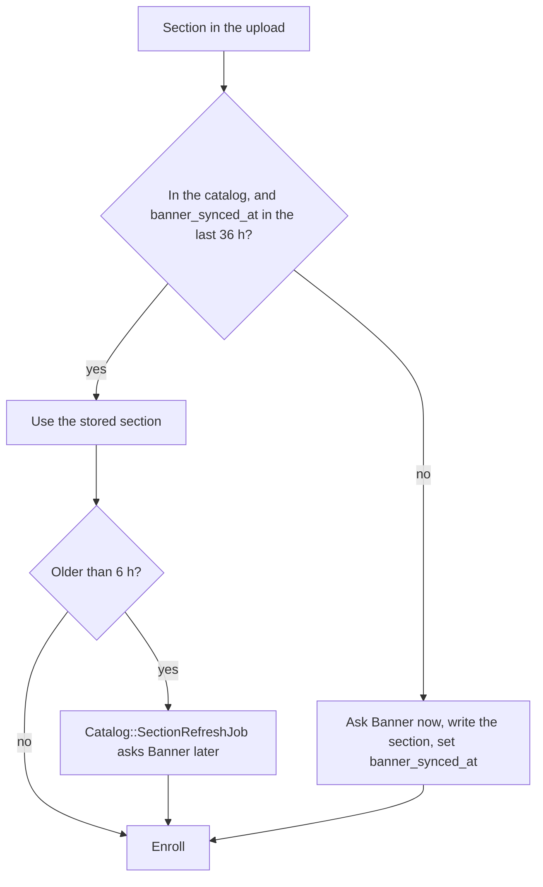

# Catalog maintenance

The course catalog comes from Banner (LeopardWeb). These jobs and tasks keep it current. Every Banner request goes through `Catalog::BannerThrottle`. Jobs share a burst of 20 requests, then 5 a second. Web requests have their own burst of 60, then 10 a second, so a student's schedule never waits behind the nightly sync.

| What | When | How |
| --- | --- | --- |
| Import one term | A new term appears | Admin, Course catalog, Import (`Catalog::ImportJob`) |
| Nightly sync | Every night, current and future terms | `Catalog::CourseDataSyncJob` (`config/recurring.yml`) |
| Refresh one schedule's sections | After `POST /api/process_courses` serves sections from the catalog that Banner confirmed more than 6 hours ago | `Catalog::SectionRefreshJob` |

## Where a schedule's sections come from

`POST /api/process_courses` (`Courses::Processor`) does not ask Banner about a section that Banner confirmed in the last 36 hours. The nightly sync and each Banner fetch record that time in `courses.banner_synced_at`. Such a section comes from the catalog, and the request needs no Banner call. A new section, or one that the sync has not confirmed in 36 hours, goes to Banner as before. If the nightly sync stops, every section goes to Banner after 36 hours.



Each request logs one line: `[Courses::Processor] user=… sections=… from_catalog=… from_banner=… refresh=… banner_ms=… total_ms=…`.
| Course details and prerequisites | After each import, and nightly | `Catalog::CourseDetailsSyncJob` |
| Re-import every term | After a change to the importer, or to find missed sections | `bin/rails catalog:reimport_all_terms` |
| Fetch every course's details again | After a new course detail column ships | `bin/rails catalog:backfill_course_details REFETCH=1` |

## Re-import every term

`catalog:reimport_all_terms` imports every term again from Banner, newest first, one term at a time. The current and future terms finish first.

```sh
# Print the plan: the terms it imports, and the terms it skips.
bin/rails catalog:reimport_all_terms DRY_RUN=1

# Import every term.
bin/rails catalog:reimport_all_terms

# Import only some terms (term uids, both ends included).
bin/rails catalog:reimport_all_terms FROM=202510 TO=202720
```

The task only queues `Catalog::ReimportAllTermsJob`. That job builds the plan, imports one term with `Catalog::ImportJob`, logs the result, and queues itself for the next term. Only one run goes at a time.

The plan has each term that Banner lists and that is in our database. It skips two kinds of term, and the log names them:

- A term that Banner lists but our database does not have. Create it on the admin course catalog page, then run the task again.
- A term in our database that Banner no longer lists. Banner has nothing to import for it.

### What a re-import changes

- It adds the sections that are missing and updates the ones that changed: title, credits, dates, link codes, and seats.
- It replaces the meeting times of a section whose times changed in Banner, the same as an import from the admin page.
- It deletes no section and changes no enrollment.
- Each import then queues the course details sync for its term. That sync skips the courses that already have fresh details.

### Follow it

Each term logs one line:

```text
[Catalog::ReimportAllTermsJob] Term 202720: 3 added, 41 updated, 1168 unchanged (28 terms left)
```

Search the logs for `Catalog::ReimportAllTermsJob`. A term that fails logs the error, is reported to `Rails.error`, and shows as failed on the admin course catalog page. The run goes on to the next term. To run one failed term again, use `FROM` and `TO` with that term's uid.

### How long it takes

- **Imports:** Banner lists every term back to 2014, about 39,500 sections. One import sends about 4 requests (a session and pages of 500 sections), so the Banner time is small. Most of the time is the database work, about 1 to 2 minutes for a term of 1,200 sections. All terms take about 30 to 60 minutes.
- **Course details:** each course details sync sends 8 requests for each course that needs new details (`LeopardWebClient::COURSE_DETAIL_PAGES`), at 5 requests a second. The newest terms take about 12 minutes each (450 courses). Older terms take less, because a course that a newer term already loaded is skipped. Expect a few hours in total, in the background, behind the imports.
