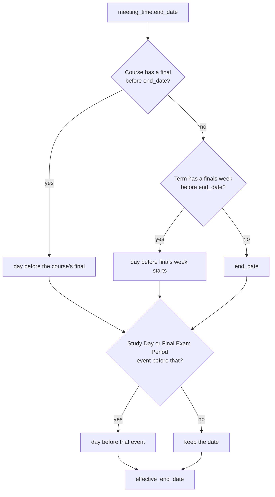

# Class end dates in processed events

Each `meeting_times` entry in these responses has two fields that tell a client on which days a class meets (#903):

- `GET /api/user/processed_events`
- `GET /api/friends/:friend_id/processed_events`
- the `my_courses` and `my_course_history` MCP tools

| Field | Format | Meaning |
| --- | --- | --- |
| `start_date`, `end_date` | date-time | The dates that Banner stores. They do not change. |
| `effective_end_date` | `YYYY-MM-DD` | The last date the class can meet. |
| `excluded_dates` | `YYYY-MM-DD` array | Dates on the meeting day, from `start_date` to `effective_end_date`, that a holiday, study day, or finals event covers. |

A class meets on a date when the date is on its meeting day, is from `start_date` to `effective_end_date`, and is not in `excluded_dates`.

`CourseCalendars::RecurrenceBuilder` gives both values. Calendar sync uses the same methods for the `UNTIL` and `EXDATE` lines, so the extension and the synced calendar agree.

The values do not depend on today's date. A request after finals have passed gets the same dates. The university events endpoint lists only upcoming events, so it cannot give these dates.
