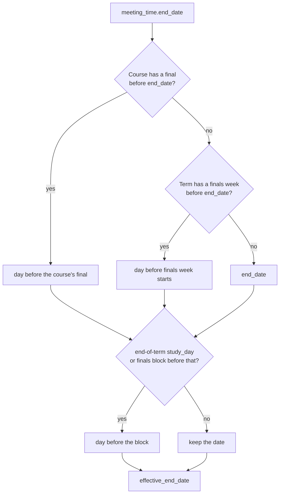

# Class end dates in processed events

Each `meeting_times` entry in these responses has two fields that tell a client on which days a class meets (#903):

- `GET /api/user/processed_events`
- `GET /api/friends/:friend_id/processed_events`
- `POST /api/friends/processed_events` (each entry)
- the `my_courses` and `my_course_history` MCP tools

| Field | Format | Meaning |
| --- | --- | --- |
| `start_date`, `end_date` | date-time | The dates that Banner stores. They do not change. |
| `effective_end_date` | `YYYY-MM-DD` | The last date the class can meet. |
| `excluded_dates` | `YYYY-MM-DD` array | Dates on the meeting day, from `start_date` to `effective_end_date`, that a holiday, study day, or finals event covers. |

A class meets on a date when the date is on its meeting day, is from `start_date` to `effective_end_date`, and is not in `excluded_dates`.

The finals cutoffs come from the whole term. A section that starts after the term's Study Day can get an `effective_end_date` before its `start_date`. That section has no meetings, in the response and in the synced calendar.

`CourseCalendars::RecurrenceBuilder` gives both values. Calendar sync and the ICS feed use the same methods for the `UNTIL` and `EXDATE` lines, so the extension, the synced calendar, and the feed agree. `UniversityCalendarEvent.finals_periods` picks the events in the `study_day` and `finals` categories, whatever their title ("Final Exam Period", "Final Exams", "Finals Week"). `UniversityCalendar::Category` puts a finals schedule announcement, such as "Final Exam Schedule Available to Students", in `academic`, so it does not end classes.

Classes end the day before the term's end-of-term finals block (`UniversityCalendarEvent.end_of_term_finals_starts`). The block is the earliest finals period that starts no more than 14 days before the term's last one. A finals period for the first 7-week classes, weeks earlier, cancels classes on its own dates only and does not end the 15-week classes.



The values do not depend on today's date. A request after finals have passed gets the same dates. The university events endpoint lists only upcoming events, so it cannot give these dates.

## Which events cancel classes

A university calendar event in the `holiday`, `study_day` or `finals` category cancels classes on its dates (`UniversityCalendarEvent::NO_CLASS_CATEGORIES`). The feed has no category field, so `UniversityCalendar::Category` reads the title.

`finals` is an allowlist (`Category.finals_period?`). A title gets `finals` only when it names the exam period: "Final Exam Period", "Final Exams" followed by "(", a space or the end of the title, "Finals Week", "Exam Period", "Examination Period" or "Final Examinations". "Final Exam Schedule ..." and "Final Exam Conflict ..." never count, and a title with "Midterm" never counts. Any other title with a finals word goes to `deadline` or `academic`:

| Title | Category |
| --- | --- |
| "Final Exam Period (15-week & 2nd 7-week classes)", "Final Exams (see schedule posted)", "Finals Week" | `finals` |
| A deadline or request: a `deadline` word, "due", "submit" or "request", such as "Final Exam Conflict Requests Due" | `deadline` |
| Any other title, such as "Spring 2027 Final Exam Schedule Available to Students", "Final Exam Schedule Is Live", or a title the feed cuts short ("Schedule Availabl") | `academic` |

`UniversityCalendar::TermDates` takes the latest `finals` event of a term as the end of the term.

The weekly import infers the category again for every event that the feed still lists. A row that the feed no longer lists keeps its old category. After a change to `UniversityCalendar::Category`, run the recategorize task once after the deploy:

```sh
bin/rails university_calendar:recategorize            # prints the changes only
bin/rails university_calendar:recategorize DRY_RUN=0  # saves them and queues the calendar syncs
```

The task skips rows with a `manual:` uid, because an admin chose their category. When a no-class category changes, it resyncs the calendars of all users, as the import and the backfill do (`UniversityCalendar::SyncJob.resync_users`).
