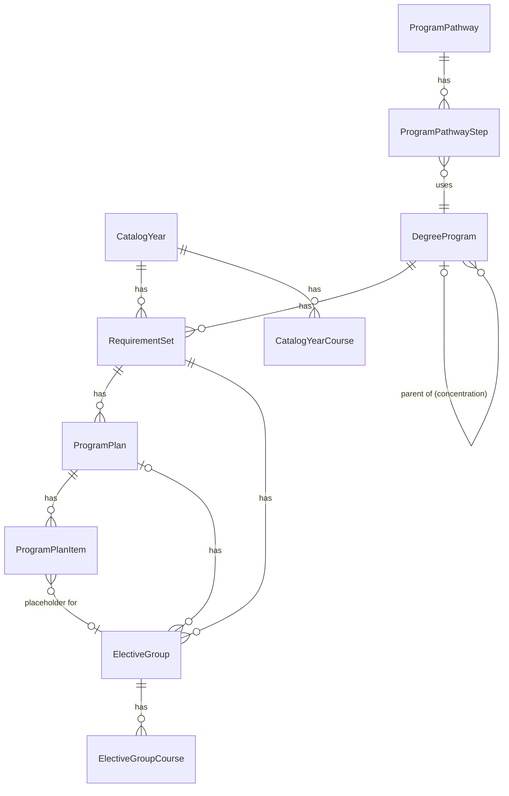
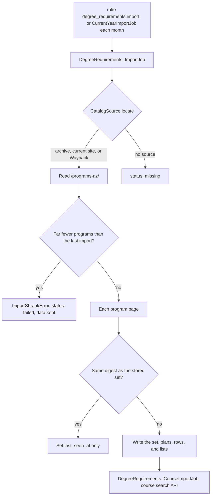

# Degree requirements

The degree requirements come from the academic catalog at <https://catalog.wit.edu>. Each catalog year has its own requirements, because a student follows the catalog of the term they started a program in. Issue #526 has the design. This page describes the tables.

## Sources

| Catalog years | Source |
|---|---|
| 2019-2020 to 2024-2025, and the current year | CourseLeaf HTML. Past years are under `/previous-catalogs/YYYY-YYYY/`. |
| 2025-2026 | No HTML archive. The Wayback Machine has most program pages, and the CourseLeaf PDF fills the gaps. |
| 2013-2014 to 2018-2019 | PDF only. The first term with Banner sections is Spring 2014. |

The course search on the catalog site has a JSON API with the courses of each year from 2019-2020 (`/course-search/api/?page=fose`). Its `srcdb` parameter is the first year of the catalog year.

## Tables

| Model | One row is |
|---|---|
| `CatalogYear` | One catalog, such as 2024-2025 (`start_year` 2024). `CatalogYear.for_term(term)` finds the catalog of a term. |
| `DegreeProgram` | One program across every year, keyed by the last part of its catalog path (`computer-science-bs`). A concentration has a `parent_program`. |
| `RequirementSet` | One program in one catalog year. The name, school, and department are as printed that year. |
| `ProgramPlan` | One plan of study, such as the "Four Year Program". `years` is its length. `RequirementSet#standard_plan` is the first plan that is not accelerated. |
| `ProgramPlanItem` | One semester row of a plan: a `course`, a `placeholder` such as "Computer Science Elective", or a `choice` between courses. |
| `ElectiveGroup` | One elective list and the minimum it asks for. |
| `ElectiveGroupCourse` | One course in an elective list. |
| `CatalogYearCourse` | One course as one catalog year printed it. |
| `CourseCodeAlias` | An old course code and the code that replaced it (COMP128 to COMP1000, 2015-2016). |
| `ProgramPathway`, `ProgramPathwayStep` | A path through more than one program: 3+1, 4+1, or the 5-year B.S. plus M.Arch. |

## Where the requirements are on a program page

- The required courses are only in the plan of study (`table.sc_plangrid`). A plan row can be a placeholder that names an elective list.
- The elective lists are `table.sc_courselist`. The minimum ("select four") is only in the heading above the list.
- One page can have more than one plan, each with its own elective lists.

## Links to Banner courses

`ProgramPlanItem`, `ElectiveGroupCourse`, and `CatalogYearCourse` name a course by `subject_code` and `course_number`. `catalog_course_id` links the row to the `CatalogCourse` with that code (`CatalogCourseLinkable`). The link is nil when Banner does not know the code.

- A save that changes the code clears the link.
- `link_catalog_courses` on each model sets every link in bulk, and fixes a link that names another course.
- The import calls it after it writes the rows. `Catalog::CourseDetailsSync.seed` calls it when Banner lists a course for the first time.

## Import

| What | How |
|---|---|
| Import one catalog year | `bin/rails 'degree_requirements:import[2024]'` |
| Import a year whose index is much shorter than the last import | `FORCE=1 bin/rails 'degree_requirements:import[2024]'` |
| Import 2019-2020 to this year | `bin/rails degree_requirements:import_all` |
| Import the current year and the year before again | `DegreeRequirements::CurrentYearImportJob`, on the 2nd of each month (`config/recurring.yml`) |

- **Source of a year.** `CatalogSource.locate` tries `/previous-catalogs/YYYY-YYYY/`, then the current site, then the Wayback Machine (only for the years in `DegreeRequirements::WAYBACK_TIMESTAMPS`). Every page must end with "Boston, MA YYYY-YYYY" for the right year. A page for another year is skipped. This catches the current site moving to a new year in the summer, and an old Wayback capture.
- **Missing year.** A year with no source gets `status: missing`. The import writes nothing and does not retry.
- **Failures.** A fetch error (5xx, timeout, refused connection) stops the import and leaves the stored data as it was. The job retries it 3 times. A page that does not parse is reported to `Rails.error` and skipped. In the course import, a course whose details fail is reported and keeps the title from the list.
- **Status.** `missing` and `failed` are set only on a year with no stored data. A year with data keeps `imported` when a later import fails, because its data is still good. The executor reports the error.
- **Short index.** When the index lists less than half the programs that the last import saw, the import stops with `ImportShrankError` and writes nothing. If the catalog really lists fewer programs, import the year again with `FORCE=1`.
- **One import at a time.** All years share one lock (`ImportJob::CONCURRENCY_GROUP`), because two years write the same `DegreeProgram` rows.
- **Summer rollover.** The current year is read from the site root. When the site moves to a new year, the monthly job also imports the year before, which then reads from `/previous-catalogs/` and stores the archive paths.
- **Parser changes.** The page digest includes `ProgramPageParser::VERSION`. Raise it when a parser change should write every page again.
- **Redirects.** The client follows a redirect only over HTTPS to catalog.wit.edu or web.archive.org.
- **Speed.** Requests to the catalog site are 0.5 seconds apart, so a year takes about one minute. The Wayback Machine refuses a client that asks for more than about 15 pages a minute, so its requests are 5 seconds apart. 2025-2026 takes about 10 minutes.
- **Plan ids.** A changed page keeps the ids of its plans. Its plan rows and elective lists are written again.
- **Program names.** The newest catalog year sets the name and the parent of a `DegreeProgram`. A program that the index lists in two departments is imported once.

### How a page is read

| On the page | Becomes |
|---|---|
| `tr.plangridyear`, `tr.plangridterm` | `year_index` and `season`. "Semester One", "Two", and "Three" are fall, spring, and summer. |
| A row with one course code | A `course` row |
| "MATH1776 & MATH1777" | Two `course` rows with no credits. The credits on the page are for the pair. |
| "COMP1100 or COMP2100" | A `choice` row |
| "Select one of the following:" with indented courses under it | A `choice` row with the indented courses as its options |
| `span.comment`, such as "Computer Science Elective1" | A `placeholder` row, linked to the elective list with the same name in its plan |
| An indented note with no credits | Nothing. It explains the row above it. |
| `table.sc_courselist` and the heading above it | An `ElectiveGroup`. "select four (4) courses" gives `min_courses`. |
| An area header or a "Select ..." note inside a list | A new `ElectiveGroup`, such as "Required Courses: Select one (1) course from the following courses" |
| "The following courses require School approval" | `requires_approval` on the courses after it |
