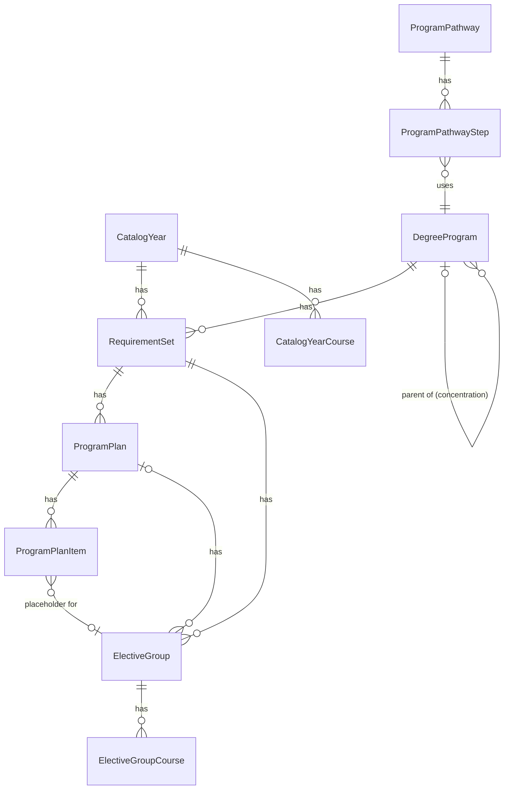
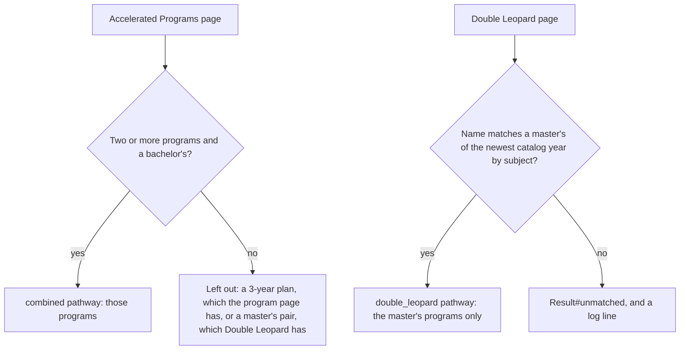
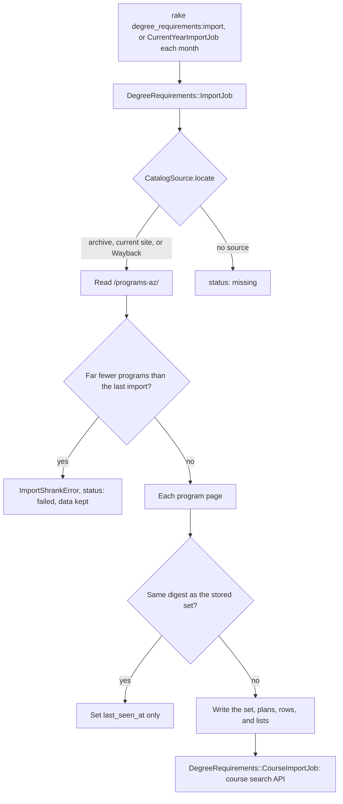
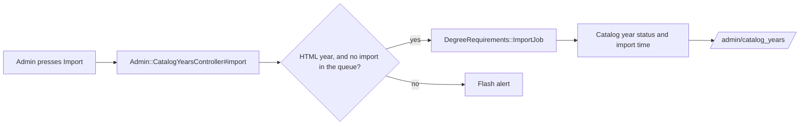
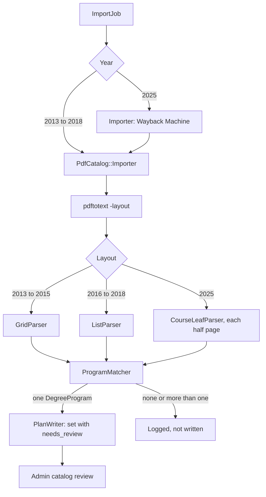
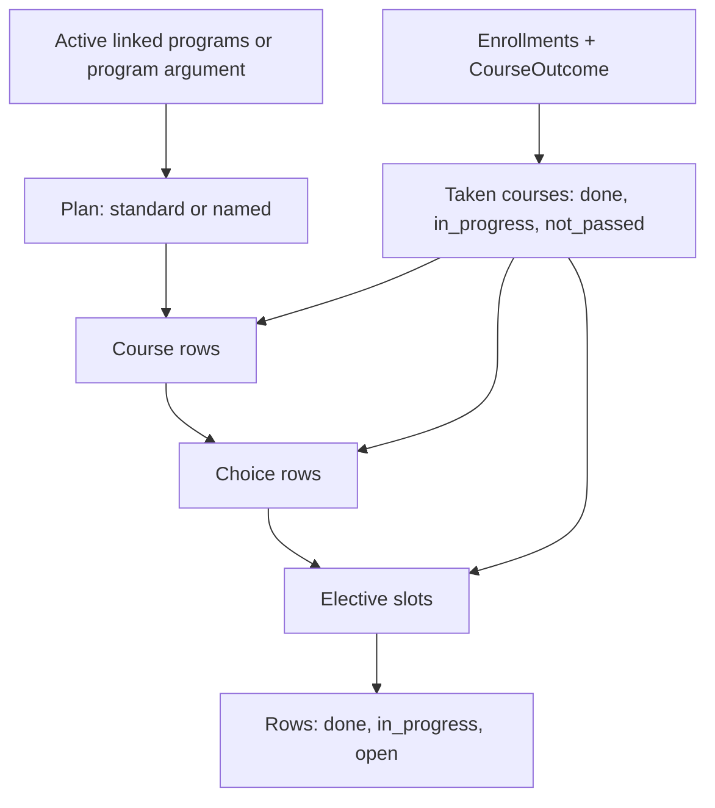
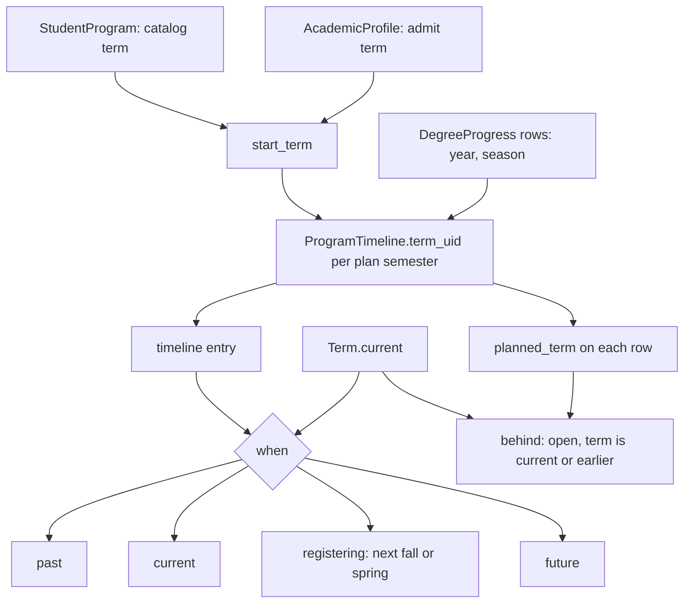
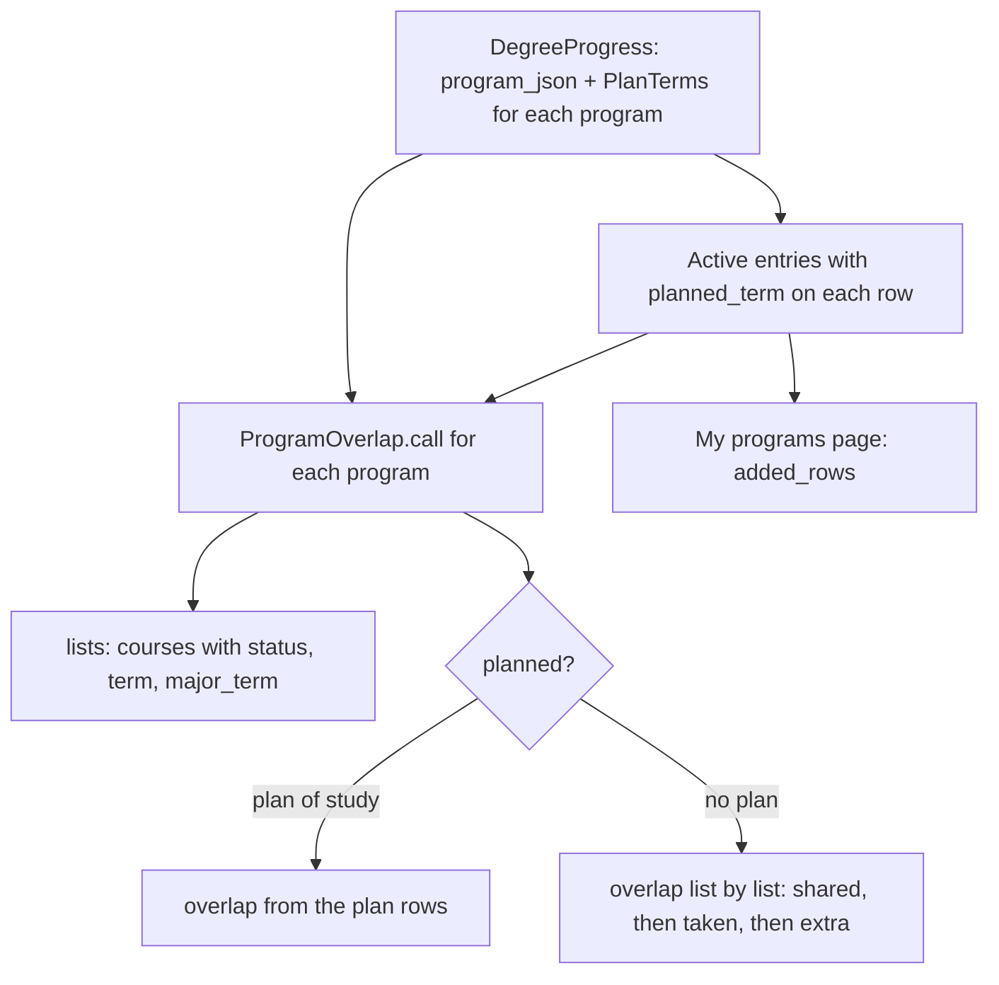
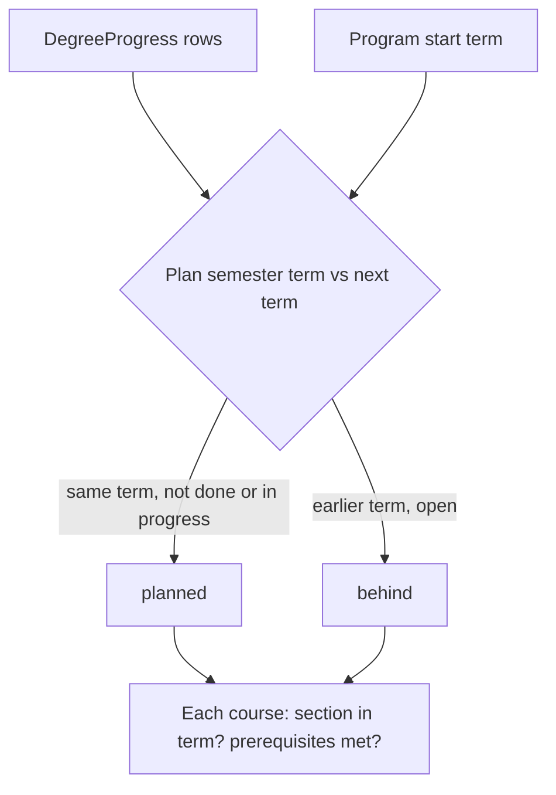
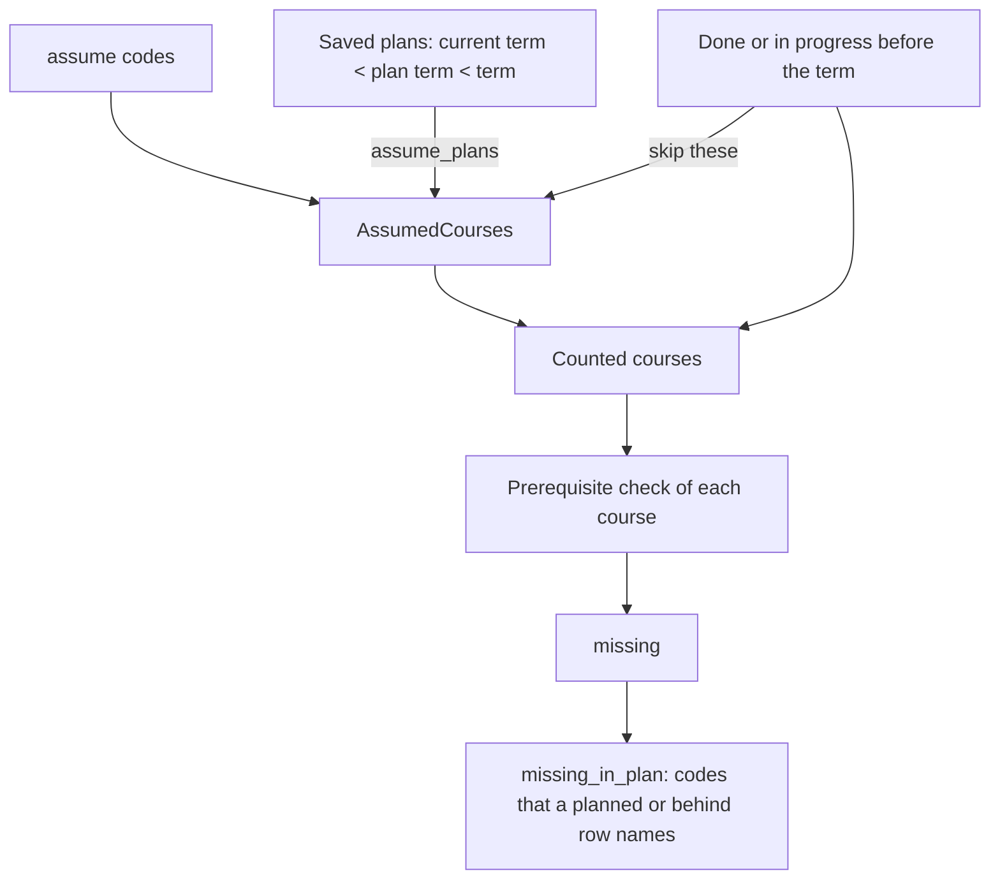

# Degree requirements

The degree requirements come from the academic catalog at <https://catalog.wit.edu>. Each catalog year has its own requirements, because a student follows the catalog of the term they started a program in. Issue #526 has the design. This page describes the tables.

## Sources

| Catalog years | Source |
|---|---|
| 2019-2020 to 2024-2025, and the current year | CourseLeaf HTML. Past years are under `/previous-catalogs/YYYY-YYYY/`. |
| 2025-2026 | No HTML archive. The Wayback Machine has most program pages, and the CourseLeaf PDF fills the gaps. |
| 2013-2014 to 2018-2019 | PDF only. The first term with Banner sections is Spring 2014. See [PDF catalogs](#pdf-catalogs). |

The course search on the catalog site has a JSON API with the courses of each year from 2019-2020 (`/course-search/api/?page=fose`). Its `srcdb` parameter is the first year of the catalog year.

## Tables



| Model | One row is |
|---|---|
| `CatalogYear` | One catalog, such as 2024-2025 (`start_year` 2024). `CatalogYear.for_term(term)` finds the catalog of a term. |
| `DegreeProgram` | One program across every year, keyed by the last part of its catalog path (`computer-science-bs`). A concentration has a `parent_program`. |
| `RequirementSet` | One program in one catalog year. The name, school, and department are as printed that year. `hss_requirement` is what the major adds to the HSS requirement. |
| `ProgramPlan` | One plan of study, such as the "Four Year Program". `years` is its length. `RequirementSet#standard_plan` is the first plan that is not accelerated. |
| `ProgramPlanItem` | One semester row of a plan: a `course`, a `placeholder` such as "Computer Science Elective", or a `choice` between courses. |
| `ElectiveGroup` | One elective list and the minimum it asks for. A shared list can be a rule: `subject_codes` (any course in these subjects) or `any_course`. |
| `ElectiveGroupCourse` | One course in an elective list. |
| `CatalogYearCourse` | One course as one catalog year printed it. |
| `CourseCodeAlias` | An old course code and the code that replaced it (COMP128 to COMP1000, 2015-2016). |
| `ProgramPathway`, `ProgramPathwayStep` | A path through more than one program: a Double Leopard master's (3+1 or 4+1), or a combined program such as the 5-year B.S. plus M.Arch. |

## Program pathways

No person keeps a list of pathways. `DegreeRequirements::PathwaySync` reads two pages (#868):

| Source | Gives | Kind |
|---|---|---|
| The Accelerated Programs page of the current catalog (`/programs-az/accelerated-programs/`) | Each option with two or more programs and a bachelor's, such as "Architecture, B.S. and Master of Architecture 5-Year". The steps are those programs. | `combined` |
| The Double Leopard page on wit.edu (`/admissions/graduate/accelerated-masters-degrees`) | Each master's program under "Double Leopard Programs", and the limit in "Take up to two courses during your senior year". | `double_leopard` |



- A Double Leopard pathway names only the master's programs. A senior in any bachelor's program can apply, so the student's own bachelor's is the first part. Its plan (3 or 4 years) makes the pathway a 3+1 or a 4+1. Planning one needs a bachelor's program (`docs/academic-profile.md`).
- A name matches by subject: "Computer Science" is "Computer Science, M.S.", and "Architecture" is "Architecture, M. Arch.". The whole name is tried first, so "Electrical and Computer Engineering" stays one program. "Architecture & Construction Management Dual Degree" splits at "&" into one pathway with two master's steps.
- `max_shared_courses` comes from the Double Leopard page. The catalog gives no limit for a combined pathway, and neither page gives a credit limit, so those stay empty.
- It runs at the end of each import of the current catalog, and `bin/rails degree_requirements:pathways` runs it now.
- A fetch error, or a page with none of the parts it reads, raises before any change, and the import reports it and goes on. The stored pathways stay.
- A combined option with a program that is not imported yet is skipped, and its stored pathway stays as it is.
- A pathway that neither page lists is set inactive, not deleted, because planned programs link to it.

## Where the requirements are on a program page

- The required courses are only in the plan of study (`table.sc_plangrid`). A plan row can be a placeholder that names an elective list.
- The elective lists are `table.sc_courselist`. The minimum ("select four") is only in the heading above the list.
- One page can have more than one plan, each with its own elective lists.

## Links to Banner courses

`ProgramPlanItem`, `ElectiveGroupCourse`, and `CatalogYearCourse` name a course by `subject_code` and `course_number`. `catalog_course_id` links the row to the `CatalogCourse` with that code (`CatalogCourseLinkable`). The link is nil when no `CatalogCourse` has the code. `CatalogCourse` rows come from the sections of the imported terms, so a course with no section since Spring 2014 has none, even when Banner's course catalog lists it.

- A save that changes the code clears the link.
- `link_catalog_courses` on each model sets every link in bulk, and fixes a link that names another course.
- The import calls it after it writes the rows. `Catalog::CourseDetailsSync.seed` calls it when Banner lists a course for the first time.
- The import also runs `AcademicProfiles::ProgramMatcher.relink_active`, so student programs saved before the import link to their `DegreeProgram` and `CatalogYear` (`docs/academic-profile.md`).

## Import



| What | How |
|---|---|
| Import one catalog year | `bin/rails 'degree_requirements:import[2024]'` |
| Sync the program pathways from the catalog and wit.edu | `bin/rails degree_requirements:pathways` |
| Import a year whose index is much shorter than the last import | `FORCE=1 bin/rails 'degree_requirements:import[2024]'` |
| Import 2013-2014 to this year | `bin/rails degree_requirements:import_all` |
| Find course code aliases | `bin/rails degree_requirements:aliases`, after the 2014 and 2015 imports |
| Move the years of a renamed program to its new slug | `bin/rails degree_requirements:merge_renamed`, or the next import |
| Import the current year and the year before again | `DegreeRequirements::CurrentYearImportJob`, on the 2nd of each month (`config/recurring.yml`) |

- **Source of a year.** `CatalogSource.locate` tries `/previous-catalogs/YYYY-YYYY/`, then the current site, then the Wayback Machine (only for the years in `DegreeRequirements::WAYBACK_TIMESTAMPS`). Every page must end with "Boston, MA YYYY-YYYY" for the right year. A page for another year is skipped. This catches the current site moving to a new year in the summer, and an old Wayback capture.
- **Missing year.** A year with no source gets `status: missing`. The import writes nothing and does not retry.
- **Failures.** A fetch error (5xx, timeout, refused connection) stops the import and leaves the stored data as it was. The job retries it 3 times. A page that does not parse is reported to `Rails.error` and skipped. In the course import, a course whose details fail is reported and keeps the title from the list.
- **Status.** `missing` and `failed` are set only on a year with no stored data. A year with data keeps `imported` when a later import fails, because its data is still good. The executor reports the error.
- **Short index.** When the index lists less than half the programs that the last import saw, the import stops with `ImportShrankError` and writes nothing. If the catalog really lists fewer programs, import the year again with `FORCE=1`.
- **One import at a time.** All years share one lock (`ImportJob::CONCURRENCY_GROUP`), because two years write the same `DegreeProgram` rows.
- **Summer rollover.** The current year is read from the site root. When the site moves to a new year, the monthly job also imports the year before, which then reads from `/previous-catalogs/` and stores the archive paths.
- **Parser changes.** The page digest includes `ProgramPageParser::VERSION`. Raise it when a parser change should write every page again.
- **Redirects.** The client follows a redirect only over HTTPS to catalog.wit.edu or web.archive.org.
- **Speed.** Requests to the catalog site are 0.5 seconds apart, so a year takes about one minute. The Wayback Machine refuses a client that asks for more than about 15 pages a minute, so its requests are 5 seconds apart. 2025-2026 takes about 10 minutes.
- **Plan ids.** A changed page keeps the ids of its plans. Its plan rows and elective lists are written again.
- **Program names.** The newest catalog year sets the name and the parent of a `DegreeProgram`. A program that the index lists in two departments is imported once. When the index gives one page two names, the name with the most words of the slug wins: the 2026-2027 index also links "Computer Science Minor" to `/data-science/`. An unchanged page still takes the name from the index.
- **Renamed programs.** A program that moved to a new catalog path gets a new slug, so the import would make a second `DegreeProgram` with the same name. Two programs with one name break the PDF and student program matchers, which link neither. `DegreeProgram::RENAMED_SLUGS` maps the old slug to the new one, and the import stores the old years on the new program. Each import first runs `DegreeRequirements::ProgramMerge`, under the import lock: it moves the years that were stored on the old program, then deletes the empty old program. `degree_requirements:merge_renamed` runs the same merge at once. When both programs have a set for one year, the merge drops the old copy if it came from the same page. If the two sets differ, that merge stops and reports the error, and the other merges go on. The public API, the MCP tools and the admin pages still find a program by its old slug.

### Admin pages

Issue #864 added admin pages for the import. Every admin can open them. They are under Academics in the admin navigation.

| Page | What it shows |
|---|---|
| `/admin/catalog_years` | Each stored catalog year and each HTML year from 2019-2020 to this year: source, status, import time, and the number of programs and courses. The Import button queues `DegreeRequirements::ImportJob` for one year. Force passes `force: true`, the same as `FORCE=1`. |
| `/admin/catalog_years/:start_year` | The programs of one catalog year, with flags for a set that needs a review or that the last import did not find |
| `/admin/catalog_years/:start_year/course_comparison` | `DegreeRequirements::CourseComparison`: the courses of the year that only the catalog has, the Banner courses with sections in the year that the catalog does not print, and the courses with a different title or credits |
| `/admin/degree_programs` | Every program, with its kind and catalog years |
| `/admin/degree_programs/:slug?year=2024` | The requirement set of one catalog year: its plans semester by semester and its elective lists. It renders `Catalog::ProgramSerializer`, so it shows the same data as the API. |

- A year with an import in the queue or running shows "Importing…" and no button (`ImportJob.queued_start_years`). The page reloads every five seconds.
- The Import button accepts only the HTML years. A PDF year has no button, because the HTML import cannot read it (#865).
- Titles in the course comparison are compared without case, punctuation, or spaces, and "&" is the same as "and".
- For each course that only the catalog has, the comparison shows where it was likely taught (`DegreeRequirements::LikelySections`). It looks for sections of other codes with a similar title (pg_trgm similarity of 0.7 or more, without a lab suffix) in the 5 academic years up to the catalog year. The two titles must have the same place in a sequence at the end: "Calculus I" does not match "CALCULUS II", and "2" is the same as "II". Older sections use the numbers from before the 2015 renumbering. Each match has a kind:
  - Special topics: a number that ends in 800, such as COMP 7800 for COMP 5100 Natural Language Processing.
  - Same number: the same number in another subject with a title similarity of 0.85 or more, which is usually a cross-listing, such as CYBR 6520 for COMP 6520.
  - Similar title: any other code. A generic title such as "Senior Project" gives false matches.



### How a page is read

| On the page | Becomes |
|---|---|
| `tr.plangridyear`, `tr.plangridterm` | `year_index` and `season`. "Semester One", "Two", and "Three" are fall, spring, and summer. |
| A row with one course code | A `course` row |
| "MATH1776 & MATH1777" | Two `course` rows with no credits. The credits on the page are for the pair. |
| "COMP1100 or COMP2100" | A `choice` row |
| "Select one of the following:" with indented courses under it | A `choice` row with the indented courses as its options |
| `span.comment`, such as "Computer Science Elective<sup>1</sup>" | A `placeholder` row, linked to an elective list of its plan or of the whole program: the same name ("Advanced Security Elective" and "The Advanced Security Electives"), or a subject code that starts the words of exactly one list ("NET Elective" and "The Computer Networking Electives", "BSCI Elective" and "Building Sciences Electives"). The last choice is a list with the same name in another plan, because a second plan can print its list under a long note. |
| An indented note with no credits | Nothing. It explains the row above it. |
| `table.sc_courselist` and the heading above it (h2 to h5) | An `ElectiveGroup`. "select four (4) courses" gives `min_courses`. With no heading, the paragraph just above the list names it ("<p><strong>Building Sciences Electives:</strong></p>"), past a "Complete the following courses" note. A long note or a placement note is not a name, and the list is "Course List". |
| An area header or a "Select ..." note inside a list | A new `ElectiveGroup`, such as "Required Courses: Select one (1) course from the following courses" |
| "The following courses require School approval" | `requires_approval` on the courses after it |

## PDF catalogs

Issue #865 added the catalog years that exist only as PDFs, and the 2025-2026 programs that the Wayback Machine does not have. `DegreeRequirements::PdfCatalog::Importer` reads the PDF under `/previous-catalogs/` with `pdftotext -layout`.



| Years | Layout | Parser |
|---|---|---|
| 2013-2014 to 2015-2016 | Word tables with a column for each semester. A cell is a code and its credits, with the title under it. A row of totals ends each year. | `GridParser` |
| 2016-2017 to 2018-2019 | A heading for each semester ("Junior Year, Fall Semester (total credits 16)") with one course a line under it. | `ListParser` |
| 2025-2026 | CourseLeaf, two columns on a page. The program name comes from the contents ("Computer Science Bachelor of Science ... 104") and the printed page number. A contents entry can take two lines. When programs share a page, the heading just above the plan names it. | `CourseLeafParser` |

- **Programs.** `PdfCatalog::ProgramMatcher` compares the subject words and the kind (bachelor from a code such as BCOS, master from MSCM) with the `DegreeProgram` rows of the HTML years. A plan with no match, or with more than one, is logged and not written. The import never makes a `DegreeProgram`, so programs that closed before 2019 (the engineering technology degrees, the architecture concentrations) are left out. Add a renamed program to `ProgramMatcher::RENAMED`.
- **What is read.** Course rows, choices ("MATH181 or MATH250"), pairs, placeholders ("Humanities or Social Science Elective"), and credits. The PDFs have no lecture or lab hours in their plans, and the elective lists are prose, so a PDF set has no program elective lists. It gets only the shared lists (below).
- **Credits in the list years.** 2016-2017 and 2017-2018 print few credits. A row with none takes, in this order:
  1. The credits another plan or a course list in the same PDF prints for the course ("MGMT7000 Business Relations (3)"). An English sequence or HSS elective slot has four: every list catalog that prints their credits prints four.
  2. The credits of the nearest HTML catalog year, else the Banner credit hours, else the credits of the nearest grid year plan (`PdfCatalog::KnownCredits`). The grid plans fill courses that closed before 2019. These credits stay only when the semester then adds up to its printed total, because a course can change credits between years. One elective slot left with none can take what the total leaves, when that is 3 or 4.
  3. Four credits each, when the semester total is four for each row with none. One row left with none takes what the total leaves, up to 6. An English or HSS slot never takes a remainder, and a course does not take one when the database gives it other credits: then the printed total is wrong, not the course.

  The credits from the database are part of the set digest of a list year. A list year imported before the grid years reads its PDF again on the next import, when the grid plans are stored. Import 2013-2015 before 2016-2018.
- **List rows.** `ListParser` also reads a slot named by a short word ("EC, Engineering Concentration", "MATH or SCIENCE", "MATH/SCIENCE", "ENGINEERING COURSE (EC)"; without a comma, only on a line that prints its credits), a choice with a slash ("MGMT1500/MATH1030"), "CODE. Title", two rows on one line ("ELECTIVE, Biomedical Engineering 4cr. ELECTIVE, Engineering 4cr."), credits alone on the next line ("(1 credit)"), and a heading that the PDF runs onto the end of a row. A line on a new page is never the rest of a title, so a course list after a page break does not join the last semester. A row is never read as the name of a program. The same semester heading twice in a row is read as the next semester (2018 BSCE prints "Sophomore Year, Fall Semester" over its spring), and `ListParser::CODE_TYPOS` corrects codes with a digit missing ("FYS100", "ELMC550").
- **Grid tables.** Word can move each column of a table a few characters left or right, and stretch it, after a page break. `GridParser` places each column again from the first codes on the new page. A number alone on a line is credits, unless a page break follows it. The parser also reads a code with words after it ("TMGT8000 Strategic"), "ELECTIVE CONM 3800", a title that ends in "OR" over the next code or over the other name ("Concentration Course II OR" over "Advanced Practicum"), a subject with no number before its credits ("CIVE 4", a slot), "SCIENCE" slots, "¾" credits, and "(6)" for an optional course.
- **Catalog typos.** `ItemBuilder` corrects subject codes that the PDFs misspell (`CONMM`, `COPP`, `ENGLISH`, `FMG`, `PMATH`, `TNGT`). A code such as "MGMTXXX" or "COMP46XX" is a placeholder for any course of that subject.
- **Review.** Every set from a PDF has `needs_review: true`, and its `path` points to its PDF page (`#page=140`). A person checks it at `/admin/catalog_reviews` and marks it checked (`reviewed_at`, `needs_review: false`). The digest of the PDF and `PdfCatalog::Importer::VERSION` decide if a set is read again. When a new PDF or a new version changes the plans of a set, the import writes the set again and asks for a new review. When the plans are the same, the set keeps its check.
- **2025-2026.** The PDF only adds programs with no set for the year. A set from the Wayback Machine is never replaced, and the year keeps `source: wayback`. The short-index check of the Wayback import does not count the PDF sets. A failure in the PDF step is reported, and the course import still runs.
- **No match at all.** A year where no plan matches a program gets `status: failed`, because that is a parser bug, not an empty catalog.
- **Degree progress** returns `needs_review` for each program, so a client can say that a plan from a PDF is not checked yet.
- **Course titles.** For 2013-2014 to 2018-2019, the plans are the only source of course titles, so the import saves them as `CatalogYearCourse` rows. A row that exists keeps its values.

## Shared elective lists

Most elective slots name a list that is not on the program page. The catalog defines these once, for every program, on its policy pages. `DegreeRequirements::SharedElectives` links them. `PlanWriter` runs it after each HTML or PDF import, and `bin/rails degree_requirements:shared_electives` runs it on every stored set.

| Slot label | Shared list | What counts |
|---|---|---|
| "HSS Elective", "HSS 02 Elective", "Humanities or Social Science Elective" | HSS Electives | A course in a humanities or social science subject: CSAS, HIST, HSSI, HUMN, LITR, PHIL, COMM, ECON, ENVM, POLS, PSYC, SOCL ([HSS requirement](https://catalog.wit.edu/academic-policies-procedures/ug/hss-elective-requirements/)) |
| "Humanities Elective" | Humanities Electives | CSAS, HIST, HSSI, HUMN, LITR, PHIL |
| "Social Science Elective" | Social Science Electives | COMM, CSAS, ECON, ENVM, HSSI, POLS, PSYC, SOCL |
| "HSS 03 Elective (PSYC4552)" | HSS Elective (PSYC4552) | That one course |
| "English Sequence" | English Sequence | ENGL0700, ENGL0800, ENGL0900, ENGL1100, ENGL2200 ([English placement](https://catalog.wit.edu/academic-policies-procedures/ug/english-placement/)) |
| "Co-op Semester" | Co-op | COOP3500, COOP4500, or COOP5000. COOP2500 (Introduction to Cooperative Education) is a course row of its own, required before the first co-op, so it does not meet this slot. |
| "Free Elective", "General Elective" | Free Electives | Any course for degree credit (`any_course`): not a COOP course and not a course below 1000, such as ENGL0700 |

- Each list is an `ElectiveGroup` of the set with no plan, after the page's own lists. A second run reuses it.
- Only a slot with no list gets one. A slot the page linked keeps its list.
- A label that names a program list ("CONM Elective") or two areas ("Math or Science Elective") matches no rule and stays open. So does a bare "Elective", which on some pages means a program elective.

### HSS requirement of each major

The HSS subjects are the same for every major. What a major adds is on its program page, in the "ENGL/HSS Note" (often in the footnote bubble of "English Sequence") and in a directed elective note. `DegreeRequirements::HssNoteParser` reads it into `RequirementSet#hss_requirement`:

```json
{ "min_credits": 20,
  "categories": [
    { "name": "Humanities", "subject_codes": ["CSAS", "HIST", "..."], "courses": [] },
    { "name": "Social Sciences", "subject_codes": ["COMM", "ECON", "..."], "courses": [] },
    { "name": "Ethics", "subject_codes": [], "courses": ["PHIL4401", "PHIL4501", "PHIL4525", "PHIL4600"] } ] }
```

| Page text | Category |
|---|---|
| Every page (the HSS requirement page asks every bachelor for it) | Humanities, Social Sciences |
| "must include ... an Ethics elective", "must be an Ethics course" | Ethics. The courses the page lists, or `HssNoteParser::ETHICS_COURSES`. |
| "must include the following: ECON4102 ... or ECON4152" | Directed: ECON4102, with the "or" courses as choices |
| "At least one elective in Art History (HUMN4243, ...)" | Art History, with those courses |
| "At least one elective in Psychology or Sociology" | Psychology or Sociology: PSYC, SOCL |
| "At least one elective in Design History" (no courses) | Design History, with no matcher. Degree progress cannot check it. |
| "A minimum of 28 credits total, including English, ..." | `min_credits`. The page body wins. The footnote notes are copies of one template and some disagree with the page, so a footnote total counts only when every footnote gives the same one. |

A page with no HSS note (a minor, a master's) has no `hss_requirement`. A set from a PDF has none either, and degree progress gives its HSS slots the Humanities and Social Sciences categories. A change to the parser bumps `ProgramPageParser::VERSION`, so the next import writes every page again.

Degree progress: these count first: the courses in the Humanities, Social Science, and directed HSS slots, the required course rows in a category (ECON4102 in Construction Management, PHIL4525 in Applied AI), and a third English course, which the notes let count as Humanities. Then each "HSS Elective" slot takes a course for the first category that no course meets yet, and names it in `hss_category`. A slot stays open for a category that no course meets. With every category met, a slot takes any HSS course. Each program gets `hss`. It is nil for a program with no HSS requirement and no HSS slot. `AcademicProfiles::HssMatcher` holds the categories and the matching rules, and `AcademicProfiles::HssDetails` builds `hss` (#991):

| Field | What it is |
|---|---|
| `min_credits` | The HSS minimum of the major, or null. |
| `credits` | The English and HSS credits: `english.credits` plus the `credits` of each entry of `courses`. A course counts in one of them only. A course with no credit hours counts 0. |
| `categories[]` | `name`, `checkable`, `status`, and `course` (the best course that meets the category). `hint` is what counts: `{ subject_codes, courses }`, with codes as "PHIL 4401". It is null for a category with no matcher (`checkable: false`). The hint lists the catalog codes only: an old or new code of a listed course (a course code alias) also counts, but the hint does not name it. |
| `english` | `{ credits, courses }`: the courses in the English Sequence slots. A third English course that counts as Humanities is in `courses`, not here. |
| `courses[]` | Each course that counts toward HSS: the courses in the HSS slots, the required course rows in a category, and the third English course. Each has `code`, `title` (the section title, as in the top-level `courses`), `credits`, `status` (done or in_progress), and `category`. `category` is the first category, in the order of `categories`, that the course meets, or null when it meets none (for example a course in a Humanities slot with a subject of no category). |
| `open_slots[]` | Each open row of an HSS slot (HSS, Humanities, Social Science, or directed HSS elective) with its `label`, `planned_term`, `planned_term_uid`, and `hss_category`. The terms come from the planned terms of the rows (#990), so they are null without a start term. |

The Ethics courses for a page that lists none come from the Computer Networking page (`HssNoteParser::ETHICS_COURSES`), so an Ethics course outside that list does not count.

### Course code aliases

Wentworth gave most courses 4-digit numbers in 2015-2016 (COMP128 to COMP1000). No catalog lists the old and new numbers. `bin/rails degree_requirements:aliases` (`DegreeRequirements::AliasFinder`) finds them by matching:

| Source | Match |
|---|---|
| `title_match` | The same subject and title in the 2014-2015 catalog (3 digits) and the 2015-2016 catalog (4 digits) |
| `banner` | A Banner term with sections of both codes, with the same subject and title |

A title must name one course on each side. The finder only adds rows: a pair that is saved in either direction stays as it is. A person checks each pair on the same admin page, or removes a wrong one. A removed pair comes back only if a person runs the task again. Degree progress uses only the checked aliases, because a match can pair two courses that only share a title.

## API and MCP tools

| Reader | Endpoint or tool |
|---|---|
| Public catalog API | `GET /api/v1/catalog/programs` and `GET /api/v1/catalog/programs/:slug` (`docs/public-catalog-api.md`) |
| MCP | `list_programs` and `degree_requirements` (`docs/mcp.md`) |

Both use `Catalog::ProgramQuery` and `Catalog::ProgramSerializer`. They read only catalog years with `status: imported`. Without a catalog year, they use the newest one. Each course in a plan or a list gets its title as that catalog year printed it, or Banner's title when the year has no row.

`my_degree_progress` (`GET /api/user/degree_progress`) compares the plan of each of a student's programs with their courses (`AcademicProfiles::DegreeProgress`, see below). `my_programs` (`GET /api/user/programs`) gives a student's own programs with the slug and catalog year that `degree_requirements` takes. `update_my_planned_programs` adds a planned program (`docs/academic-profile.md`).

## Degree progress

`AcademicProfiles::DegreeProgress` is a help for planning, not a degree audit. The official audit is Stellic.

- It checks each active `StudentProgram` that links to a `DegreeProgram` in an imported catalog year, or the `program` argument. Without a linked program it answers with a message that says how to add one, and does not guess.
- With `include_planned` (`GET /api/user/degree_progress?include_planned=true`), it also checks the planned programs. Each program in the result has `status`: `active` or `planned` (null for the `program` argument). The My programs dashboard page uses this to show the courses that a planned program adds (#867).
- It uses the `plan` argument, or the plan the student picked on the My programs page (`StudentProgram#plan_name`), or the standard plan (the first plan that is not accelerated). A picked plan that a later import renamed falls back to the standard plan. A program with no plan, such as a minor, is checked list by list against `min_courses`, `min_credits`, or every course of a list with neither.
- A course with a passing `CourseOutcome` is done. A failed, withdrawn, or incomplete outcome does not count. A course with no outcome is done in a past term and in progress in the current or a future term. The result lists these assumptions.
- A course meets a requirement with the same code, or through a checked `CourseCodeAlias` in either direction.
- Each course counts once. Course rows take a course first, then choice rows, then elective slots. Among the slots, a list of courses goes first, then a subject list (HSS), then a free elective, so a broad slot does not use a course that a narrow one needs. A slot with no elective list, such as a "CONM Elective" whose page prints no list, stays open with `checkable: false`.

### Course details and program totals

The student routes give the course details, so a client does not call `GET /api/v1/catalog/courses/:code` for each course (#989). `AcademicProfiles::CourseDetails` loads the `CatalogCourse` rows of the whole response in one query.

- Each course row has `title`, `description`, `credit_hours`, and `typically_offered` from `CatalogCourse`. `typically_offered` is null for a row that `Catalog::CourseDetailsSync` did not fill yet. A course row with no `CatalogCourse` row keeps the title of the section that meets it. `CatalogCourse` has one row for each code, the same for every catalog year. A code with no row takes the row of a checked `CourseCodeAlias`, so a plan from an old catalog year finds the renumbered course. A code with neither gets null for each field.
- Each plan row has `list`: the `heading`, `notes`, `min_courses`, `min_credits`, and `subject_codes` of its elective list, or null for a row with no list (a course row, most choice rows, a slot that the import could not link).
- An elective slot or a choice row has `filled_course`: the `code` and the same details of the course that fills it, or null when the row is open. A course with no `CatalogCourse` row keeps the title of its section.
- Each program has `summary`:
  - `total_credits`, `school`, and `department` from the `RequirementSet`.
  - `credits: { earned, in_progress }`: the sum of the credits of `courses[]`, with the rules of the rows. Each course counts once, with its best attempt, and a course not passed does not count. Done courses are `earned`, courses in progress are `in_progress`. The sum is over every course the student took, not only the courses that fill a row of the program. It is the same for each program of the student, and it also counts courses that give no degree credit, such as ENGL0700. A course whose sections have no credit hours takes the credit hours of its `CatalogCourse` row, or else counts as 0.
  - `co_ops: { required, done }`: the plan rows in the Co-op elective list, and the course rows that name a co-op semester (COOP3500, COOP4500, COOP5000), with the number of them that are done. COOP2500 is a normal course row and does not count. A program with no plan has 0 and 0.
- `GET /api/user/next_term_courses` gives the same details for each course of a row, and each row has the `list` of its plan row.



### Plan against real terms

Each program in the result also gives its plan against real terms (#990). `AcademicProfiles::PlanTerms` adds the fields. It maps each plan semester to a term with `ProgramTimeline.semesters` and `ProgramTimeline.term_uid`, the same calculation as the My programs dashboard page and `NextTermCourses`.

- `start_term` is the start term of `ProgramTimeline`: the program's catalog term, else the admit term of the academic profile. It is the same value as `start_term` of `GET /api/user/programs`. A planned program and the `program` argument have no student start term, so `start_term` is null.
- `timeline` has one entry for each plan semester, in plan order: `term`, `uid`, `year`, `season`, `when`, `estimated`, and `co_op`. It is empty without a start term, or for a program with no plan of study (a minor).
- `when` compares the Banner code with `Term.current`, as `NextTermCourses` does. `past` is before the current term. `current` is the current term. `registering` is the default term of `NextTermCourses`: the next fall or spring term after the current term. `future` is every later term. A summer term between the current term and the registering term is `future`, because the registering term is never a summer term. `when` is null when WIT Calendar has no current term.
- `estimated` is true for each semester after plan year 2. A co-op or a summer class can move these terms. The timeline keeps the order of the plan.
- `co_op` is true when every row of the semester is a co-op row: a row of the `Co-op` elective list (`DegreeRequirements::SharedElectives::CO_OP`), a co-op course row (`COOP 3500`, `COOP 4500`, `COOP 5000`), or a choice of those courses. Most plans list a co-op semester as a course row.
- `expected_end` is `{ term, estimated }` of the last semester of the timeline, or null when the timeline is empty.
- Each requirement row has `planned_term` (such as `Fall 2027`) and `planned_term_uid`. Both are null for a row with no plan semester (an elective list of a minor) and for a program with no start term.
- Each requirement row has `behind`. It is true for an open row whose planned term is the current term or earlier, the same rule as the `behind` rows of `NextTermCourses`. It is false for every other row, and for a row with no planned term.

The service reads the admit term once for every program. It makes no query for each program.



### Minor course lists and overlap

`AcademicProfiles::ProgramOverlap` adds these fields to each program of the result (#992). `DegreeProgress` calls it after `PlanTerms`, so it reads the planned terms of the active programs that `PlanTerms` already set. It makes no query of its own, and the titles come from the same `CourseDetails` query, which also loads the codes of the list courses.

- `total_credits` and `school` have the same values as `summary`. `summary` stays.
- `lists` has one entry for each elective list of a program with no plan of study, such as a minor: `name`, `min_courses`, `min_credits`, `notes`, `checkable`, and `courses`. It is empty for a program with a plan of study, because its rows already name each course. An active minor and a minor named as the `program` argument also get `lists`.
- `min_courses` of a "Required ..." list with no minimum is the number of its courses. A list that cannot be checked (`checkable: false`) keeps its courses, and `min_courses` and `min_credits` are null.
- `courses` of a list of courses has every course on the list. A list of subjects (`subject_codes`) or of any course has no fixed courses, so `courses` has the same courses as `courses` of its requirement row. Today that row counts only the courses named on a list, so for these lists it is empty.
- Each course has `code`, `title` (from `CatalogCourse`, or the title of the section the student took, or null), `status` (`done`, `in_progress`, or `open`), `term` (the term of the best attempt, or null), and `major_term`. A course that the student did not pass is `open`. The status does not say which list the course counts for. `requirements` keeps that.
- `major_term` is the earliest `planned_term` of a row of an active program that has the course: a course row, an option of a choice row, or the course that fills a row. It is null when no active program has the course, when the active program has no start term, and for the `program` argument, which checks no active program. A planned program that the student also declared as active does not count as its own active program.
- A course code matches through a checked `CourseCodeAlias`, as in the rest of the service.
- The existing `requirements` rows of a minor do not change.

`overlap: { shared, extra }` is only on a planned program. It says how many of the program's needed courses an active program already has, and how many courses the program adds. The My programs page uses the same class (`ProgramOverlap#added_rows`) to mark the rows of a planned program that an active program also has.

- **A program with a plan of study:** each row is one needed course. A row is shared when an active row has its code (for a choice, one option is enough). It is extra when it is open and not shared. A row that the student took and that no active program has is neither. Course rows match before choice rows, so a choice does not use an active row that a course row needs.
- **A list with `min_courses`:** it needs `min_courses` courses. A "Required ..." list with no minimum needs every course.
- **A list with only `min_credits`:** it needs courses until their credits meet the minimum. A course the student took counts the credits of its section, or 0, the same rule as the requirement row. Any other course counts the credits of `CatalogCourse`, or 3 (`ProgramOverlap::ASSUMED_CREDITS`). The extra courses are the open list courses in list order. When the list runs out, each further course counts 3 credits.
- **A list of subjects or of any course:** no course is shared. The courses of its requirement row count, and the rest is extra.
- **A list that cannot be checked:** it needs nothing, so it adds 0 and 0.

For each list, the needed courses come in this order: the courses that the student took for this list (`shared` when an active program has them), then the other list courses that an active program has (`shared`), then the courses still to take (`extra`). The taken courses go first, so a list that a taken course meets does not use an active row that a later list needs. Each active row counts as shared once, for one list course. A course the student took for the minor is never extra. So `shared + extra` can be smaller than the needed courses: the difference is the courses the student took that no active program has. With no active program, `shared` is 0 and `extra` is the needed courses minus the taken ones.

Example. The major plans MATH 1750 (Fall 2025), MATH 2500 (Fall 2026), and MATH 2300 (Spring 2027). The student passed MATH 1750. The minor has two lists:

| List | Needs | Courses | Shared | Taken, not shared | Extra |
| --- | --- | --- | --- | --- | --- |
| Required Mathematics (no minimum) | 3 | MATH 1750, MATH 2300, MATH 2100 | MATH 1750, MATH 2300 | none | MATH 2100 |
| Upper-level Mathematics (`min_courses: 2`) | 2 | MATH 2500, MATH 3500, MATH 3600 | MATH 2500 | none | 1 more course |

`overlap` is `{ shared: 3, extra: 2 }`. MATH 1750 is done and the major has it, so it is shared, not taken-only. Issue #998 adds where the extra courses fit in the major plan.



## Next term courses

`AcademicProfiles::NextTermCourses` (#449) answers "what does my plan say I take next term?". The My programs page shows it in the "Plan for <term>" card. `GET /api/user/next_term_courses` and the MCP tool `my_next_term_courses` send the same hash.

- The term is the `term` argument (a Banner code or a label), or the next fall or spring term after `Term.current`. Students register for fall during the spring term, so the default skips summer.
- It reads the rows of `DegreeProgress` for each active program with a plan of study, and maps each plan semester to a term with `ProgramTimeline.term_uid` and the program's start term.
- `planned` holds the rows of the plan semester in the term that are not done or in progress. `behind` holds the open rows of earlier plan semesters that already started (the current term or earlier). A row between the current term and a later `term` argument is in neither list.
- Each course in a row has `offered` (the term has an active section; null when WIT Calendar has no sections of the term yet) and `prerequisites`: `met`, `not_met` with the `missing` courses, `unknown`, or null when `CatalogCourse` has no prerequisites. The options of an `or` are one `missing` entry, such as `WDGT 1100 or WDGT 1200`.
- A course done or in progress in a term before the term meets a prerequisite, also through a `CourseCodeAlias`. A course in the same term does not, as in Banner.
- A D (`passed_below_c`) meets a prerequisite with no minimum or a D minimum, but not a C minimum. A minimum above C is `unknown`, because outcomes do not store the letter grade. A test score is `unknown`.
- The section check and the catalog lookup also try the aliases of a code, so a plan from an old catalog year finds the renumbered course.
- Each course has `description`, `credit_hours`, and `typically_offered` next to `title`, from the same `CatalogCourse` row (#989). Each row has `list`, the elective list of its plan row, or null.
- It is a help for planning, not a registration check. Registration happens in LeopardWeb.



### Assumed courses and missing_in_plan

A student who plans a later term needs the prerequisite check to count the courses of the terms between now and then (#996). `AcademicProfiles::AssumedCourses` gives those courses to `NextTermCourses`.

- `assume`: course codes to count as passed before the term. The API takes them separated by commas (`assume=COMP3350,MATH 2300`) or as a list (`assume[]=COMP3350`). The MCP tool takes a list of strings. `CatalogCourse.parse_code` reads each code. A value that is not a course code, or more than 50 codes, gives 422 with the usual error body (a tool error in MCP).
- `assume_plans=true`: also count the courses of the student's saved registration plans (#995) for the terms after the current term and before the term. The enrollments of the current term and of earlier terms are the real record, so the plans of those terms do not count. Without a current term, no plan counts. The client writes the codes of a plan, so a code that does not parse is skipped. One query reads the plans.
- An assumed course counts as a course in progress counts: as passed with a C or better, also through a `CourseCodeAlias`.
- With either argument, the hash has `assumed` after `term`: `courses` holds the assumed codes as `SUBJ 1234`, sorted, each one time, and `from_plans` holds the terms of the plans that gave at least one of them, oldest first. A course that the student did or takes before the term with a C or better (also through an alias) is not in `courses`, because it already counts. A course passed below C stays, because a retake can meet a minimum grade of C. Without the arguments, the hash has no `assumed`, and the rest is the same as before.
- `assumptions` gets the line "A course in assumed counts toward prerequisites, as if you pass it with a C or better." only when `assumed.courses` is not empty.
- Each course has `missing_in_plan`: the course codes of `missing` that a `planned` or `behind` row of the term names, in any program of the hash. A row names its code, or each option of a choice. The check also tries the aliases of each code. An entry with options or a group, such as `WDGT 1100 or WDGT 1200` or `(WDGT 1200 and WDGT 1300)`, gives each of its codes that a row names, as a plain code. The client can then say "take WDGT 1100 first" in place of "not eligible". Without such a course, `missing_in_plan` is empty.
- The My programs page passes no arguments, so it shows the same data as before.


