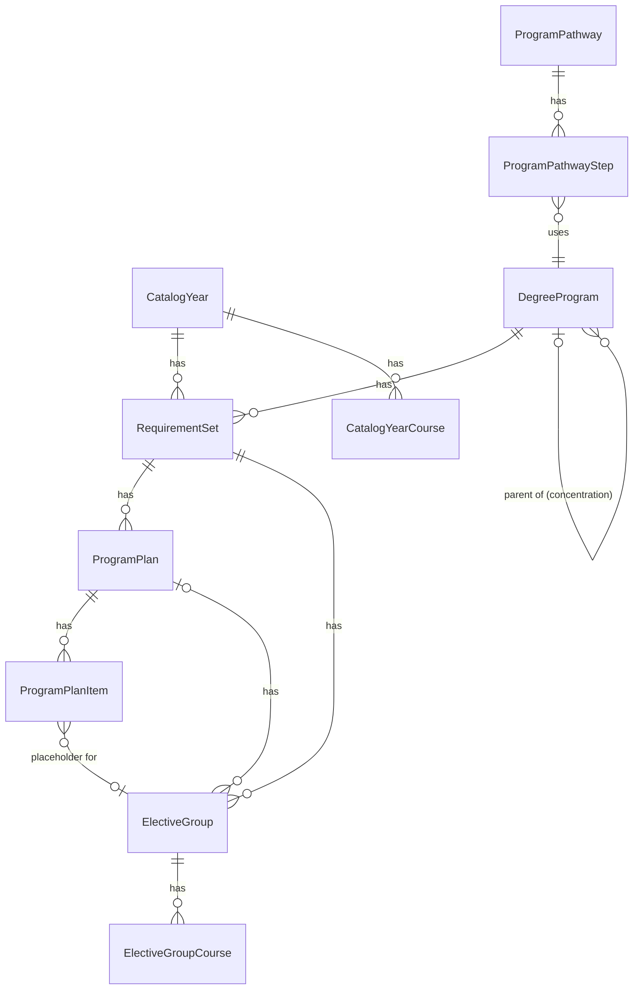
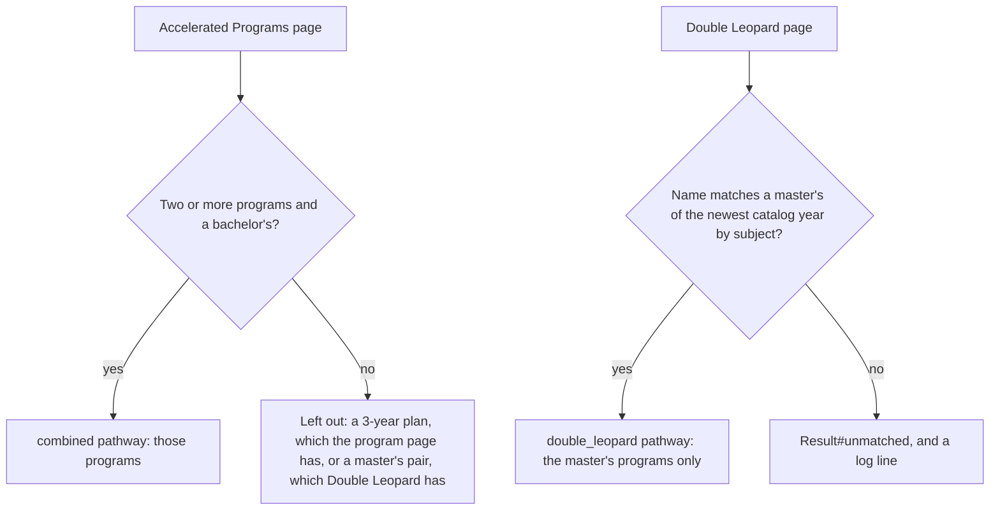
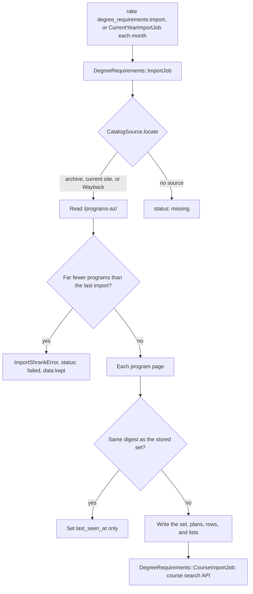
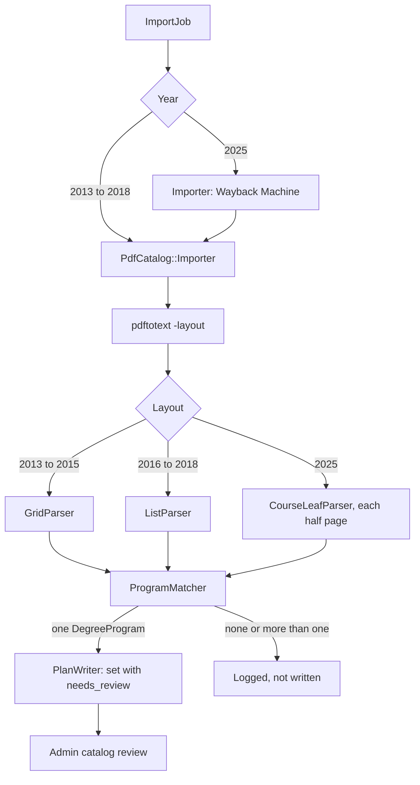
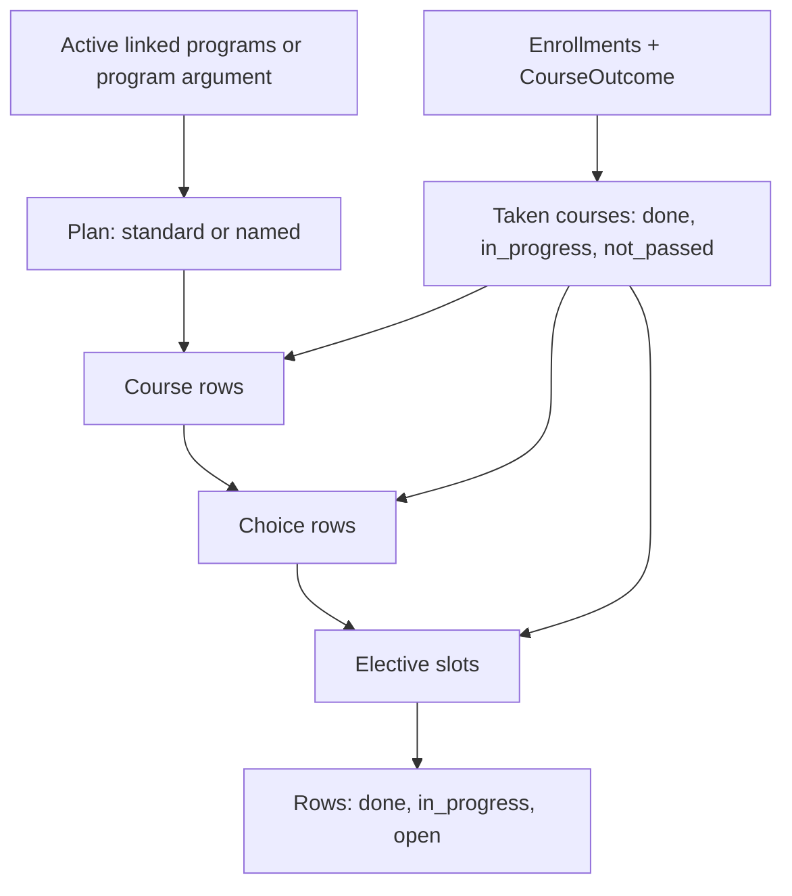

# Degree requirements

The degree requirements come from the academic catalog at <https://catalog.wit.edu>. Each catalog year has its own requirements, because a student follows the catalog of the term they started a program in. Issue #526 has the design. This page describes the tables.

## Sources

| Catalog years | Source |
|---|---|
| 2019-2020 to 2024-2025, and the current year | CourseLeaf HTML. Past years are under `/previous-catalogs/YYYY-YYYY/`. |
| 2025-2026 | No HTML archive. The Wayback Machine has most program pages, and the CourseLeaf PDF fills the gaps. |
| 2013-2014 to 2018-2019 | PDF only. The first term with Banner sections is Spring 2014. See [PDF catalogs](#pdf-catalogs). |

The course search on the catalog site has a JSON API with the courses of each year from 2019-2020 (`/course-search/api/?page=fose`). Its `srcdb` parameter is the first year of the catalog year.

## Tables



| Model | One row is |
|---|---|
| `CatalogYear` | One catalog, such as 2024-2025 (`start_year` 2024). `CatalogYear.for_term(term)` finds the catalog of a term. |
| `DegreeProgram` | One program across every year, keyed by the last part of its catalog path (`computer-science-bs`). A concentration has a `parent_program`. |
| `RequirementSet` | One program in one catalog year. The name, school, and department are as printed that year. `hss_requirement` is what the major adds to the HSS requirement. |
| `ProgramPlan` | One plan of study, such as the "Four Year Program". `years` is its length. `RequirementSet#standard_plan` is the first plan that is not accelerated. |
| `ProgramPlanItem` | One semester row of a plan: a `course`, a `placeholder` such as "Computer Science Elective", or a `choice` between courses. |
| `ElectiveGroup` | One elective list and the minimum it asks for. A shared list can be a rule: `subject_codes` (any course in these subjects) or `any_course`. |
| `ElectiveGroupCourse` | One course in an elective list. |
| `CatalogYearCourse` | One course as one catalog year printed it. |
| `CourseCodeAlias` | An old course code and the code that replaced it (COMP128 to COMP1000, 2015-2016). |
| `ProgramPathway`, `ProgramPathwayStep` | A path through more than one program: a Double Leopard master's (3+1 or 4+1), or a combined program such as the 5-year B.S. plus M.Arch. |

## Program pathways

No person keeps a list of pathways. `DegreeRequirements::PathwaySync` reads two pages (#868):

| Source | Gives | Kind |
|---|---|---|
| The Accelerated Programs page of the current catalog (`/programs-az/accelerated-programs/`) | Each option with two or more programs and a bachelor's, such as "Architecture, B.S. and Master of Architecture 5-Year". The steps are those programs. | `combined` |
| The Double Leopard page on wit.edu (`/admissions/graduate/accelerated-masters-degrees`) | Each master's program under "Double Leopard Programs", and the limit in "Take up to two courses during your senior year". | `double_leopard` |



- A Double Leopard pathway names only the master's programs. A senior in any bachelor's program can apply, so the student's own bachelor's is the first part. Its plan (3 or 4 years) makes the pathway a 3+1 or a 4+1. Planning one needs a bachelor's program (`docs/academic-profile.md`).
- A name matches by subject: "Computer Science" is "Computer Science, M.S.", and "Architecture" is "Architecture, M. Arch.". The whole name is tried first, so "Electrical and Computer Engineering" stays one program. "Architecture & Construction Management Dual Degree" splits at "&" into one pathway with two master's steps.
- `max_shared_courses` comes from the Double Leopard page. The catalog gives no limit for a combined pathway, and neither page gives a credit limit, so those stay empty.
- It runs at the end of each import of the current catalog, and `bin/rails degree_requirements:pathways` runs it now.
- A fetch error, or a page with none of the parts it reads, raises before any change, and the import reports it and goes on. The stored pathways stay.
- A combined option with a program that is not imported yet is skipped, and its stored pathway stays as it is.
- A pathway that neither page lists is set inactive, not deleted, because planned programs link to it.

## Where the requirements are on a program page

- The required courses are only in the plan of study (`table.sc_plangrid`). A plan row can be a placeholder that names an elective list.
- The elective lists are `table.sc_courselist`. The minimum ("select four") is only in the heading above the list.
- One page can have more than one plan, each with its own elective lists.

## Links to Banner courses

`ProgramPlanItem`, `ElectiveGroupCourse`, and `CatalogYearCourse` name a course by `subject_code` and `course_number`. `catalog_course_id` links the row to the `CatalogCourse` with that code (`CatalogCourseLinkable`). The link is nil when Banner does not know the code.

- A save that changes the code clears the link.
- `link_catalog_courses` on each model sets every link in bulk, and fixes a link that names another course.
- The import calls it after it writes the rows. `Catalog::CourseDetailsSync.seed` calls it when Banner lists a course for the first time.
- The import also runs `AcademicProfiles::ProgramMatcher.relink_active`, so student programs saved before the import link to their `DegreeProgram` and `CatalogYear` (`docs/academic-profile.md`).

## Import



| What | How |
|---|---|
| Import one catalog year | `bin/rails 'degree_requirements:import[2024]'` |
| Sync the program pathways from the catalog and wit.edu | `bin/rails degree_requirements:pathways` |
| Import a year whose index is much shorter than the last import | `FORCE=1 bin/rails 'degree_requirements:import[2024]'` |
| Import 2013-2014 to this year | `bin/rails degree_requirements:import_all` |
| Find course code aliases | `bin/rails degree_requirements:aliases`, after the 2014 and 2015 imports |
| Import the current year and the year before again | `DegreeRequirements::CurrentYearImportJob`, on the 2nd of each month (`config/recurring.yml`) |

- **Source of a year.** `CatalogSource.locate` tries `/previous-catalogs/YYYY-YYYY/`, then the current site, then the Wayback Machine (only for the years in `DegreeRequirements::WAYBACK_TIMESTAMPS`). Every page must end with "Boston, MA YYYY-YYYY" for the right year. A page for another year is skipped. This catches the current site moving to a new year in the summer, and an old Wayback capture.
- **Missing year.** A year with no source gets `status: missing`. The import writes nothing and does not retry.
- **Failures.** A fetch error (5xx, timeout, refused connection) stops the import and leaves the stored data as it was. The job retries it 3 times. A page that does not parse is reported to `Rails.error` and skipped. In the course import, a course whose details fail is reported and keeps the title from the list.
- **Status.** `missing` and `failed` are set only on a year with no stored data. A year with data keeps `imported` when a later import fails, because its data is still good. The executor reports the error.
- **Short index.** When the index lists less than half the programs that the last import saw, the import stops with `ImportShrankError` and writes nothing. If the catalog really lists fewer programs, import the year again with `FORCE=1`.
- **One import at a time.** All years share one lock (`ImportJob::CONCURRENCY_GROUP`), because two years write the same `DegreeProgram` rows.
- **Summer rollover.** The current year is read from the site root. When the site moves to a new year, the monthly job also imports the year before, which then reads from `/previous-catalogs/` and stores the archive paths.
- **Parser changes.** The page digest includes `ProgramPageParser::VERSION`. Raise it when a parser change should write every page again.
- **Redirects.** The client follows a redirect only over HTTPS to catalog.wit.edu or web.archive.org.
- **Speed.** Requests to the catalog site are 0.5 seconds apart, so a year takes about one minute. The Wayback Machine refuses a client that asks for more than about 15 pages a minute, so its requests are 5 seconds apart. 2025-2026 takes about 10 minutes.
- **Plan ids.** A changed page keeps the ids of its plans. Its plan rows and elective lists are written again.
- **Program names.** The newest catalog year sets the name and the parent of a `DegreeProgram`. A program that the index lists in two departments is imported once.

### How a page is read

| On the page | Becomes |
|---|---|
| `tr.plangridyear`, `tr.plangridterm` | `year_index` and `season`. "Semester One", "Two", and "Three" are fall, spring, and summer. |
| A row with one course code | A `course` row |
| "MATH1776 & MATH1777" | Two `course` rows with no credits. The credits on the page are for the pair. |
| "COMP1100 or COMP2100" | A `choice` row |
| "Select one of the following:" with indented courses under it | A `choice` row with the indented courses as its options |
| `span.comment`, such as "Computer Science Elective<sup>1</sup>" | A `placeholder` row, linked to the elective list with the same name in its plan |
| An indented note with no credits | Nothing. It explains the row above it. |
| `table.sc_courselist` and the heading above it | An `ElectiveGroup`. "select four (4) courses" gives `min_courses`. |
| An area header or a "Select ..." note inside a list | A new `ElectiveGroup`, such as "Required Courses: Select one (1) course from the following courses" |
| "The following courses require School approval" | `requires_approval` on the courses after it |

## PDF catalogs

Issue #865 added the catalog years that exist only as PDFs, and the 2025-2026 programs that the Wayback Machine does not have. `DegreeRequirements::PdfCatalog::Importer` reads the PDF under `/previous-catalogs/` with `pdftotext -layout`.



| Years | Layout | Parser |
|---|---|---|
| 2013-2014 to 2015-2016 | Word tables with a column for each semester. A cell is a code and its credits, with the title under it. A row of totals ends each year. | `GridParser` |
| 2016-2017 to 2018-2019 | A heading for each semester ("Junior Year, Fall Semester (total credits 16)") with one course a line under it. | `ListParser` |
| 2025-2026 | CourseLeaf, two columns on a page. The program name comes from the contents ("Computer Science Bachelor of Science ... 104") and the printed page number. | `CourseLeafParser` |

- **Programs.** `PdfCatalog::ProgramMatcher` compares the subject words and the kind (bachelor from a code such as BCOS, master from MSCM) with the `DegreeProgram` rows of the HTML years. A plan with no match, or with more than one, is logged and not written. The import never makes a `DegreeProgram`, so programs that closed before 2019 (the engineering technology degrees, the architecture concentrations) are left out. Add a renamed program to `ProgramMatcher::RENAMED`.
- **What is read.** Course rows, choices ("MATH181 or MATH250"), pairs, placeholders ("Humanities or Social Science Elective"), and credits. The PDFs have no lecture or lab hours in their plans, and the elective lists are prose, so a PDF set has no program elective lists. It gets only the shared lists (below). 2016-2017 and 2017-2018 print few credits: when a semester total is four credits for each course with none, each gets four.
- **Review.** Every set from a PDF has `needs_review: true`, and its `path` points to its PDF page (`#page=140`). A person checks it at `/admin/catalog_reviews` and marks it checked (`reviewed_at`, `needs_review: false`). The digest of the PDF and `PdfCatalog::Importer::VERSION` decide if a set is written again. A new PDF or a new version writes the set again and asks for a new review.
- **2025-2026.** The PDF only adds programs with no set for the year. A set from the Wayback Machine is never replaced, and the year keeps `source: wayback`. The short-index check of the Wayback import does not count the PDF sets. A failure in the PDF step is reported, and the course import still runs.
- **No match at all.** A year where no plan matches a program gets `status: failed`, because that is a parser bug, not an empty catalog.
- **Degree progress** returns `needs_review` for each program, so a client can say that a plan from a PDF is not checked yet.
- **Course titles.** For 2013-2014 to 2018-2019, the plans are the only source of course titles, so the import saves them as `CatalogYearCourse` rows. A row that exists keeps its values.

## Shared elective lists

Most elective slots name a list that is not on the program page. The catalog defines these once, for every program, on its policy pages. `DegreeRequirements::SharedElectives` links them. `PlanWriter` runs it after each HTML or PDF import, and `bin/rails degree_requirements:shared_electives` runs it on every stored set.

| Slot label | Shared list | What counts |
|---|---|---|
| "HSS Elective", "HSS 02 Elective", "Humanities or Social Science Elective" | HSS Electives | A course in a humanities or social science subject: CSAS, HIST, HSSI, HUMN, LITR, PHIL, COMM, ECON, ENVM, POLS, PSYC, SOCL ([HSS requirement](https://catalog.wit.edu/academic-policies-procedures/ug/hss-elective-requirements/)) |
| "Humanities Elective" | Humanities Electives | CSAS, HIST, HSSI, HUMN, LITR, PHIL |
| "Social Science Elective" | Social Science Electives | COMM, CSAS, ECON, ENVM, HSSI, POLS, PSYC, SOCL |
| "HSS 03 Elective (PSYC4552)" | HSS Elective (PSYC4552) | That one course |
| "English Sequence" | English Sequence | ENGL0700, ENGL0800, ENGL0900, ENGL1100, ENGL2200 ([English placement](https://catalog.wit.edu/academic-policies-procedures/ug/english-placement/)) |
| "Co-op Semester" | Co-op | COOP3500, COOP4500, or COOP5000. COOP2500 (Introduction to Cooperative Education) is a course row of its own, required before the first co-op, so it does not meet this slot. |
| "Free Elective", "General Elective" | Free Electives | Any course for degree credit (`any_course`): not a COOP course and not a course below 1000, such as ENGL0700 |

- Each list is an `ElectiveGroup` of the set with no plan, after the page's own lists. A second run reuses it.
- Only a slot with no list gets one. A slot the page linked keeps its list.
- A label that names a program list ("CONM Elective") or two areas ("Math or Science Elective") matches no rule and stays open. So does a bare "Elective", which on some pages means a program elective.

### HSS requirement of each major

The HSS subjects are the same for every major. What a major adds is on its program page, in the "ENGL/HSS Note" (often in the footnote bubble of "English Sequence") and in a directed elective note. `DegreeRequirements::HssNoteParser` reads it into `RequirementSet#hss_requirement`:

```json
{ "min_credits": 20,
  "categories": [
    { "name": "Humanities", "subject_codes": ["CSAS", "HIST", "..."], "courses": [] },
    { "name": "Social Sciences", "subject_codes": ["COMM", "ECON", "..."], "courses": [] },
    { "name": "Ethics", "subject_codes": [], "courses": ["PHIL4401", "PHIL4501", "PHIL4525", "PHIL4600"] } ] }
```

| Page text | Category |
|---|---|
| Every page (the HSS requirement page asks every bachelor for it) | Humanities, Social Sciences |
| "must include ... an Ethics elective", "must be an Ethics course" | Ethics. The courses the page lists, or `HssNoteParser::ETHICS_COURSES`. |
| "must include the following: ECON4102 ... or ECON4152" | Directed: ECON4102, with the "or" courses as choices |
| "At least one elective in Art History (HUMN4243, ...)" | Art History, with those courses |
| "At least one elective in Psychology or Sociology" | Psychology or Sociology: PSYC, SOCL |
| "At least one elective in Design History" (no courses) | Design History, with no matcher. Degree progress cannot check it. |
| "A minimum of 28 credits total, including English, ..." | `min_credits`. The page body wins. The footnote notes are copies of one template and some disagree with the page, so a footnote total counts only when every footnote gives the same one. |

A page with no HSS note (a minor, a master's) has no `hss_requirement`. A set from a PDF has none either, and degree progress gives its HSS slots the Humanities and Social Sciences categories. A change to the parser bumps `ProgramPageParser::VERSION`, so the next import writes every page again.

Degree progress: these count first: the courses in the Humanities, Social Science, and directed HSS slots, the required course rows in a category (ECON4102 in Construction Management, PHIL4525 in Applied AI), and a third English course, which the notes let count as Humanities. Then each "HSS Elective" slot takes a course for the first category that no course meets yet, and names it in `hss_category`. A slot stays open for a category that no course meets. With every category met, a slot takes any HSS course. Each program gets `hss`: the categories with their status and course, and the English and HSS credits against `min_credits`. It is nil for a program with no HSS requirement and no HSS slot. The Ethics courses for a page that lists none come from the Computer Networking page (`HssNoteParser::ETHICS_COURSES`), so an Ethics course outside that list does not count.

### Course code aliases

Wentworth gave most courses 4-digit numbers in 2015-2016 (COMP128 to COMP1000). No catalog lists the old and new numbers. `bin/rails degree_requirements:aliases` (`DegreeRequirements::AliasFinder`) finds them by matching:

| Source | Match |
|---|---|
| `title_match` | The same subject and title in the 2014-2015 catalog (3 digits) and the 2015-2016 catalog (4 digits) |
| `banner` | A Banner term with sections of both codes, with the same subject and title |

A title must name one course on each side. The finder only adds rows: a pair that is saved in either direction stays as it is. A person checks each pair on the same admin page, or removes a wrong one. A removed pair comes back only if a person runs the task again. Degree progress uses only the checked aliases, because a match can pair two courses that only share a title.

## API and MCP tools

| Reader | Endpoint or tool |
|---|---|
| Public catalog API | `GET /api/v1/catalog/programs` and `GET /api/v1/catalog/programs/:slug` (`docs/public-catalog-api.md`) |
| MCP | `list_programs` and `degree_requirements` (`docs/mcp.md`) |

Both use `Catalog::ProgramQuery` and `Catalog::ProgramSerializer`. They read only catalog years with `status: imported`. Without a catalog year, they use the newest one. Each course in a plan or a list gets its title as that catalog year printed it, or Banner's title when the year has no row.

`my_degree_progress` (`GET /api/user/degree_progress`) compares the plan of each of a student's programs with their courses (`AcademicProfiles::DegreeProgress`, see below). `my_programs` (`GET /api/user/programs`) gives a student's own programs with the slug and catalog year that `degree_requirements` takes. `update_my_planned_programs` adds a planned program (`docs/academic-profile.md`).

## Degree progress

`AcademicProfiles::DegreeProgress` is a help for planning, not a degree audit. The official audit is Stellic.

- It checks each active `StudentProgram` that links to a `DegreeProgram` in an imported catalog year, or the `program` argument. Without a linked program it answers with a message that says how to add one, and does not guess.
- With `include_planned` (`GET /api/user/degree_progress?include_planned=true`), it also checks the planned programs. Each program in the result has `status`: `active` or `planned` (null for the `program` argument). The My programs dashboard page uses this to show the courses that a planned program adds (#867).
- It uses the `plan` argument, or the plan the student picked on the My programs page (`StudentProgram#plan_name`), or the standard plan (the first plan that is not accelerated). A picked plan that a later import renamed falls back to the standard plan. A program with no plan, such as a minor, is checked list by list against `min_courses`, `min_credits`, or every course of a list with neither.
- A course with a passing `CourseOutcome` is done. A failed, withdrawn, or incomplete outcome does not count. A course with no outcome is done in a past term and in progress in the current or a future term. The result lists these assumptions.
- A course meets a requirement with the same code, or through a checked `CourseCodeAlias` in either direction.
- Each course counts once. Course rows take a course first, then choice rows, then elective slots. Among the slots, a list of courses goes first, then a subject list (HSS), then a free elective, so a broad slot does not use a course that a narrow one needs. A slot with no elective list, such as a "CONM Elective" whose page prints no list, stays open with `checkable: false`.


