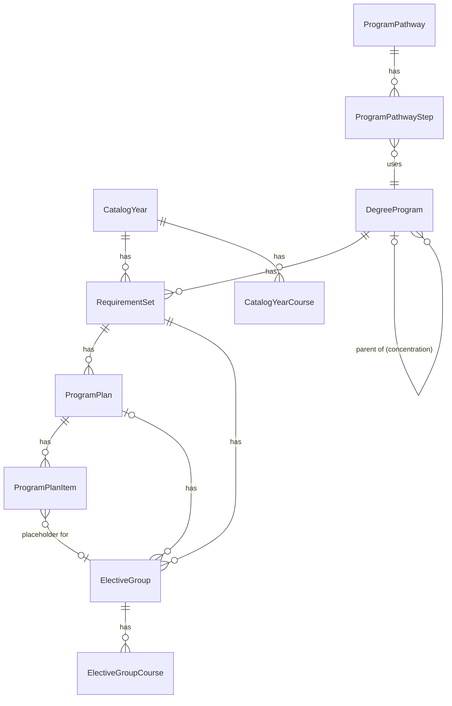

# Degree requirements

The degree requirements come from the academic catalog at <https://catalog.wit.edu>. Each catalog year has its own requirements, because a student follows the catalog of the term they started a program in. Issue #526 has the design. This page describes the tables.

## Sources

| Catalog years | Source |
|---|---|
| 2019-2020 to 2024-2025, and the current year | CourseLeaf HTML. Past years are under `/previous-catalogs/YYYY-YYYY/`. |
| 2025-2026 | No HTML archive. The Wayback Machine has most program pages, and the CourseLeaf PDF fills the gaps. |
| 2013-2014 to 2018-2019 | PDF only. The first term with Banner sections is Spring 2014. |

The course search on the catalog site has a JSON API with the courses of each year from 2019-2020 (`/course-search/api/?page=fose`). Its `srcdb` parameter is the first year of the catalog year.

## Tables

| Model | One row is |
|---|---|
| `CatalogYear` | One catalog, such as 2024-2025 (`start_year` 2024). `CatalogYear.for_term(term)` finds the catalog of a term. |
| `DegreeProgram` | One program across every year, keyed by the last part of its catalog path (`computer-science-bs`). A concentration has a `parent_program`. |
| `RequirementSet` | One program in one catalog year. The name, school, and department are as printed that year. |
| `ProgramPlan` | One plan of study, such as the "Four Year Program". `years` is its length. `RequirementSet#standard_plan` is the first plan that is not accelerated. |
| `ProgramPlanItem` | One semester row of a plan: a `course`, a `placeholder` such as "Computer Science Elective", or a `choice` between courses. |
| `ElectiveGroup` | One elective list and the minimum it asks for. |
| `ElectiveGroupCourse` | One course in an elective list. |
| `CatalogYearCourse` | One course as one catalog year printed it. |
| `CourseCodeAlias` | An old course code and the code that replaced it (COMP128 to COMP1000, 2015-2016). |
| `ProgramPathway`, `ProgramPathwayStep` | A path through more than one program: 3+1, 4+1, or the 5-year B.S. plus M.Arch. |

## Where the requirements are on a program page

- The required courses are only in the plan of study (`table.sc_plangrid`). A plan row can be a placeholder that names an elective list.
- The elective lists are `table.sc_courselist`. The minimum ("select four") is only in the heading above the list.
- One page can have more than one plan, each with its own elective lists.

## Links to Banner courses

`ProgramPlanItem`, `ElectiveGroupCourse`, and `CatalogYearCourse` name a course by `subject_code` and `course_number`. `catalog_course_id` links the row to the `CatalogCourse` with that code (`CatalogCourseLinkable`). The link is nil when Banner does not know the code.

- A save that changes the code clears the link.
- `link_catalog_courses` on each model sets every link in bulk, and fixes a link that names another course. Run it after a degree requirements import, and after the Banner course sync adds courses. The import and the sync do not call it yet (#527).
