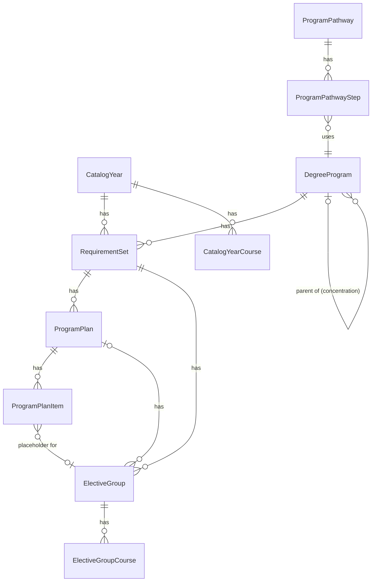
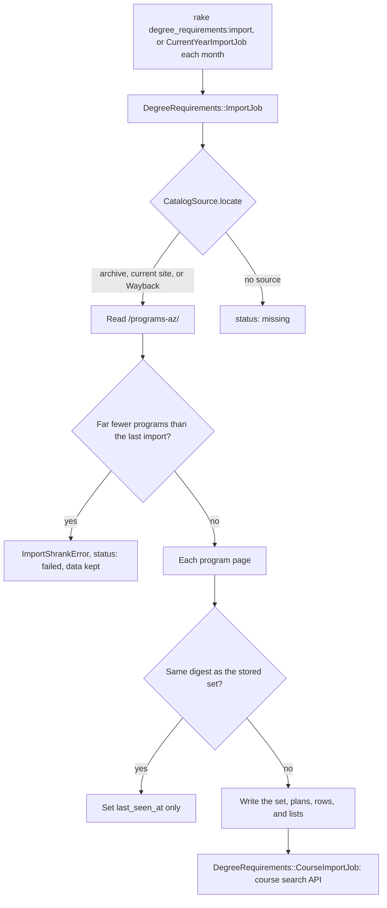
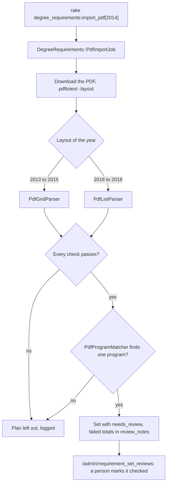
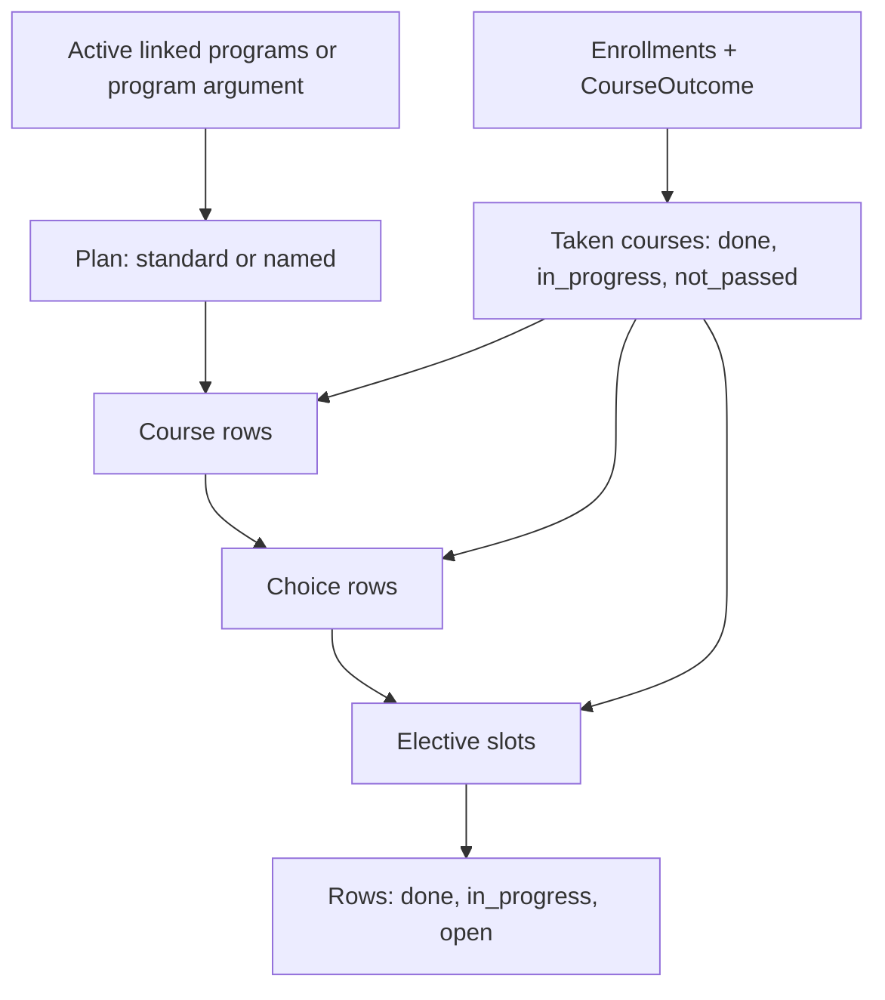

# Degree requirements

The degree requirements come from the academic catalog at <https://catalog.wit.edu>. Each catalog year has its own requirements, because a student follows the catalog of the term they started a program in. Issue #526 has the design. This page describes the tables.

## Sources

| Catalog years | Source |
|---|---|
| 2019-2020 to 2024-2025, and the current year | CourseLeaf HTML. Past years are under `/previous-catalogs/YYYY-YYYY/`. |
| 2025-2026 | No HTML archive. The Wayback Machine has most program pages, and the CourseLeaf PDF fills the gaps. |
| 2013-2014 to 2018-2019 | PDF only. The first term with Banner sections is Spring 2014. See "PDF catalogs" below. |

The course search on the catalog site has a JSON API with the courses of each year from 2019-2020 (`/course-search/api/?page=fose`). Its `srcdb` parameter is the first year of the catalog year.

## Tables

| Model | One row is |
|---|---|
| `CatalogYear` | One catalog, such as 2024-2025 (`start_year` 2024). `CatalogYear.for_term(term)` finds the catalog of a term. |
| `DegreeProgram` | One program across every year, keyed by the last part of its catalog path (`computer-science-bs`). A concentration has a `parent_program`. |
| `RequirementSet` | One program in one catalog year. The name, school, and department are as printed that year. |
| `ProgramPlan` | One plan of study, such as the "Four Year Program". `years` is its length. `RequirementSet#standard_plan` is the first plan that is not accelerated. |
| `ProgramPlanItem` | One semester row of a plan: a `course`, a `placeholder` such as "Computer Science Elective", or a `choice` between courses. |
| `ElectiveGroup` | One elective list and the minimum it asks for. |
| `ElectiveGroupCourse` | One course in an elective list. |
| `CatalogYearCourse` | One course as one catalog year printed it. |
| `CourseCodeAlias` | An old course code and the code that replaced it (COMP128 to COMP1000, 2015-2016). |
| `ProgramPathway`, `ProgramPathwayStep` | A path through more than one program: 3+1, 4+1, or the 5-year B.S. plus M.Arch. |

## Where the requirements are on a program page

- The required courses are only in the plan of study (`table.sc_plangrid`). A plan row can be a placeholder that names an elective list.
- The elective lists are `table.sc_courselist`. The minimum ("select four") is only in the heading above the list.
- One page can have more than one plan, each with its own elective lists.

## Links to Banner courses

`ProgramPlanItem`, `ElectiveGroupCourse`, and `CatalogYearCourse` name a course by `subject_code` and `course_number`. `catalog_course_id` links the row to the `CatalogCourse` with that code (`CatalogCourseLinkable`). The link is nil when Banner does not know the code.

- A save that changes the code clears the link.
- `link_catalog_courses` on each model sets every link in bulk, and fixes a link that names another course.
- The import calls it after it writes the rows. `Catalog::CourseDetailsSync.seed` calls it when Banner lists a course for the first time.
- The import also runs `AcademicProfiles::ProgramMatcher.relink_active`, so student programs saved before the import link to their `DegreeProgram` and `CatalogYear` (`docs/academic-profile.md`).

## Import

| What | How |
|---|---|
| Import one catalog year | `bin/rails 'degree_requirements:import[2024]'` |
| Import a year whose index is much shorter than the last import | `FORCE=1 bin/rails 'degree_requirements:import[2024]'` |
| Import 2019-2020 to this year | `bin/rails degree_requirements:import_all` |
| Import the current year and the year before again | `DegreeRequirements::CurrentYearImportJob`, on the 2nd of each month (`config/recurring.yml`) |

- **Source of a year.** `CatalogSource.locate` tries `/previous-catalogs/YYYY-YYYY/`, then the current site, then the Wayback Machine (only for the years in `DegreeRequirements::WAYBACK_TIMESTAMPS`). Every page must end with "Boston, MA YYYY-YYYY" for the right year. A page for another year is skipped. This catches the current site moving to a new year in the summer, and an old Wayback capture.
- **Missing year.** A year with no source gets `status: missing`. The import writes nothing and does not retry.
- **Failures.** A fetch error (5xx, timeout, refused connection) stops the import and leaves the stored data as it was. The job retries it 3 times. A page that does not parse is reported to `Rails.error` and skipped. In the course import, a course whose details fail is reported and keeps the title from the list.
- **Status.** `missing` and `failed` are set only on a year with no stored data. A year with data keeps `imported` when a later import fails, because its data is still good. The executor reports the error.
- **Short index.** When the index lists less than half the programs that the last import saw, the import stops with `ImportShrankError` and writes nothing. If the catalog really lists fewer programs, import the year again with `FORCE=1`.
- **One import at a time.** All years share one lock (`ImportJob::CONCURRENCY_GROUP`), because two years write the same `DegreeProgram` rows.
- **Summer rollover.** The current year is read from the site root. When the site moves to a new year, the monthly job also imports the year before, which then reads from `/previous-catalogs/` and stores the archive paths.
- **Parser changes.** The page digest includes `ProgramPageParser::VERSION`. Raise it when a parser change should write every page again.
- **Redirects.** The client follows a redirect only over HTTPS to catalog.wit.edu or web.archive.org.
- **Speed.** Requests to the catalog site are 0.5 seconds apart, so a year takes about one minute. The Wayback Machine refuses a client that asks for more than about 15 pages a minute, so its requests are 5 seconds apart. 2025-2026 takes about 10 minutes.
- **Plan ids.** A changed page keeps the ids of its plans. Its plan rows and elective lists are written again.
- **Program names.** The newest catalog year sets the name and the parent of a `DegreeProgram`. A program that the index lists in two departments is imported once.

### How a page is read

| On the page | Becomes |
|---|---|
| `tr.plangridyear`, `tr.plangridterm` | `year_index` and `season`. "Semester One", "Two", and "Three" are fall, spring, and summer. |
| A row with one course code | A `course` row |
| "MATH1776 & MATH1777" | Two `course` rows with no credits. The credits on the page are for the pair. |
| "COMP1100 or COMP2100" | A `choice` row |
| "Select one of the following:" with indented courses under it | A `choice` row with the indented courses as its options |
| `span.comment`, such as "Computer Science Elective1" | A `placeholder` row, linked to the elective list with the same name in its plan |
| An indented note with no credits | Nothing. It explains the row above it. |
| `table.sc_courselist` and the heading above it | An `ElectiveGroup`. "select four (4) courses" gives `min_courses`. |
| An area header or a "Select ..." note inside a list | A new `ElectiveGroup`, such as "Required Courses: Select one (1) course from the following courses" |
| "The following courses require School approval" | `requires_approval` on the courses after it |

## PDF catalogs

The catalogs from 2013-2014 to 2018-2019 are PDFs on <https://catalog.wit.edu/previous-catalogs/>. `DegreeRequirements::PdfCatalog::FILES` names the file of each year. Issue #865 added the import. The PDFs are not in the repo: the repo is public, and the specs use synthetic text in `spec/fixtures/files/degree_requirements/`.

| What | How |
|---|---|
| Import one PDF year | `bin/rails 'degree_requirements:import_pdf[2014]'` |
| Import every PDF year | `bin/rails degree_requirements:import_pdf_all` |
| Find the course code aliases | `bin/rails degree_requirements:course_code_aliases` |
| Check the sets | `/admin/requirement_set_reviews` (Catalog Review) |
| Check the aliases | `/admin/course_code_alias_reviews` (Course Code Aliases) |

### Layouts

| Years | Layout | Parser |
|---|---|---|
| 2013-2014 to 2015-2016 | A grid with a column for each semester. A row is a code and its credits, then the title on one or more lines. A line of totals ends each year, and the year label is in the left margin. | `PdfGridParser` |
| 2016-2017 to 2018-2019 | A heading for each semester, such as "Freshman Year, Fall Semester (total credits 16)", and a row on each line: "COMP1000, Computer Science I". 2018-2019 adds the credits: "Studio 01 (6 credits)". | `PdfListParser` |

The PDFs have no lecture or lab hours, so `lecture_hours` and `lab_hours` stay empty.

### Checks

A wrong plan is worse than a missing one. A parser leaves a plan out when:

- a cell does not read as a course, a choice ("MATH1750 or MATH1850"), or a placeholder ("ELECTIVE", "HSS ELECTIVE"),
- credits or text have no row above them, or rows come after the last line of totals,
- a year label does not count up from the first year,
- text cuts the rows of a semester in two, and the plan goes on after it,
- a program name, such as a concentration, sits between two semesters of a plan,
- the semesters do not start in the fall of the first year, or the plan has no program name above it.

A printed total that does not match its rows only adds a line to `review_notes`. The catalogs have such typos: the 2014-2015 Computer Science plan prints 20 credits over four 4-credit rows.

`PdfProgramMatcher` links a plan to a `DegreeProgram` from the HTML catalogs by its subject. The Banner code in the heading gives the kind: BCOS is a bachelor, MSCM a master. A concentration matches by its full name. A program that ended before 2019-2020, such as Computer Engineering Technology, has no `DegreeProgram`, so its plans are left out. A heading such as "(Two-Year)" names the plan: "Two Year Program".

### Review

- Every set from a PDF has `needs_review`. The serializer gives it to API and MCP clients.
- Marking a set as checked sets `needs_review: false` and `reviewed_at`.
- An import that finds the same plans again keeps the review. A changed plan needs a review again.
- The PDF import never writes over a set from the HTML catalog or the Wayback Machine.

### Course code aliases

No catalog lists the old and new numbers of 2015-2016, so `DegreeRequirements::CourseCodeAliasFinder` matches them:

- **Catalogs** (`title_match`): the same subject and title in the 2014-2015 and 2015-2016 PDFs, from the plans and the course tables.
- **Banner** (`banner`): the same subject and title on a 3-digit and a 4-digit code in the Banner sections.

A title gives an alias only when one old code and one new code of the subject have it. When a title has more new codes, the new codes that took the old code's place in a plan win: COMP128 became COMP1000 in Computer Science and COMP1070 in Applied Mathematics, so it gets two aliases. When the catalogs and Banner give different codes, the old code gets no alias. A stored alias is never changed. A deleted alias comes back when the task runs again and still finds it.

## API and MCP tools

| Reader | Endpoint or tool |
|---|---|
| Public catalog API | `GET /api/v1/catalog/programs` and `GET /api/v1/catalog/programs/:slug` (`docs/public-catalog-api.md`) |
| MCP | `list_programs` and `degree_requirements` (`docs/mcp.md`) |

Both use `Catalog::ProgramQuery` and `Catalog::ProgramSerializer`. They read only catalog years with `status: imported`. Without a catalog year, they use the newest one. Each course in a plan or a list gets its title as that catalog year printed it, or Banner's title when the year has no row.

`my_degree_progress` (`GET /api/user/degree_progress`) compares the plan of each of a student's programs with their courses (`AcademicProfiles::DegreeProgress`, see below). `my_programs` (`GET /api/user/programs`) gives a student's own programs with the slug and catalog year that `degree_requirements` takes. `update_my_planned_programs` adds a planned program (`docs/academic-profile.md`).

## Degree progress

`AcademicProfiles::DegreeProgress` is a help for planning, not a degree audit. The official audit is Stellic.

- It checks each active `StudentProgram` that links to a `DegreeProgram` in an imported catalog year, or the `program` argument. Without a linked program it answers with a message that says how to add one, and does not guess.
- It uses the standard plan (the first plan that is not accelerated), or the `plan` argument. A program with no plan, such as a minor, is checked list by list against `min_courses`, `min_credits`, or every course of a list with neither.
- A course with a passing `CourseOutcome` is done. A failed, withdrawn, or incomplete outcome does not count. A course with no outcome is done in a past term and in progress in the current or a future term. The result lists these assumptions.
- A course meets a requirement with the same code, or through a `CourseCodeAlias` in either direction.
- Each course counts once. Course rows take a course first, then choice rows, then elective slots. A slot with no elective list, such as a free elective, stays open with `checkable: false`.

