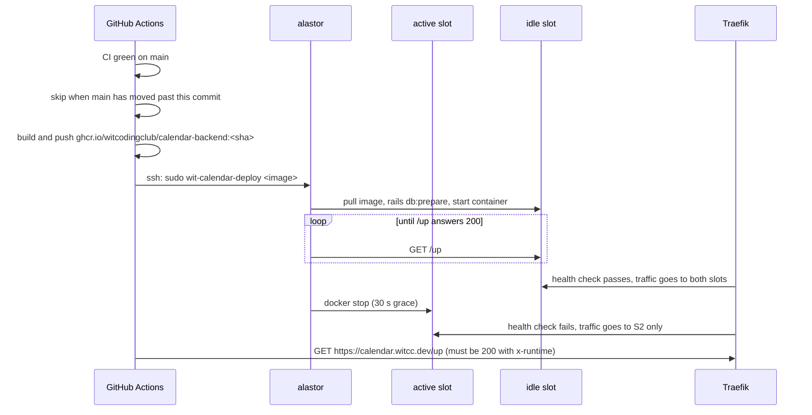

# Deploy

Production is one host, alastor. The infra repo (`modules/wit-calendar`) defines the host. This repo only builds the image and starts the swap.

## Flow

## Version in the image

The image has no git binary. The workflow passes `GIT_SHA=<sha>` as a build arg, and the final stage writes it to `/rails/REVISION`. `VersionService` reads that file for `current_sha` and `current_version`. The `ARG` sits late in the final stage, so the new SHA changes only the `REVISION` layer there.

The image has no release tag. Releases and tags (`v6.x`) live in the `WITCodingClub/calendar` repo, not in this repo. This repo has only the old `v1.0.x` tags. So `update_available?` stays false in production, and the admin footer shows the short SHA.

## Rules that follow from this

- Two app versions run at the same time for a few seconds. A migration runs while the old code still serves, so it must be safe next to the old code. strong_migrations enforces this (see `CLAUDE.md`).
- A failed migration or a container that never answers `/up` fails the deploy. The old slot keeps serving. Fix the problem and merge again.
- Deploys run one at a time. When several PRs merge in a row, the runs for the older commits skip themselves, and the run for the newest commit deploys everything. If the newest commit's CI is red, nothing deploys until a green commit lands.
- A manual run (`gh workflow run Deploy`) deploys the current `main` and never skips.
- Two Solid Queue workers run during the swap. Solid Queue locks jobs and recurring tasks in the database, so no job runs twice.

## Threads and connection pools

Each slot runs Puma, and the Solid Queue plugin forks the supervisor, a dispatcher, a scheduler and a worker from it (`SOLID_QUEUE_IN_PUMA`).

| Env var | Default | Sets |
| --- | --- | --- |
| `RAILS_MAX_THREADS` | 3 | Puma threads (`config/puma.rb`) |
| `JOB_THREADS` | 3 | Solid Queue worker threads (`config/queue.yml`) |
| `JOB_CONCURRENCY` | 1 | Solid Queue worker processes |

`config/database.yml` reads the first two and gives every database a pool of `RAILS_MAX_THREADS + JOB_THREADS + 2` (8 by default). The queue pool needs the worker threads + 2 for the poller and the heartbeat. `spec/config/queue_spec.rb` checks both rules. A pool opens a connection only when a thread needs one.

Postgres allows 100 connections. With the defaults, one slot uses about 25 at most: Puma uses one for each thread on each database, the worker uses its threads + 2 on the queue database, and the dispatcher, scheduler and supervisor use the queue database only. Two slots run during a swap, so that is about 50, plus Blazer. Before you raise a thread count, do this sum again.

The worker takes `high`, then `default`, then `low`, and polls each second when the queues are empty. Code that queues a sync for many users calls `CourseCalendars::SyncJob.perform_bulk_later`. It puts the sync on `default` at priority 10, so mail and the other `default` jobs go first. It does not use `low`: Solid Queue takes the per-user lock at enqueue, so a sync that the person starts waits behind their bulk sync.

A new queue name, also one from a gem, must go in `config/queue.yml`, or no worker runs its jobs. `spec/config/queue_spec.rb` checks every job class and every recurring task.

## Checks after a deploy

- `gh run list --workflow Deploy --limit 3`
- On alastor: `systemctl status 'wit-calendar-web@*'` shows which slot is active.
- On alastor: `sudo docker ps --format '{{.Names}} {{.Image}}'` shows the running image.
