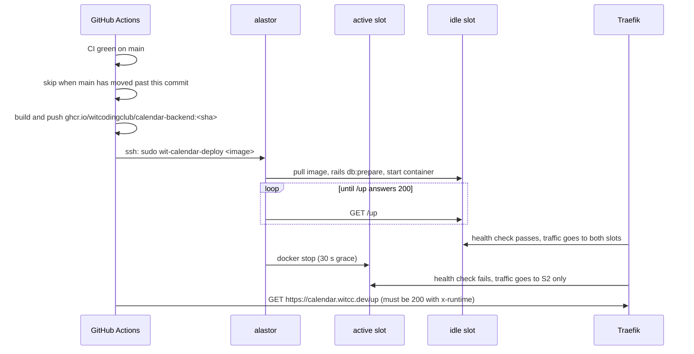

# Deploy

Production is one host, alastor. The infra repo (`modules/wit-calendar`) defines the host. This repo only builds the image and starts the swap.

## Flow

## Rules that follow from this

- Two app versions run at the same time for a few seconds. A migration runs while the old code still serves, so it must be safe next to the old code. strong_migrations enforces this (see `CLAUDE.md`).
- A failed migration or a container that never answers `/up` fails the deploy. The old slot keeps serving. Fix the problem and merge again.
- Deploys run one at a time. When several PRs merge in a row, the runs for the older commits skip themselves, and the run for the newest commit deploys everything. If the newest commit's CI is red, nothing deploys until a green commit lands.
- A manual run (`gh workflow run Deploy`) deploys the current `main` and never skips.
- Two Solid Queue workers run during the swap. Solid Queue locks jobs and recurring tasks in the database, so no job runs twice.

## Checks after a deploy

- `gh run list --workflow Deploy --limit 3`
- On alastor: `systemctl status 'wit-calendar-web@*'` shows which slot is active.
- On alastor: `sudo docker ps --format '{{.Names}} {{.Image}}'` shows the running image.
