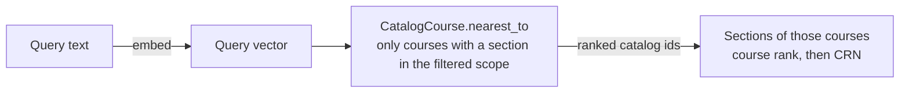

# Embeddings

The catalog stores a vector for each course, instructor and review. The
vectors let a person search by meaning instead of by exact words, and let the
API answer "what is like this one?".

## How it works

1. A model includes `Embeddable` and defines `embedding_text`, the sentence
   that stands for the record.
2. `Embeddings::BackfillJob` finds the rows whose text has no vector, or whose
   text changed since the vector was made, and hands them to
   `Embeddings::GenerateJob` in batches of 100.
3. `Embeddings::GenerateJob` calls `Embeddings::Generator`, which sends the batch to
   OpenAI and returns one vector per text.
4. The vector and the SHA256 of the text go into the `embedding` and
   `embedding_digest` columns with `update_columns`. An embedding is derived
   data, so the write must not touch `updated_at` and must not mark a
   student's calendar for sync.

The backfill runs every night at 4:45am, after the catalog sync. Text that did
not change never reaches the API, so a second run costs one table scan.

| Model           | What the vector stands for                                                     |
| --------------- | ------------------------------------------------------------------------------ |
| `CatalogCourse` | Code, title, description, the first 1,000 characters of the learning objectives, department, college |
| `Faculty`       | Name, title, department, school                                                |
| `RmpRating`     | The review comment, with the course it is about                                |

### Sections use the vector of their course

Every section of a course teaches the same thing, so the vector belongs to the
`CatalogCourse`, not to each `Course` row. `Catalog::CourseDetailsSync.seed`
makes a `CatalogCourse` for every course that has a section.
`Course::CATALOG_COURSE_JOIN` joins a section to its course by the code in the
subject ("Computer Science (COMP)" to `COMP`) and the course number.

The description comes from Banner. A course that Banner has not described
takes the description from its newest catalog year (`CatalogYearCourse`).



A semantic section search ranks the courses that have a section in the
filtered scope, then lists their sections: nearest course first, and by CRN
within a course. `Course#similar_sections` works the same way, and leaves out
the sections of the course itself.

`courses` has no vector columns. They were never filled, and
`20261106130000_remove_embedding_from_courses` dropped them.

Where the vectors are read:

- `/api/v1/catalog/sections` and `/api/v1/catalog/instructors` with
  `semantic=true`, and the same switch on the GraphQL `sections` and
  `instructors` queries.
- `/api/v1/catalog/sections/:crn/similar` and
  `/api/v1/catalog/instructors/:pub_id/similar`.
- `/api/v1/catalog/reviews` with `semantic=true`, and the GraphQL `reviews`
  query.
- The admin review list, which has a "By meaning" box next to its search.

## Model

`text-embedding-3-small`, 1536 dimensions, cosine distance. The whole catalog
costs a few cents to embed. `Embeddings::Generator::MODEL` and `DIMENSIONS` are the
one place both the stored vectors and the query vectors read, so they cannot
drift apart.

Changing the model or the dimension count means a new migration for the column
width and a full re-embed. Old vectors are not comparable to new ones.

## Configuration

`OPENAI_API_KEY` turns the feature on. Without it `Embeddings::Generator.configured?`
is false, the jobs log and return, and search falls back to keyword matching.
The key lives in the `wit-calendar-env` agenix secret on alastor.

Search by meaning needs the key **and** the `semantic_search` Flipper flag. The
flag is global: turn it on for everybody, not per actor. Turn it off to stop
every query embedding at once, for example if the API bill surprises you. The
catalog then answers with keyword results, and no request fails.

## Postgres

The `vector` extension must be installed on the server.

- **Production**: `ghcr.io/witcodingclub/calendar-postgres:17-alpine`, built by
  `.github/workflows/postgres-image.yml` from `docker/postgres/Dockerfile`. It
  is the same `postgres:17-alpine` the server already ran, with pgvector added.
  A Debian image such as `pgvector/pgvector:pg17` would swap musl for glibc,
  which changes text collation and needs a `REINDEX` of every text index.
- **CI**: `pgvector/pgvector:pg17`. The test database is thrown away every run,
  so collation does not matter there.
- **Local**: `brew install pgvector` next to `postgresql@17`.

Each table has an HNSW index with `vector_cosine_ops`. HNSW answers approximate
nearest-neighbour queries; at catalog size the approximation is exact in
practice.

### Filters and the iterative scan

An HNSW index scan reads `hnsw.ef_search` rows (40 by default), and the
filters run after it. A filter that drops most rows, such as "has a section
this term", can leave fewer rows than the limit, or none. Every filtered
vector query goes through `Embeddable.nearest_ids`, which runs it in a
transaction with `SET LOCAL hnsw.iterative_scan = strict_order`. The scan then
keeps reading the index until the limit is full, in exact distance order.

This needs pgvector 0.8 or later. The production image builds v0.8.6
(`docker/postgres/Dockerfile`).

The spec checks that the setting is on, not the result. With sequential scans
and sorts off, a filtered query returned nothing without the setting and
filled the limit with it. That check depends on the HNSW graph, and dead index
entries from rolled-back examples change the graph, so it is not a spec.

## Commands

```bash
# Queue everything that needs a vector
bin/rails embeddings:backfill

# One model, still through the queue
bin/rails 'embeddings:backfill[CatalogCourse]'

# One model, right now, without the queue
bin/rails 'embeddings:run[CatalogCourse]'

# How much is embedded
bin/rails embeddings:status
```

## Specs

WebMock blocks the OpenAI host, so specs stub the request:

```ruby
stub_request(:post, Embeddings::Generator::API_URL)
  .to_return(status: 200, body: file_fixture("openai/embeddings.json").read)
```

`spec/support/embeddings.rb` has helpers that build a fake response of the
right shape and that write vectors onto records without an HTTP call.
