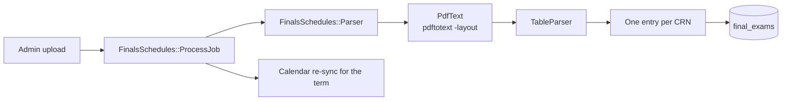

# Finals schedules

An admin uploads the registrar's finals PDF on the admin finals page. `FinalsSchedules::ProcessJob` parses it and saves one `FinalExam` for each CRN in the term.



## The parser

The registrar changes the columns, the headers, and the page breaks of the PDF each term. `FinalsSchedules::TableParser` does not use column positions or headers. It reads `pdftotext -layout` text, where each exam is one line, and finds a row by its content:

- A row has a weekday date and a time range on one line.
- The row's CRNs are the five-digit numbers before the date. A chain such as `10001-10002` is the group of CRNs that take one exam together.
- When the date line has no CRN, the row is tall and its cells wrap (Fall 2025). The CRNs then come from the lines next to it, up to the previous and the next date line. A chain that ends in `-` continues on the next line.
- The room is the first cell after the time. A room that wraps to the lines above and below its row is joined.
- `WENTW212` becomes `WENTW 212`, and `CEIS 414A/B` becomes `CEIS 414A / CEIS 414B`, so `FinalExam::ROOM_PATTERN` finds each room. `SEE FACULTY` (also `SEE FACULTY FOR DETAILS`), `ONLINE`, `VIRTUAL`, and `TBA` become `See Faculty`, `Online`, `Virtual`, and `TBA`. `#N/A` is a spreadsheet error, so it gives no location.
- When a few rows have a year that does not match their weekday (Fall 2026 has a fill-down error), the parser uses the year that most rows use and warns.

A row with no date gets no exam, even when another CRN of its group has a date. The old `SpringFallParser` copied the date of that CRN. No PDF from 2022 to 2026 has such a row in its `-layout` text.

The parser warns about a line with a CRN but no date and time, unless the line says `ONLINE`, `TBA`, `VIRTUAL`, or `SEE FACULTY`. The admin sees the warnings on the upload page.

The fixtures in `spec/fixtures/files/finals_schedules/` copy the layout of each PDF from Fall 2022 to Fall 2026, with made-up data.

## A new PDF format

Do not commit a real PDF: the repo is public. Put the PDFs in a local folder and run:

```sh
bin/rails finals:check_corpus DIR=~/Desktop/WIT/Finals\ Schedules
```

It prints the count of CRNs and the warnings for each PDF. When a PDF gives warnings or a low count, add a fixture with made-up data in the same layout and change `TableParser`.

## Fix stored finals: `finals:reparse`

Until October 2026, four format parsers read the PDFs. Some saved wrong dates, times, or rooms, and some missed CRNs. `finals:reparse` parses the latest completed upload of each term again:

```sh
bin/rails finals:reparse                  # dry run: prints each change
bin/rails finals:reparse TERM_UID=202520  # one term
bin/rails finals:reparse APPLY=1          # save
```

- `+ 10001` is a new exam. `~ 10001: start_time 800 -> 1015` is a change.
- The task keeps a stored exam that the PDF does not have, and lists it under "Not in the PDF (kept)".
- With `APPLY=1`, it starts a calendar re-sync only for the current term and later terms that changed.

Remove the task when it has run on production.
