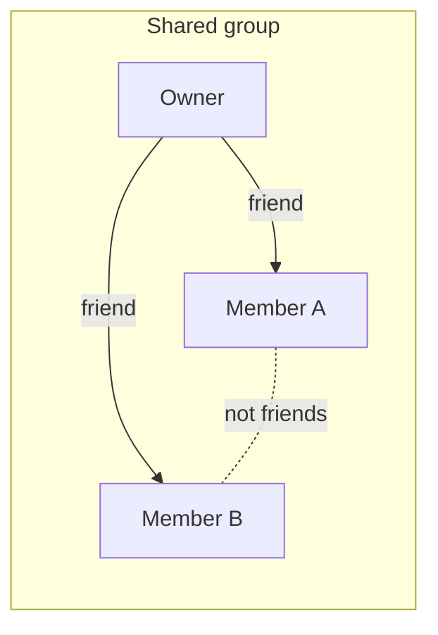

# Friend groups

A person can put friends into named groups, for example "Study group" or "Suitemates". A group can have a color and an end date.

A group is private to its owner. The owner can share a group (extension#213). Then each member sees the group too, read only: the owner, the other members, and the busy times of each person. A member does not need to make the same group again.

Each member chooses how a shared group treats them. See [Member status](#member-status).

## The flag

The Flipper flag `friend_groups` is off by default. Friends v6 waits on a privacy policy update, so do not turn on the flag for real users until that update is live. While the flag is off for a person, every route below answers 404 for that person. The extension reads the flag as `friendGroups` from `GET /api/user/feature_flags`.

## Who sees what



- The owner sees and changes the group at `/api/friends/groups`.
- A member of a shared group sees it at `/api/friends/shared_groups`. A member sees every person in the group who did not opt out, also a person who is not their friend.
- A member is a friend of the owner. When that friendship ends, the person leaves the group.
- A member can hide the group or opt out of it. The friendship with the owner stays.
- When the end date passes, the group goes for everyone. The friendships stay.

## Routes

All routes use the extension's bearer token. Groups use `fgr_` ids. People use `usr_` ids, the same ids that `GET /api/friends` returns.

| Route | Who | What |
| --- | --- | --- |
| `GET /api/friends/groups` | owner | The groups the person owns. |
| `POST /api/friends/groups` | anyone | Make a group. |
| `GET /api/friends/groups/:group_id` | owner | One group. |
| `PATCH /api/friends/groups/:group_id` | owner | Change the name, members, end date, color, or shared flag. |
| `DELETE /api/friends/groups/:group_id` | owner | Delete the group. |
| `POST /api/friends/groups/:group_id/members` | owner | Add one friend: `{ "friend_id": "usr_..." }`. |
| `DELETE /api/friends/groups/:group_id/members/:friend_id` | owner | Remove one friend. |
| `GET /api/friends/groups/:group_id/busy_blocks` | owner, member of a shared group who did not opt out | The busy times of each person in the group. |
| `GET /api/friends/shared_groups` | member | The active groups that other people shared with the person. Add `?include_hidden=true` for all of them. |
| `GET /api/friends/shared_groups/:group_id` | member | One shared group, with any status. |
| `PATCH /api/friends/shared_groups/:group_id` | member | Set the member's own status: `{ "status": "hidden" }`. |

Any group that the person cannot see answers 404 with `"error": "Group not found"`.

## Make or change a group

`POST /api/friends/groups` and `PATCH /api/friends/groups/:group_id` take these keys. A POST needs `name`. A PATCH needs at least one key.

| Key | Value |
| --- | --- |
| `name` | 1 to 50 characters. Unique for the owner, case does not matter. |
| `member_ids` | A list of `usr_` ids. It replaces the members. An id that is not an accepted friend answers 422 with `invalid_member_ids`. |
| `expires_at` | A date (`2026-12-01`, the end of that day in America/New_York), an ISO 8601 time with an offset, or `null` for no end. |
| `shared` | `true` or `false`. Any other value answers 400. |
| `color` | Any `"#rrggbb"` hex color, or `null` for no color. The app stores it in lowercase. Any other value answers 422. |

```json
{ "name": "WITCL", "member_ids": ["usr_..."], "shared": true, "color": "#33b679" }
```

## Owned group

`GET /api/friends/groups` answers `{ "groups": [ ... ] }`. Each group:

```json
{
  "id": "fgr_...",
  "name": "WITCL",
  "color": "#33b679",
  "shared": true,
  "members": [ { "id": "usr_...", "name": "Ada Lovelace" } ],
  "opted_out_member_ids": [],
  "expires_at": null,
  "created_at": "2026-10-22T16:30:00-04:00",
  "updated_at": "2026-10-22T16:30:00-04:00"
}
```

`members` lists every member, also the members who opted out. `opted_out_member_ids` names the members who opted out. The other members do not see them.

`GET /api/friends` gives each friend a `groups` list with `{ "id", "name", "color" }`. It lists only the groups that the person owns.

## Shared group

`GET /api/friends/shared_groups` answers `{ "groups": [ ... ] }`. Each group has no `shared` key, because every group here is shared. It has an `owner`. `members` leaves out the members who opted out. `status` is the status of the person who asks.

```json
{
  "id": "fgr_...",
  "name": "WITCL",
  "color": "#33b679",
  "status": "active",
  "owner": { "id": "usr_...", "name": "Grace Hopper" },
  "members": [
    { "id": "usr_...", "name": "Ada Lovelace" },
    { "id": "usr_...", "name": "Alan Turing" }
  ],
  "expires_at": null,
  "created_at": "2026-10-22T16:30:00-04:00",
  "updated_at": "2026-10-22T16:30:00-04:00"
}
```

## Member status

Each member of a shared group has a status. Only the member can change it. The owner cannot.

| Status | The member sees the group | The other members see the member |
| --- | --- | --- |
| `active` (default) | yes | yes |
| `hidden` | only with `?include_hidden=true` | yes |
| `opted_out` | only with `?include_hidden=true` | no, and no busy times |

`PATCH /api/friends/shared_groups/:group_id` with `{ "status": "opted_out" }` answers `{ "group": { ... } }` with the new `status`. An unknown status answers 422. Send `"active"` to undo a hide or an opt-out. A member who opted out cannot read the busy times of the group (403).

The owner still sees a member who opted out. When the owner edits the group, a member who stays in it keeps their status. When the owner removes a member and adds them again, the status starts at `active`.

## Busy times

`GET /api/friends/groups/:group_id/busy_blocks?start_date=2026-10-26&end_date=2026-10-30`

The dates are optional. `start_date` is today by default, and `end_date` is six days after `start_date`. The range can be 120 days or fewer. A bad date or range answers 400.

The owner comes first, then the members by name. Members who opted out are left out, except for the owner. Each person has the same `busy` list that `GET /api/friends/:friend_id/busy_blocks` gives: class times, final exams, and friend meetings, with no course data.

```json
{
  "group_id": "fgr_...",
  "time_zone": "America/New_York",
  "start_date": "2026-10-26",
  "end_date": "2026-10-30",
  "people": [
    {
      "id": "usr_...",
      "name": "Grace Hopper",
      "role": "owner",
      "busy": [ { "date": "2026-10-26", "weekday": "monday", "start": "09:00", "end": "10:15" } ]
    },
    { "id": "usr_...", "name": "Ada Lovelace", "role": "member", "busy": [] }
  ]
}
```

The route works for the owner of any group. It works for a member only while the group is shared and the member did not opt out.

## Dashboard

The friends page (`/dashboard/friends`) shows the same data. The group form has a color picker, a "No color" box, and a "Share with the friends in this group" box. The "Shared with you" section lists the groups that friends shared, with "Hide" and "Opt out" buttons. Hidden groups and opted-out groups go into a "Hidden and opted out" list, with a button to undo.
