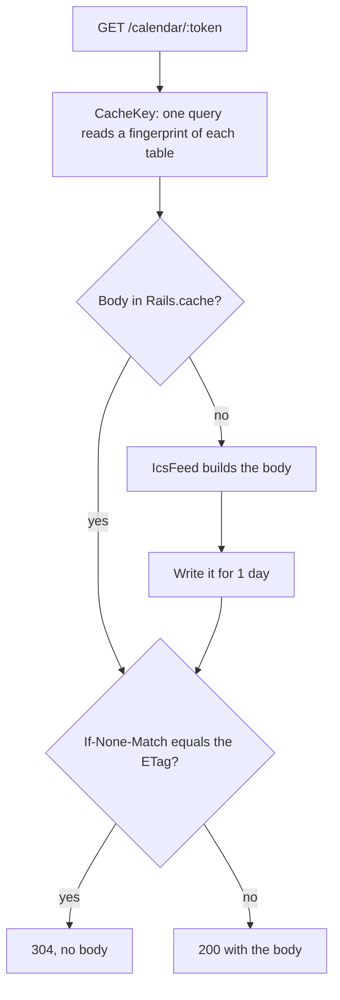

# ICS feed

Calendar apps subscribe to `/calendar/:token` and poll it. Apple Calendar and Outlook read `REFRESH-INTERVAL` (one hour). Google Calendar uses its own schedule. `Feeds::CalendarsController` serves the feed, and `CourseCalendars::IcsFeed` builds it.

## Caching

The feed has two caches.

1. **HTTP:** the ETag is a hash of the body. A client that sends `If-None-Match` with the current ETag gets a `304` with no body (#673).
2. **Server:** `Rails.cache` keeps the rendered body (#680). A request that finds it does not build the feed again.

`CourseCalendars::IcsFeed::CacheKey` makes the key from:

- The user row, the date, and the deploy revision.
- The id and `updated_at` of each row of the user's own data: enrollments, courses, terms, meeting times, faculty, preferences, the extension config, and friend meetings with their publications and attendees. An insert, an update, or a delete changes the key.
- The count and latest `updated_at` of the finals in the user's terms, of all university events, and of all rooms and buildings. A final's location names any room that its text matches.
- The cached no-class days (`UniversityCalendarEvent.no_class_spans_between`), so a feed built from an old copy of them is not kept after that copy is refreshed.
- The friend meetings that have not ended, because a meeting leaves the feed when it ends.

A write that skips `updated_at` (`update_all`, `update_columns`) does not change the key. The cache entry expires after one day, so such a feed stays at most one day. The same write also leaves `LAST-MODIFIED` as it was, so calendar apps keep their old copy too.

When the feed starts to read a new table or column, add it to `CacheKey`. To drop every cached feed, increase `CacheKey::VERSION`.
