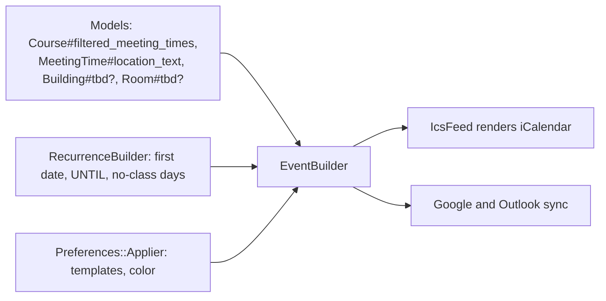
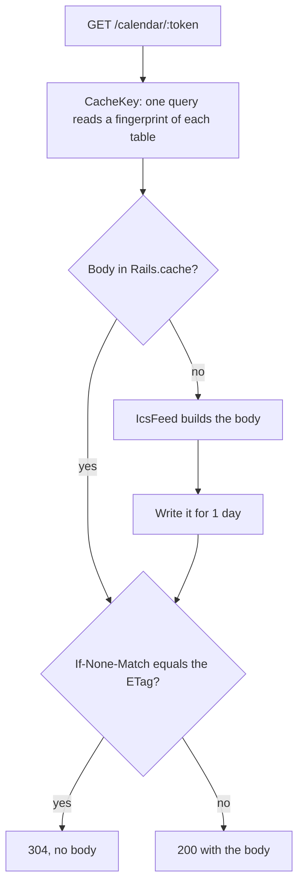

# ICS feed

Calendar apps subscribe to `/calendar/:token` and poll it. Apple Calendar and Outlook read `REFRESH-INTERVAL` (one hour). Google Calendar uses its own schedule. `Feeds::CalendarsController` serves the feed, and `CourseCalendars::IcsFeed` builds it.

## Events

`CourseCalendars::EventBuilder` builds the class, final exam, and university events for the Google and Outlook sync and for the feed. The feed gives it a `Preferences::Applier`, the same object the sync uses, so each event has the person's templates and color, as in the sync. The feed only renders the events as iCalendar.

The feed differs from the sync in three places:

- A class shows `MeetingTime#location_text` (for example `Wentworth Hall - 212`). The feed does not apply the location template to classes.
- An all-day class has a `DATE` in its `UNTIL`, as RFC 5545 needs for a `DATE` start.
- A class with no color preference gets the color of its schedule type (`MeetingTime#event_color`).

`LAST-MODIFIED` and `SEQUENCE` are the latest change to any row that the event shows, including its preferences and its term. A calendar app keeps its copy until they go up. A code change that alters an event body changes no row, so the event also takes `IcsFeed::EVENT_LOGIC_CHANGED_AT`. Move that time forward when you change how the feed builds an event.

## Caching

The feed has two caches.

1. **HTTP:** the ETag is a hash of the body. A client that sends `If-None-Match` with the current ETag gets a `304` with no body (#673).
2. **Server:** `Rails.cache` keeps the rendered body (#680). A request that finds it does not build the feed again.

`CourseCalendars::IcsFeed::CacheKey` makes the key from:

- The user row, the date, and the deploy revision.
- The id and `updated_at` of each row of the user's own data: enrollments, courses, terms, meeting times, faculty, preferences, the extension config, and friend meetings with their publications and attendees. An insert, an update, or a delete changes the key.
- The count and latest `updated_at` of the finals in the user's terms, of all university events and their terms, and of all rooms and buildings. A final's location names any room that its text matches, and a university event's template can show its term.
- The cached no-class days (`UniversityCalendarEvent.no_class_spans_between`), so a feed built from an old copy of them is not kept after that copy is refreshed.
- The friend meetings that have not ended, because a meeting leaves the feed when it ends.

A write that skips `updated_at` (`update_all`, `update_columns`) does not change the key. The cache entry expires after one day, so such a feed stays at most one day. The same write also leaves `LAST-MODIFIED` as it was, so calendar apps keep their old copy too.

When the feed starts to read a new table or column, add it to `CacheKey`. The key holds the deploy revision, so a deploy drops every cached feed. Increase `CacheKey::VERSION` only to drop them without a code change to the feed, for example when the key format changes.
