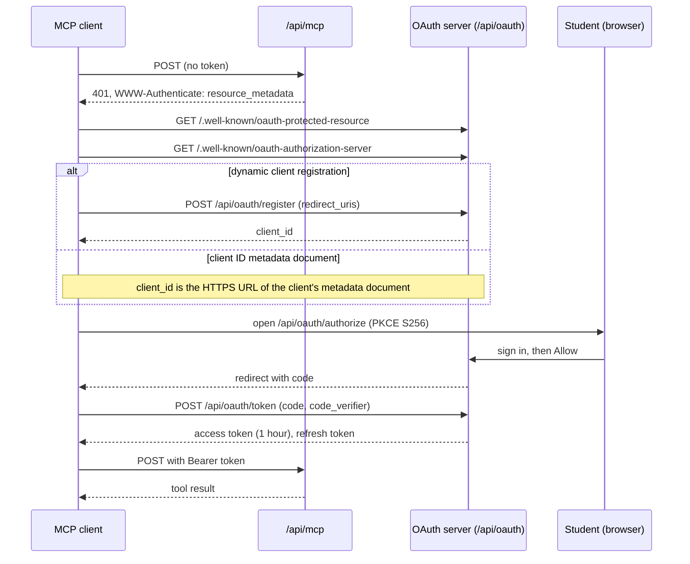

# MCP server

WIT Calendar has a [Model Context Protocol](https://modelcontextprotocol.io) (MCP) server. A student connects an AI client, such as Claude or ChatGPT. The client can then read the course catalog and the student's schedule, and, when the student allows it, change the student's calendar settings.

- **Endpoint:** `https://calendar.witcc.dev/api/mcp`
- **Transport:** Streamable HTTP, stateless. Send each request as a `POST`.
- **Sign-in:** OAuth 2.1 with PKCE. The student signs in with their WIT account and approves the app on a consent page.
- **Access:** by permission. The consent page has one checkbox for each permission. The permissions that change data start unchecked. See [Permissions](#permissions).

## Connect a client

### Claude

1. Open **Settings**, then **Connectors**.
2. Select **Add custom connector**.
3. Enter `https://calendar.witcc.dev/api/mcp` as the URL.
4. Sign in with your WIT account, then select **Allow**.

### Claude Code

```sh
claude mcp add --transport http wit-calendar https://calendar.witcc.dev/api/mcp
```

Then run `/mcp` in Claude Code and complete the sign-in in the browser.

### Other clients

Any MCP client that supports OAuth with dynamic client registration or client ID metadata documents can connect. Give it the endpoint URL. The client finds the rest from the `401` response.

## Tools

Each catalog tool matches a public catalog endpoint, so the MCP server, the REST API, and GraphQL give the same answers. The catalog tools share the query objects of those endpoints (`Catalog::SectionQuery`, `Catalog::InstructorQuery`, `Catalog::ReviewQuery`, `Catalog::SubjectQuery`).

| Tool | What it reads | REST endpoint | GraphQL field |
| --- | --- | --- | --- |
| `list_terms` | The terms, the current term, and the next term. Call it first. | `GET /api/v1/catalog/terms` | `terms` |
| `list_subjects` | Subjects with their codes and section counts. | `GET /api/v1/catalog/subjects` | `subjects` |
| `search_sections` | Sections, with every catalog filter and paging. | `GET /api/v1/catalog/sections` | `sections` |
| `get_section` | One section by CRN, cancelled or not. | `GET /api/v1/catalog/sections/:crn` | `section` |
| `search_courses` | Courses (not sections) by code or title words. | `GET /api/v1/catalog/courses` | `courses` |
| `get_course` | One course: description, prerequisites, corequisites, restrictions, terms usually offered, what it unlocks. | `GET /api/v1/catalog/courses/:code` | `course` |
| `similar_sections` | Sections that teach something close to one section. | `GET /api/v1/catalog/sections/:crn/similar` | |
| `check_schedule` | Time conflicts, lecture and lab pairs, duplicates, and totals for a set of CRNs. | `GET /api/v1/catalog/schedule_check` | `scheduleCheck` |
| `search_instructors` | Instructors who teach, by name or by meaning. | `GET /api/v1/catalog/instructors` | `instructors` |
| `get_instructor` | One instructor, with RateMyProfessor ratings, distribution, tags, recent reviews, and the sections in a term. | `GET /api/v1/catalog/instructors/:pub_id` | |
| `similar_instructors` | Instructors who teach something close to one instructor. | `GET /api/v1/catalog/instructors/:pub_id/similar` | |
| `search_reviews` | RateMyProfessor reviews, by instructor, words, meaning, or sentiment. | `GET /api/v1/catalog/reviews` | `reviews` |
| `catalog_graphql` | Any read-only query on the catalog schema. | `POST /api/v1/graphql` | all |
| `my_courses` | Your courses in one term, with weekly meeting times and rooms. | `GET /api/user/processed_events` | |
| `my_course_history` | Every term you processed, newest first, with your courses in each term. | `GET /api/user/course_history` | |
| `my_busy_times` | The times you are busy between two dates: classes, finals, and friend meetings. | `GET /api/user/busy_blocks` | |
| `my_finals` | Your final exams in one term. | `GET /api/user/finals` | |
| `list_friends` | Your friends and their ids. | `GET /api/friends` | |
| `friend_busy_times` | When a friend is busy between two dates, with no course details. | `GET /api/friends/:friend_id/busy_blocks` | |
| `university_events` | The academic calendar: holidays, deadlines, finals week. | `GET /api/university_calendar_events` | |
| `my_calendar_settings` | Your calendar event settings at each level, the classes with their own settings, and the color names and template variables the settings tools take. | `GET /api/calendar_preferences` | |
| `preview_template` | What an event title, description, or location template gives for one of your classes. | `POST /api/calendar_preferences/preview` | |
| `update_class_settings` | **Changes** the event title, description, location, color, visibility, or reminders of one class meeting. | `PATCH`, `DELETE /api/meeting_times/:id/preference` | |
| `update_calendar_settings` | **Changes** the same settings for all classes, one kind of class, final exams, or university events. | `PATCH`, `DELETE /api/calendar_preferences/:scope` | |
| `set_notifications` | **Changes** whether your reminders are paused. | `PATCH /api/user/notifications` | |

Times are in the `America/New_York` time zone.

`my_course_history` lists only the terms that you processed in the extension. The server cannot read LeopardWeb as you, so it cannot find the other terms. Since extension v6.0.0, each time you fetch a term, the extension also processes your other LeopardWeb terms in the background. A student who has not fetched a term since v6.0.0 can still have gaps.

`catalog_graphql` has the same depth, cost, and page limits as `POST /api/v1/graphql`, and one semantic search for each query.

A settings tool takes a color as a name (`lavender`, `sage`, `grape`, `flamingo`, `banana`, `tangerine`, `peacock`, `graphite`, `blueberry`, `basil`, `tomato`), a Google Calendar color id from 1 to 11, or a `#rrggbb` hex color. A change to a setting queues the same calendar sync as the extension.

## Permissions

Each tool needs one OAuth scope. The consent page shows one checkbox for each scope the client asks for. A client that follows the MCP spec asks for every scope, because the first `401` names them all. The student checks or clears each box.

| Scope | Gives | Starts |
| --- | --- | --- |
| `catalog` | `list_terms`, `list_subjects`, `search_sections`, `get_section`, `search_courses`, `get_course`, `similar_sections`, `check_schedule`, `search_instructors`, `get_instructor`, `similar_instructors`, `search_reviews`, `catalog_graphql`, `university_events` | always on, no checkbox (public data) |
| `schedule:read` | `my_courses`, `my_finals`, `my_busy_times` | checked |
| `friends:read` | `list_friends`, `friend_busy_times` | checked |
| `settings:read` | `my_calendar_settings`, `preview_template` | checked |
| `settings:write` | `update_class_settings`, `update_calendar_settings` | unchecked |
| `notifications:write` | `set_notifications` | unchecked |
| `friends:requests`, `friends:meetings`, `friends:groups` | reserved for the friend tools | unchecked |

- The server lists every tool to every token. A tool that needs a permission the token lacks says so in its description.
- A call to a tool without its scope gets a tool error that tells the student how to add the permission: disconnect the app in its connector settings, connect again, and check the box. The server counts these in `calendar_mcp_scope_denials_total`.
- The MCP spec also defines step-up authorization: the server answers `403` with `WWW-Authenticate: Bearer error="insufficient_scope", scope="..."`, and the client asks the student for the missing scope. Not every client does this, and in a client that does not, the `403` fails the whole request with no reason shown. So the server sends the `403` only to clients in `McpTools::Scopes::STEP_UP_CLIENTS`. Add a client there after a test shows that it signs in again and retries. The step-up consent page starts with the requested boxes checked.
- A box the student checked for this app before starts checked the next time.
- Tokens issued before the scopes were split have the scope `read`. The server treats it as every read scope, so those connections keep their tools. A client registered before the split lists only `read`; the consent page updates its list on the next sign-in.
- Settings on the dashboard lists each app's permissions.

## Rate limits

The MCP server uses the same limits as the rest of the API.

- Each request with a token counts against the student who owns the token: `api/user`, 100 a minute. The extension and the MCP server share this budget.
- A semantic search (`semantic: true` with `q`) counts against `catalog/semantic`, 30 a minute. With a token, it counts against the student, not the address.
- claude.ai and ChatGPT send every student's requests from a few shared addresses (`McpPlatforms`). The per-IP limits skip those addresses. Each address has one high backstop limit instead: `mcp/platform`, 3,000 a minute. It covers the requests that carry no token: discovery, registration, and the token exchange.
- Anthropic publishes one fixed range (`160.79.104.0/21`). OpenAI publishes a list that changes, so `McpPlatforms::RefreshOpenaiRangesJob` fetches it every 6 hours. Without a copy, ChatGPT requests get the normal per-IP limits.
- A local client, such as Claude Code, uses the normal per-IP limits for the requests without a token.

## Disconnect an app

Open **Settings** on the dashboard. **Connected apps** lists every app that can use your data, with the permissions it holds. Select **Disconnect** to revoke its access. To change an app's permissions, disconnect it, then connect it again and pick the boxes you want.

## How the sign-in works

The diagram shows the sign-in steps. The client first calls `/api/mcp` with no token and gets a 401 answer. It then finds the OAuth server, registers or sends its metadata URL, and opens the sign-in page in the browser. After you select **Allow**, the client trades the code for a token. It sends that token with each tool call.



| Endpoint | Standard |
| --- | --- |
| `GET /.well-known/oauth-protected-resource` | RFC 9728 protected resource metadata |
| `GET /.well-known/oauth-authorization-server` | RFC 8414 authorization server metadata |
| `POST /api/oauth/register` | RFC 7591 dynamic client registration |
| `client_id` as an HTTPS URL | Client ID metadata documents (the method the MCP spec prefers) |
| `GET /api/oauth/authorize` | The consent page |
| `POST /api/oauth/token` | Code exchange and refresh |
| `POST /api/oauth/revoke` | RFC 7009 token revocation |

Rules:

- Every client is public: it has no secret, and it must use PKCE with `S256`.
- The scopes are in `McpTools::Scopes`. `catalog` is the default scope. The consent form sends only the checked scopes, so a token holds only what the student approved (`Oauth::ConsentScopes`).
- A redirect URI must use `https`. A local client may use `http` on `localhost` or `127.0.0.1`.
- An access token lasts one hour. Each refresh gives a new refresh token.
- A token works on `/api/mcp` only. The extension API uses its own tokens.
- When a client sends the `resource` parameter (RFC 8707), it must be the endpoint URL.
- A client registers in one of two ways. With dynamic client registration, it posts its metadata to `/api/oauth/register`. With a client ID metadata document, its `client_id` is an HTTPS URL, and the server fetches the document at that URL on the first sign-in (`Oauth::ClientMetadataDocument`). The document's own `client_id` must be the same URL. The server keeps a copy for one hour.
- The document fetch is guarded against SSRF (`Oauth::MetadataDocumentClient`): HTTPS on port 443 only, public addresses only, no redirects, a 5-second timeout, and a 10 KB limit.
- A client that registered itself and holds no token after one day is deleted (`Cleanup::UnusedOauthClientsJob`).

## For developers

| Code | Role |
| --- | --- |
| `config/initializers/doorkeeper.rb` | The OAuth server settings |
| `config/routes/oauth.rb` | The OAuth routes |
| `Oauth::` (`app/controllers/oauth/`, `app/services/oauth/`) | Consent page, registration, metadata |
| `Api::McpController` | The MCP endpoint and the bearer token check |
| `McpTools::` (`app/services/mcp_tools/`) | The server and its tools |
| `Dashboard::ConnectedAppsController` | Disconnect an app |

### Add a tool

1. Add a class in `app/services/mcp_tools/` that inherits `McpTools::BaseTool`. A tool that changes data inherits `McpTools::BaseWriteTool`.
2. Set `tool_name`, `title`, `description`, `requires_scope` (a scope from `McpTools::Scopes`), and `input_schema`. Call `requires_scope` after `description`: it adds the permission to the description.
3. Define `perform`. Return a Hash. Raise `McpTools::ToolError` for a bad argument.
4. Call `authorize` for any record that belongs to a user. Reuse the policies, queries, and serializers of the matching API endpoint. If no endpoint gives the data, add one too, so the extension and the MCP server stay equal.
5. A tool with a semantic search calls `spend_semantic_search!` first.
6. Add the class to `McpTools.all`, and add a row to the table above and to the permissions table.
7. Write a spec in `spec/services/mcp_tools/`. Check that a token without the scope gets a tool error.

A write tool changes only the signed-in student's own data, through the same models and policies as its API endpoint. A tool that reaches other people, such as a friend request, needs a scope of its own. `McpTools::BaseTool` marks a read tool read-only for the client, and `McpTools::BaseWriteTool` marks a write tool as not destructive.

### Try it locally

```sh
bin/dev
npx @modelcontextprotocol/inspector
```

In the Inspector, connect to `http://localhost:3000/api/mcp` with the Streamable HTTP transport.
