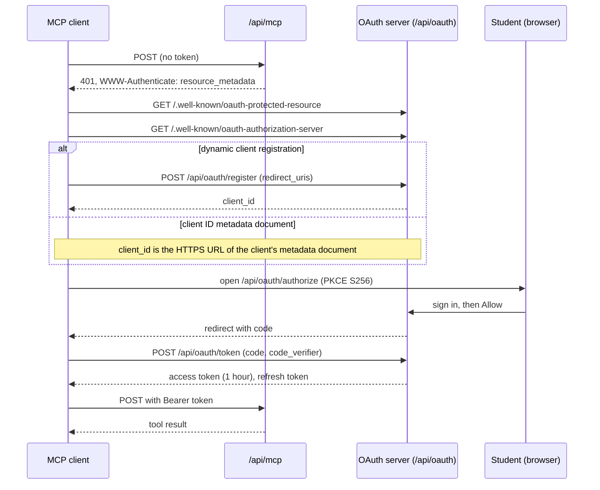

# MCP server

WIT Calendar has a [Model Context Protocol](https://modelcontextprotocol.io) (MCP) server. A student connects an AI client, such as Claude or ChatGPT. The client can then read the course catalog and the student's schedule, and, when the student allows it, change the student's calendar settings.

- **Endpoint:** `https://calendar.witcc.dev/api/mcp`
- **Transport:** Streamable HTTP, stateless. Send each request as a `POST`.
- **Sign-in:** OAuth 2.1 with PKCE. The student signs in with their WIT account and approves the app on a consent page.
- **Access:** by permission. The consent page has one checkbox for each permission. The permissions that change data start unchecked. See [Permissions](#permissions).

## Connect a client

### Claude

1. Open **Settings**, then **Connectors**.
2. Select **Add custom connector**.
3. Enter `https://calendar.witcc.dev/api/mcp` as the URL.
4. Sign in with your WIT account, then select **Allow**.

### Claude Code

```sh
claude mcp add --transport http wit-calendar https://calendar.witcc.dev/api/mcp
```

Then run `/mcp` in Claude Code and complete the sign-in in the browser.

### Other clients

Any MCP client that supports OAuth with dynamic client registration or client ID metadata documents can connect. Give it the endpoint URL. The client finds the rest from the `401` response.

## Tools

Each catalog tool matches a public catalog endpoint, so the MCP server, the REST API, and GraphQL give the same answers. The catalog tools share the query objects of those endpoints (`Catalog::SectionQuery`, `Catalog::InstructorQuery`, `Catalog::ReviewQuery`, `Catalog::SubjectQuery`, `Catalog::ProgramQuery`).

| Tool | What it reads | REST endpoint | GraphQL field |
| --- | --- | --- | --- |
| `list_terms` | The terms, the current term, and the next term. Call it first. | `GET /api/v1/catalog/terms` | `terms` |
| `list_subjects` | Subjects with their codes and section counts. | `GET /api/v1/catalog/subjects` | `subjects` |
| `search_sections` | Sections, with every catalog filter and paging. | `GET /api/v1/catalog/sections` | `sections` |
| `get_section` | One section by CRN, cancelled or not, with its part of term, campus, and cross-listed sections. | `GET /api/v1/catalog/sections/:crn` | `section` |
| `search_courses` | Courses (not sections) by code or title words. | `GET /api/v1/catalog/courses` | `courses` |
| `get_course` | One course: description, prerequisites, corequisites, restrictions, mutual exclusions, catalog entry, fees, learning objectives, terms usually offered, what it unlocks. | `GET /api/v1/catalog/courses/:code` | `course` |
| `list_programs` | The degree programs of one catalog year, and the catalog years WIT Calendar has. | `GET /api/v1/catalog/programs` | |
| `degree_requirements` | What one program requires in one catalog year: each plan of study by semester, and the elective lists. | `GET /api/v1/catalog/programs/:slug` | |
| `similar_sections` | Sections that teach something close to one section. | `GET /api/v1/catalog/sections/:crn/similar` | |
| `check_schedule` | Time conflicts, lecture and lab pairs, duplicates, and totals for a set of CRNs. | `GET /api/v1/catalog/schedule_check` | `scheduleCheck` |
| `search_instructors` | Instructors who teach, by name or by meaning. | `GET /api/v1/catalog/instructors` | `instructors` |
| `get_instructor` | One instructor, with RateMyProfessor ratings, distribution, tags, recent reviews, and the sections in a term. | `GET /api/v1/catalog/instructors/:pub_id` | |
| `similar_instructors` | Instructors who teach something close to one instructor. | `GET /api/v1/catalog/instructors/:pub_id/similar` | |
| `search_reviews` | RateMyProfessor reviews, by instructor, words, meaning, or sentiment. | `GET /api/v1/catalog/reviews` | `reviews` |
| `catalog_graphql` | Any read-only query on the catalog schema. | `POST /api/v1/graphql` | all |
| `my_courses` | Your courses in one term, with their CRNs, weekly meeting times, and rooms. | `GET /api/user/processed_events` | |
| `my_course_history` | Every term you processed, newest first, with your courses in each term. | `GET /api/user/course_history` | |
| `my_busy_times` | The times you are busy between two dates: classes, finals, and friend meetings. | `GET /api/user/busy_blocks` | |
| `my_finals` | Your final exams in one term. | `GET /api/user/finals` | |
| `list_friends` | Your friends and their ids. | `GET /api/friends` | |
| `friend_busy_times` | When a friend is busy between two dates, with no course details. | `GET /api/friends/:friend_id/busy_blocks` | |
| `university_events` | The academic calendar: holidays, deadlines, finals week. | `GET /api/university_calendar_events` | |
| `my_calendar_settings` | Your calendar event settings at each level, the classes with their own settings, and the color names and template variables the settings tools take. | `GET /api/calendar_preferences` | |
| `preview_template` | What an event title, description, or location template gives for one of your classes. | `POST /api/calendar_preferences/preview` | |
| `update_class_settings` | **Changes** the event title, description, location, color, visibility, or reminders of one class meeting. | `PATCH`, `DELETE /api/meeting_times/:id/preference` | |
| `update_calendar_settings` | **Changes** the same settings for all classes, one kind of class, final exams, or university events. | `PATCH`, `DELETE /api/calendar_preferences/:scope` | |
| `set_notifications` | **Changes** whether your reminders are paused. | `PATCH /api/user/notifications` | |

Times are in the `America/New_York` time zone.

`my_course_history` lists only the terms that you processed in the extension. The server cannot read LeopardWeb as you, so it cannot find the other terms. Since extension v6.0.0, each time you fetch a term, the extension also processes your other LeopardWeb terms in the background. A student who has not fetched a term since v6.0.0 can still have gaps.

WIT Calendar is not an official Wentworth service. It copies its data from official Wentworth sources on a schedule. The tools that give course, schedule, finals, and academic calendar data add an `advisory` field to each result. The field has two parts:

- `message` tells the AI client to ask the student to confirm a course plan with their program director and their academic advisor.
- `data_sources` lists the sources of that tool's data, how often WIT Calendar refreshes each one, and when it last did.

| Source key | Data | Source | Refresh | Last refresh |
| --- | --- | --- | --- | --- |
| `sections` | Meeting times, rooms, instructors, seats | Banner class schedule (LeopardWeb) | Every day at 4 AM Eastern, for the current and future terms. A past term is not refreshed after it ends. Seats also every 30 minutes, from the time a term's sections are listed until 7 days after its classes start (`Catalog::SeatRefreshJob`). | `terms.sections_synced_at`: when `Catalog::CourseDataSyncJob` finished the term |
| `course_details` | Descriptions, credits, prerequisites, restrictions, mutual exclusions, catalog entry, fees, learning objectives | Banner course catalog | Each course at most once every 7 days, in the daily run | `terms.details_synced_at`: when `Catalog::CourseDetailsSyncJob` finished the term |
| `finals` | Final exam dates, times, rooms | Registrar finals schedule (PDF) | When an admin uploads a new schedule | The latest completed `FinalsSchedule` of the term |
| `university_calendar` | Holidays, term dates, deadlines | Academic calendar (25Live) | Every Saturday at 2 AM Eastern | The latest `university_calendar_events.last_fetched_at` |
| `degree_requirements` | Degree programs, plans of study, elective lists | Academic catalog (catalog.wit.edu) | On the 2nd of each month at 3 AM Eastern, for the current catalog year and the year before | The latest `catalog_years.imported_at` |

The term sources give one time for each current and future term. The time is when a full run finished, not when one course changed: a student's own courses also refresh when the extension processes a term, so one fresh course says nothing about the rest. `Catalog::Freshness` builds the list and keeps the times in the cache for 10 minutes. The server instructions say the same. When a schedule in `config/recurring.yml` changes, change the text in `Catalog::Freshness` too. A spec checks this.

### When a client calls the tools

A student must not have to name WIT Calendar or a tool. The model calls a tool when the question matches what the server says about itself. Two texts decide this:

- **The server instructions** (`McpTools::Server::INSTRUCTIONS`). The client puts them in the context of every chat, also when it defers the tools. A client with many tools, such as Claude Code with tool search, shows the model only the tool names until it searches. So the instructions start with when to use the server: the topics, and the words students use ("my classes", "my finals", "my professor"). The rules come after.
- **The tool descriptions.** A tool search matches the words of the question with the names and the descriptions. Each tool that a student asks about in plain words has a "Use it for" sentence with example questions. Give Wentworth or WIT in the description of a student tool, so that "my classes" does not go to a general calendar.

Rules:

- Claude Code cuts server instructions and tool descriptions after 2,048 characters, with no error (`McpTools::Server::MAX_INSTRUCTIONS_LENGTH`). `spec/requests/api/mcp_spec.rb` checks the length of the instructions. Keep the trigger sentences first, so that a cut removes rules, not triggers.
- Put a rule for one tool in the description of that tool, not in the instructions. The model reads a description when it loads the tool.
- `DESCRIPTION` (the `serverInfo` description) lists the topics too. Some clients show it in their connector list.

### Registration overrides

Banner can block a registration. A student can ask for an override of the block. At Wentworth, the dean's office of the school that offers the course gives overrides.

| Override | It lets the student |
| --- | --- |
| Capacity or closed | Register in a full section. Check the department waitlist rules first. |
| Prerequisite or corequisite | Register without a prerequisite or a corequisite. |
| Major, minor, or program | Register in a section restricted to other majors, minors, colleges, or programs. |
| Class year or level | Register in a section restricted to other class years. |
| Time conflict | Register in two sections whose meeting times overlap. |
| Instructor or department approval | Register in a section that needs that approval. |
| Maximum hours (`ADV_MAX_HR`) | Register for more credits than the term maximum. |

The server instructions (`McpTools::Server::INSTRUCTIONS`) and each prompt (`McpTools::Prompts::BasePrompt::OVERRIDE`) give the model these rules. `check_schedule` and `get_course` name the override in their descriptions.

- An override is not certain, so make plans that do not need one.
- Offer one option that needs an override only when no plan without one works, or when the student is stuck or worried.
- For that option, name the override and the course, and tell the student to ask the dean's office of the school that offers the course.
- For a time conflict, give the minutes of overlap. `check_schedule` gives the times of each conflict.

No tool reads or requests overrides. Banner does not show them to WIT Calendar. When the override text changes, change it in each place.

### Registration steps

The Registrar's notice for Spring 2027 gives these rules. `plan_term_schedule` gives all of them after the options (`McpTools::Prompts::PlanTermSchedule::REGISTRATION`). The server instructions have only the time ticket and the RAC, because of the length limit (see [When a client calls the tools](#when-a-client-calls-the-tools)). The tool descriptions have the other rules:

- **Time ticket:** each student registers at the time on their time ticket. The student finds it in myWentworth under **Prepare for Registration**.
- **Registration time:** the time comes from the completed earned credits, with transfer and graduate credits. Credits in progress do not count. `university_events` says this.
- **Registration Alternate PIN (RAC):** first-year students, sophomores, and students on academic probation, continued probation, or academic dismissal need a RAC before they can register. The primary advisor gives it. WIT Calendar does not know the class year or the academic standing of a student, so the model gives the rule and does not guess.
- **Electives not listed yet:** for a Technical or HSS elective that is not in the schedule yet, the student asks the dean or associate dean of their school. The Registrar adds the electives when the schools send the lists. `search_sections` says this.

- **Waitlists:** not every section has a Banner waitlist. The `waitlist` of a section result gives its capacity and open seats (#905), a capacity of 0 means no waitlist, and null means WIT Calendar has not read it yet. For a full section with a waitlist, the student joins it before they ask for a capacity override. `search_sections`, `get_section`, and the prompts say this.
- **Minimum grades:** some prerequisites need a minimum grade. `Catalog::CourseDetailsSync` stores it as `min_grade` in the prerequisite tree, and `get_course` gives it. `my_course_history` has no grades, so the model asks the student for the grade. `get_course`, `plan_term_schedule`, and `plan_degree_progression` say this.
- **Substitutions and transfer credit:** a course substitution or transfer credit for a degree requirement needs approval from the program director, the dean's office of the school, or both. `degree_requirements` and `plan_degree_progression` say this.

No tool reads the time ticket, the RAC, or the standing of a student. The dates of each registration window change each term, so the docs and the server do not give them. When the Registrar changes these rules, change the text in each place.

### Old section data

The nightly sync can be a day old, and seats change fast during registration. So the server does two things:

- **A refresh on our server.** `get_section`, `check_schedule`, and `my_courses` queue `Catalog::SectionRefreshJob` for each section in the result that is not cancelled, is in a term that the nightly sync reads (`Term.active` and `Term.current_and_future`, the same as `Catalog::CourseDataSyncJob`), and whose `banner_synced_at` is older than `Courses::Processor::CATALOG_FRESH_FOR` (36 hours), so the nightly sync missed it. This is the same refresh that the extension starts when it processes a schedule. Seats need no refresh here: `Catalog::SeatRefreshJob` writes them every 30 minutes during registration, and it does not change `banner_synced_at`. The answer does not wait for it. A call queues at most 30 sections (`McpTools::BaseTool::REFRESH_LIMIT`), and a cache key stops a section from being queued again for 6 hours (`REFRESH_QUEUED_FOR`, the same as `Courses::Processor::REFRESH_AFTER`). The key also holds when Banner gives nothing and `banner_synced_at` does not change. If the job cannot be queued, the keys are removed, so the next call tries again. A past term gets no refresh: the nightly sync leaves past terms out on purpose. `Catalog::BannerThrottle` paces the job. A fault in the refresh is reported, and the tool still answers.
- **A direct read of Banner by the client.** The `get_section` description (`McpTools::GetSection::BANNER_HINT`) tells the model to read Banner itself, for a current or future term, when the advisory says the section data is more than 2 days old or has no refresh time. The model needs a web fetch tool for this. These Banner pages need no sign-in or session, and a GET works:

| Page | Gives |
| --- | --- |
| `searchResults/getEnrollmentInfo?term=<term_uid>&courseReferenceNumber=<crn>` | Seats and waitlist, as HTML |
| `searchResults/getFacultyMeetingTimes?term=<term_uid>&courseReferenceNumber=<crn>` | Meeting times, rooms, and instructors, as JSON |

The base URL is `Catalog::LeopardWebClient::BASE_URL`, and the term uid is the Banner term code. On 2026-10-14, Banner failed after about 40 requests in a minute, so the description limits the model to 10 CRNs, one at a time.

`catalog_graphql` has the same depth, cost, and page limits as `POST /api/v1/graphql`, and one semantic search for each query.

A settings tool takes a color as a name (`lavender`, `sage`, `grape`, `flamingo`, `banana`, `tangerine`, `peacock`, `graphite`, `blueberry`, `basil`, `tomato`), a Google Calendar color id from 1 to 11, or a `#rrggbb` hex color. A change to a setting queues the same calendar sync as the extension.

### Class settings

A class setting overrides the calendar settings for one weekly class meeting. It is an `EventPreference` row on a `Course::MeetingTime`, the same row that `PATCH /api/meeting_times/:id/preference` writes. `my_calendar_settings` lists these rows under `classes`. `update_class_settings` adds, changes, and removes them.

`Preferences::Resolver` finds each field on its own. For an event of a class meeting, the first level that sets the field wins:

| Order | Level | Set with | `sources` value |
| --- | --- | --- | --- |
| 1 | The class meeting | `update_class_settings` | `individual` |
| 2 | The kind of class (`lecture`, `laboratory`, and the other schedule types) | `update_calendar_settings` with that level | `event_type:<type>` |
| 3 | All classes | `update_calendar_settings` with `all_classes` | `global` |
| 4 | The defaults | | `system_default` |

So a class setting for the color only changes the color. The title, the reminders, and the other fields still come from the levels below. The default color is the lecture or lab color from the extension settings, else the color of the class meeting (`Course::MeetingTime#event_color`).

Rules:

- A class setting applies to one meeting time: one course, on one day of the week, in one term. A course that meets on Monday and Wednesday has two meeting times. To change the whole course, call `update_class_settings` once for each `meeting_time_id` that `my_courses` gives. A course in a new term has new meeting times, so the settings do not carry over.
- A class setting does not change the final exam of the course. Final exams use the `final_exam` level.
- Only the fields in the call change. The other fields of the row stay.
- `reset` removes fields from the row, so the level below applies again. When no field is left, the tool deletes the row and gives `result: "deleted"` and `class_settings: null`. This is the same as the `DELETE` endpoint.
- An empty template counts as not set, so the level below applies. An empty `reminders` list counts as set: the class gets no reminders.
- A change with `update_calendar_settings` does not remove class settings. Its confirmation message says that a class with settings of its own keeps them.
- Paused notifications (`set_notifications`) remove the reminders of every event in the calendar sync, also the reminders of a class setting. `resolved` and `sources` show the stored reminders, not the pause.
- The result gives `class_settings` (the row), `resolved` (the value of each field after the lookup), `sources` (the level of each value, from the table above), and `preview` (the title, description, and location of the class meeting with those values).

### Confirmation

Before a tool that changes data makes the change, the server asks the student to confirm it in the client (MCP elicitation). The server does not depend on the AI model to ask. `McpTools::Confirmation` does this for every `McpTools::BaseWriteTool`.

- The client shows a message and a "Make this change" box. The message lists the events that the change affects (one class, all classes, one kind of class, final exams, or university events). It also gives each field that changes, with the old value and the new value. Then it says which settings stay: a kind of class or a class with settings of its own keeps them, and a university event category keeps its settings. For `set_notifications`, it says what changes and the current state.
- The message comes from the same parsing as the save (`setting_attributes`), so the student sees what the tool saves. The model checks the new values before the question (`validate_settings!`). A change that cannot be saved gets a tool error, and the student does not see a question.
- A template comes last, on one line. The message shows newlines and quotes as escapes, and it cuts a template after 120 characters (`TEMPLATE_PREVIEW_LENGTH`). So a template cannot change the layout of the question.
- A reminder time shows as a number: "1.0" shows as "1", and 1 takes the singular ("1 hour"). `set_notifications` stores a pause in whole minutes and shows that time. It refuses a pause of less than one minute.
- When the university color changes, or the student picks the same color again, the save removes the colors of the university event categories (`CalendarPreference#clear_category_colors`). The message gives the number of category colors that the save removes. A university save that does not set the color keeps the category colors.
- When the student checks the box and accepts, the tool makes the change.
- When the student declines, cancels, or accepts with the box clear, nothing changes. The tool gives a normal result, not an error. The result has the current values, `result: "unchanged"` for a settings tool, and a `not_changed` field with the `reason` (`declined` or `cancelled`) and a `message`.
- When nothing would change, the tool does not ask.

The server is stateless, so it uses the multi round-trip form of MCP 2026-07-28 (SEP-2322):

1. The first call returns an `input_required` result. It has one `elicitation/create` request under the key `confirm`, and a `requestState`.
2. The client shows the question. Then it calls the same tool again, with the same arguments, the answer in `inputResponses`, and the same `requestState`.
3. The tool runs again from the start. The scope check, the `authorize` calls, and the argument checks run again before the change.

Only a client that sends its requests on the 2026-07-28 wire and declares form elicitation in the request `_meta` sees the confirmation. Any other client gets the old behavior: the tool makes the change with no question. The server cannot send the question on an older wire. There, the SDK sends a server-to-client request, and a stateless JSON response cannot carry it. So `McpTools::Server` sets `input_required_legacy_shim: false`.

The `requestState` comes back from the client, so the SDK seals it (`MCP::Server::RequestStateSecurity`):

- AES-256-GCM encrypts the state, so the client cannot read or change it.
- The seal binds the state to `tools/call`, the tool name, a digest of the arguments, and the user (the audience). The state of one student cannot complete the call of another student.
- The state expires after 10 minutes (`McpTools::Server::REQUEST_STATE_TTL`).
- The key comes from `secret_key_base` through `Rails.application.key_generator` and the salt `McpTools::Server::REQUEST_STATE_SALT`. Both deploy slots use the same key, so a retry can go to either slot. Change the salt to make every open state invalid.
- The state also holds a digest of the message and of the version of the record that the change writes: `updated_at` of the preference row, or of the user for `set_notifications`, or a nil marker when the row does not exist yet. If the message or the record changes before the retry, the tool asks again. After the change, the record has a new `updated_at`, so the same state and answer cannot make the change again, also when the setting goes back to the old value. One gap stays: when the change creates a row and a later change deletes it, the nil marker is the same again, so the state works again until it expires.

A state that is changed, expired, or for another user, tool, or set of arguments gets the JSON-RPC error `-32602` "Invalid or expired requestState" (HTTP 400). This is a client error, so the server does not report it. The client can call the tool again with no state, and the student gets a new question. An answer or a state that is not a JSON object counts as a cancel or as no state. It does not cause an error.

`calendar_mcp_tool_calls_total` counts the question as `input_required`, and a call that the student did not confirm as `declined` or `cancelled` (`docs/metrics.md`).

## Apps

The server supports the MCP Apps extension ([SEP-1865](https://github.com/modelcontextprotocol/ext-apps/blob/main/specification/2026-01-26/apps.mdx), `io.modelcontextprotocol/ui`). A host that supports the extension shows a tool result as an interactive page in a sandboxed iframe.

| App | Resource | Tools |
| --- | --- | --- |
| Week grid | `ui://wit-calendar/week-grid` | `check_schedule` (conflicts are marked), `my_courses` |

How it works:

1. `initialize` declares the extension in `capabilities.extensions`.
2. `tools/list` gives each tool with an app a `_meta.ui.resourceUri`. It also gives the old flat key `_meta["ui/resourceUri"]` for older hosts.
3. The host reads the template with `resources/read`. The MIME type is `text/html;profile=mcp-app`.
4. The page sends `ui/initialize` to the host. It applies the `theme` and `styles.variables` of the host context, then sends `ui/notifications/initialized`.
5. The host sends `ui/notifications/tool-result`. The page draws the `structuredContent` of the result. It also handles `ui/notifications/host-context-changed`, `ui/notifications/tool-cancelled`, `ui/resource-teardown`, and `ping`, and it sends `ui/notifications/size-changed`.

Rules:

- A tool with an app returns the same text and `structuredContent` as before. A client without the extension ignores the `_meta` and reads the normal result. The server is stateless, so it cannot see what the client declared at `initialize`, and it always sends the `_meta`.
- `resources/list` gives the template to every client. A client without the extension can show it as a resource to attach. The list keeps it, because a host with the extension can read the list to find the template first.
- The page shows times in the 12-hour format. It shows the advisory of the result (see [Tools](#tools)): the advisor message, and when the section data of the result's term last refreshed. A past term is not in the list of `Catalog::Freshness`, so the page says that its data no longer refreshes.
- A template is one HTML file in `app/views/mcp_apps/`, with inline CSS and JavaScript. It loads nothing from the network, so the resource declares no CSP domains and the host uses its strictest CSP. `spec/services/mcp_tools/week_grid_app_spec.rb` checks this.
- The page uses the host CSS variables (for example `--color-background-primary`) and has its own `light-dark()` values when the host gives none.
- Do not put an app behind a Flipper flag. The tool scope is the gate, the same as for the tool.
- `spec/system/mcp_week_grid_spec.rb` puts the template in an iframe with a fake host, and sends it a real tool result.

To add an app: add the HTML file, add an `MCP::Resource` subclass in `app/services/mcp_tools/` (see `McpTools::WeekGridApp`), add it to `McpTools.app_resources`, and call `meta YourApp.tool_meta` in each tool that uses it.

## Page links

Some tools add links to the WIT Calendar pages where the student can see or change the same data. Each link is a `resource_link` content item (MCP 2025-06-18). A client can show it as a link that the student opens in the browser.

| Tool | Page | Route |
| --- | --- | --- |
| `my_courses` | My schedule, for the term of the result. Only when the page lists that term. | `dashboard_schedule_url(term_uid:)` |
| `list_friends` | Friends | `dashboard_friends_url` |
| `friend_busy_times` | The friend's page: the full schedule, or the busy times of the week of `start_date` | `dashboard_friend_url(id, week_start:)` |
| `my_calendar_settings`, `update_calendar_settings` | Calendar settings | `dashboard_calendar_preferences_url` |
| `set_notifications` | Notification settings | `dashboard_notifications_url` |
| Any tool, when the token does not have its permission | The **Connected apps** card on Settings | `dashboard_settings_url(anchor: "connected-apps")` |

Rules:

- The JSON text stays the first content item. The links come after it. The links are not in `structuredContent`, so the output schemas do not change.
- A tool error has no page link. The one exception is the missing permission error, which links to the connected apps card.
- Link only to a page that exists in Rails. The catalog tools have no links, because the catalog has no web pages. `my_finals`, `my_busy_times`, `my_course_history`, `update_class_settings`, and `preview_template` have no links, because no page shows the same data.
- Build each URL with a route helper through `page_url`. It adds `McpTools::Server.url_options`, so the host is correct in each environment. Do not write a host in the code.
- A URL holds only the public ids that the page itself uses in its URLs. It never holds a token. A dashboard page needs a session, so the student signs in in the browser.
- The `mcp` gem does not check content items. It sends each Hash as it is.
- Only a client on protocol version 2025-06-18 or later gets links. An older client can check the content against a closed list of types and refuse the whole result. The server reads the version from the `_meta` envelope (2026-07-28) first, then from the `MCP-Protocol-Version` header. A request with no version is 2025-03-26, so it gets no links. This rule also applies to the missing permission error.
- The dashboard sends a student with no processed courses to the onboarding page. Such a student gets no link to those pages. Use `onboarded_page_link` for them. The notification and settings pages skip onboarding, so they use `page_link`. `User#onboarding_complete?` is the rule for both.
- The schedule page lists the enrolled current and future terms, or the last 6 enrolled terms when there are none (`ScheduleLoading.terms_for`). `my_courses` links only to a term in that list.
- A link is extra. When a `links` block raises an error, the server reports it with `Rails.error.report` and sends the result with no links.

To add a link to a tool, call `links` in the tool class. The block gets the result Hash and returns a list of link Hashes from `page_link` or `onboarded_page_link` (`McpTools::PageLinks`):

```ruby
links do
  [ onboarded_page_link(name: "wit-calendar-friends", title: "My friends on WIT Calendar",
                        url: page_url(:dashboard_friends_url)) ]
end
```

Then add the tool and its arguments to `spec/services/mcp_tools/page_links_spec.rb` and `spec/requests/mcp/page_links_spec.rb`. The request spec opens each link as a signed-in student and expects `200`. Add a row to the table above.

## Prompts

A prompt is a task that the student starts from the client, for example as a slash command. The server gives one user message. The message tells the model which tools to call and in which order. It tells the model to ask the student for a fact that no tool gives, and not to guess it. Each message ends with the advisor message: confirm the plan with the program director and the academic advisor. Every argument is optional.

| Prompt | Arguments | What it does |
| --- | --- | --- |
| `plan_term_schedule` | `term`, `courses`, `preferences` | Plans one term: `list_terms`, `my_courses`, `my_course_history`, `get_course` for the prerequisites of each course, `search_sections` with the preferences as filters, then `check_schedule` until each option has no conflicts. Gives one to three options with their CRNs. |
| `check_my_schedule` | `term` | Checks the student's courses: `my_courses`, `check_schedule` on their CRNs, `get_course` for corequisites, and `my_finals` for exams at the same time. |
| `plan_degree_progression` | `program`, `catalog_year`, `graduation_term` | Plans each term to graduation: `my_course_history`, then `list_programs` and `degree_requirements` for the required courses, then `get_course` for prerequisites, corequisites, and the terms each course is usually offered. Lists the risks. |
| `find_class_for_free_time` | `term`, `subject`, `days`, `times` | Finds sections that fit the student's free time: `my_busy_times`, `search_sections` with time filters, then `check_schedule`. |

- `term` takes a term uid (`202710`) or a name (`Spring 2027`). Without it, `plan_term_schedule` and `find_class_for_free_time` use the next fall or spring term, and tell the model to confirm the term with the student. They skip summer, because a student in March registers for fall. `check_my_schedule` uses the next term if the student has courses in it, else the current term.
- `courses` takes course codes separated by commas, semicolons, or new lines: `COMP 2350, MATH 1750`.
- The server cuts an argument at 500 characters. The message puts each argument in quotes.
- Arguments that are not an object of strings get `-32602` (Invalid params). The server does not report this client error.
- A prompt reads no student data. The tools read it when the model calls them, with the scopes of the token. `my_courses` gives the CRN of each course, so `check_my_schedule` can pass the CRNs to `check_schedule`.
- `plan_degree_progression` reads the required courses with `list_programs` and `degree_requirements`. The tools do not read the student's own programs yet (#868), so the model asks for the program and the catalog year. The catalog has no data before 2019-2020. For an older catalog year, the model asks the student for the list of required courses, from their degree audit or their program page on catalog.wit.edu.

### Completions

The server answers `completion/complete` for the prompt arguments (`McpTools::Completions`). Each match is on the start of the value and ignores case. An answer has at most 100 values. When more match, `hasMore` is true.

| Argument | Values | Source |
| --- | --- | --- |
| `term` | Term uids. The current and future terms come first, then the past terms, newest first. The value matches the start of the uid or of the name (`spr` gives `Spring 2027`). | `terms` |
| `subject` | Subject codes with active sections. When the client sends the `term` argument as context (a uid or a name), only the subjects of that term. Without it, only the subjects of the current and future terms. | `Catalog::SubjectQuery#codes` |
| `courses` | Course codes from the catalog, for example `COMP 2350`. The separators are the same as for the prompts. Only the code after the last separator completes. The codes before it stay. | `Catalog::CourseQuery#codes_starting_with` |

Other arguments get no values. A `context` or `context.arguments` that is not an object gives no context, not an error. The course query uses the unique index on `(subject_code, course_number)` when the value has a number, and a limit of 101 rows.

### Cache hints

The server sets the SEP-2549 cache hints: `ttlMs` is 300,000 (5 minutes) and `cacheScope` is `public` (`McpTools::Server::CACHE_TTL_MS` and `CACHE_SCOPE`). The SDK adds the hints to `tools/list`, `prompts/list`, `resources/list`, `resources/read`, and `server/discover`. It does not add them to `tools/call`, `prompts/get`, or `completion/complete`.

- The scope is `public` because those results are the same for every token. The server lists every tool and prompt to every token, their descriptions are fixed in code, and the only resources are the static app templates. A cache that a client shares between students cannot leak the data of one student.
- The TTL is short because the results change on a deploy: a new tool, a new prompt, or a new week grid template. The server is stateless, so it cannot send `list_changed` to tell a client to read them again. With 5 minutes, a client is at most 5 minutes behind a deploy, and it still saves the reads in one chat.
- A client on a protocol version before 2026-07-28 also gets the two fields in the list results. A client ignores result fields it does not know.
- Before you add a resource or a list result that changes for each student, set the scope to `private`, or give that result its own hints.

## Permissions

Each tool needs one OAuth scope. The consent page shows one checkbox for each scope the client asks for. A client that follows the MCP spec asks for every scope, because the first `401` names them all. The student checks or clears each box.

| Scope | Gives | Starts |
| --- | --- | --- |
| `catalog` | `list_terms`, `list_subjects`, `search_sections`, `get_section`, `search_courses`, `get_course`, `list_programs`, `degree_requirements`, `similar_sections`, `check_schedule`, `search_instructors`, `get_instructor`, `similar_instructors`, `search_reviews`, `catalog_graphql`, `university_events` | always on, no checkbox (public data) |
| `schedule:read` | `my_courses`, `my_finals`, `my_busy_times` | checked |
| `friends:read` | `list_friends`, `friend_busy_times` | checked |
| `settings:read` | `my_calendar_settings`, `preview_template` | checked |
| `settings:write` | `update_class_settings`, `update_calendar_settings` | unchecked |
| `notifications:write` | `set_notifications` | unchecked |
| `friends:requests`, `friends:meetings`, `friends:groups` | reserved for the friend tools | unchecked |

- The server lists every tool to every token. A tool that needs a permission the token lacks says so in its description.
- A call to a tool without its scope gets a tool error that tells the student how to add the permission: disconnect the app in its connector settings, connect again, and check the box. The error also links to Settings on the dashboard, which shows the permissions of each app. The server counts these in `calendar_mcp_scope_denials_total`.
- The MCP spec also defines step-up authorization: the server answers `403` with `WWW-Authenticate: Bearer error="insufficient_scope", scope="..."`, and the client asks the student for the missing scope. Not every client does this, and in a client that does not, the `403` fails the whole request with no reason shown. So the server sends the `403` only to clients in `McpTools::Scopes::STEP_UP_CLIENTS`. Add a client there after a test shows that it signs in again and retries. The step-up consent page starts with the requested boxes checked.
- A box the student checked for this app before starts checked the next time.
- Tokens issued before the scopes were split have the scope `read`. The server treats it as every read scope, so those connections keep their tools. A client registered before the split lists only `read`; the consent page updates its list on the next sign-in.
- Settings on the dashboard lists each app's permissions.

## Rate limits

The MCP server uses the same limits as the rest of the API.

- Each request with a token counts against the student who owns the token: `api/user`, 100 a minute. The extension and the MCP server share this budget.
- A semantic search (`semantic: true` with `q`) counts against `catalog/semantic`, 30 a minute. With a token, it counts against the student, not the address.
- claude.ai and ChatGPT send every student's requests from a few shared addresses (`McpPlatforms`). The per-IP limits skip those addresses. Each address has one high backstop limit instead: `mcp/platform`, 3,000 a minute. It covers the requests that carry no token: discovery, registration, and the token exchange.
- Anthropic publishes one fixed range (`160.79.104.0/21`). OpenAI publishes a list that changes, so `McpPlatforms::RefreshOpenaiRangesJob` fetches it every 6 hours. Without a copy, ChatGPT requests get the normal per-IP limits.
- A local client, such as Claude Code, uses the normal per-IP limits for the requests without a token.

## Disconnect an app

Open **Settings** on the dashboard. **Connected apps** lists every app that can use your data, with the permissions it holds. Select **Disconnect** to revoke its access. To change an app's permissions, disconnect it, then connect it again and pick the boxes you want.

## How the sign-in works

The diagram shows the sign-in steps. The client first calls `/api/mcp` with no token and gets a 401 answer. It then finds the OAuth server, registers or sends its metadata URL, and opens the sign-in page in the browser. After you select **Allow**, the client trades the code for a token. It sends that token with each tool call.



| Endpoint | Standard |
| --- | --- |
| `GET /.well-known/oauth-protected-resource` | RFC 9728 protected resource metadata |
| `GET /.well-known/oauth-authorization-server` | RFC 8414 authorization server metadata |
| `POST /api/oauth/register` | RFC 7591 dynamic client registration |
| `client_id` as an HTTPS URL | Client ID metadata documents (the method the MCP spec prefers) |
| `GET /api/oauth/authorize` | The consent page |
| `POST /api/oauth/token` | Code exchange and refresh |
| `POST /api/oauth/revoke` | RFC 7009 token revocation |

Rules:

- Every client is public: it has no secret, and it must use PKCE with `S256`.
- The scopes are in `McpTools::Scopes`. `catalog` is the default scope. The consent form sends only the checked scopes, so a token holds only what the student approved (`Oauth::ConsentScopes`).
- A redirect URI must use `https`. A local client may use `http` on `localhost` or `127.0.0.1`.
- An access token lasts one hour. Each refresh gives a new refresh token.
- A token works on `/api/mcp` only. The extension API uses its own tokens.
- When a client sends the `resource` parameter (RFC 8707), it must be the endpoint URL.
- A client registers in one of two ways. With dynamic client registration, it posts its metadata to `/api/oauth/register`. With a client ID metadata document, its `client_id` is an HTTPS URL, and the server fetches the document at that URL on the first sign-in (`Oauth::ClientMetadataDocument`). The document's own `client_id` must be the same URL. The server keeps a copy for one hour.
- The document fetch is guarded against SSRF (`Oauth::MetadataDocumentClient`): HTTPS on port 443 only, public addresses only, no redirects, a 5-second timeout, and a 10 KB limit.
- A client that registered itself and holds no token after one day is deleted (`Cleanup::UnusedOauthClientsJob`).

## For developers

| Code | Role |
| --- | --- |
| `config/initializers/doorkeeper.rb` | The OAuth server settings |
| `config/routes/oauth.rb` | The OAuth routes |
| `Oauth::` (`app/controllers/oauth/`, `app/services/oauth/`) | Consent page, registration, metadata |
| `Api::McpController` | The MCP endpoint and the bearer token check |
| `McpTools::` (`app/services/mcp_tools/`) | The server, its tools, and its app resources |
| `app/views/mcp_apps/` | The HTML templates of the MCP Apps |
| `McpTools::Prompts::` (`app/services/mcp_tools/prompts/`) | The prompts |
| `McpTools::Completions` | Completions for the prompt arguments |
| `McpTools::PageLinks` | The `resource_link` items that point to WIT Calendar pages |
| `Dashboard::ConnectedAppsController` | Disconnect an app |

### Add a tool

1. Add a class in `app/services/mcp_tools/` that inherits `McpTools::BaseTool`. A tool that changes data inherits `McpTools::BaseWriteTool`.
2. Set `tool_name`, `title`, `description`, `requires_scope` (a scope from `McpTools::Scopes`), and `input_schema`. Call `requires_scope` after `description`: it adds the permission to the description.
3. Set `output_schema`: the JSON Schema of the Hash that `perform` returns. Build it from the parts in `McpTools::Schemas`. Add a shared part there, not in the tool. Do not add the `advisory` key: `academic_planning` adds it.
4. Define `perform`. Return a Hash. Raise `McpTools::ToolError` for a bad argument. A write tool checks its arguments and calls `authorize` first. Then it makes the change in a `with_confirmation` block (see "Confirmation"). Add the optional `not_changed` key (`McpTools::Schemas::NOT_CHANGED`) to its output schema.
5. Call `authorize` for any record that belongs to a user. Reuse the policies, queries, and serializers of the matching API endpoint. If no endpoint gives the data, add one too, so the extension and the MCP server stay equal.
6. A tool with a semantic search calls `spend_semantic_search!` first. A tool whose answer a student can use to plan courses calls `academic_planning` with the keys of its data sources (`Catalog::Freshness::SOURCES`), so its result carries the advisory.
   If a WIT Calendar page shows the same data, call `links` (see [Page links](#page-links)).
7. Add the class to `McpTools.all`, and add a row to the table above and to the permissions table.
8. Write a spec in `spec/services/mcp_tools/`. Check that a token without the scope gets a tool error.
9. Add calls of the tool to `spec/services/mcp_tools/output_schemas_spec.rb`. Use full data and sparse data: nil fields and empty lists.

### Output schemas

Each tool sends an `outputSchema` in `tools/list`. The MCP spec says that the structured result of a tool must conform to its output schema. Clients, such as ChatGPT, use the schema to check and read a result.

- A key that can be null has a nullable type. `required` lists only the keys that are always in the result.
- An object can take keys that the schema does not name, so a new field does not break a client.
- `McpTools::BaseTool::ADVISORY_SCHEMA` is the schema of the `advisory` key. `academic_planning` adds it to the output schema of the tool.
- `catalog_graphql` has a loose schema, because the shape of `data` follows the query.
- `spec/services/mcp_tools/output_schemas_spec.rb` calls each tool and checks the result against its schema. The spec is stricter than the schema: it fails on a key that the schema does not name. When a serializer gets a new key, add the key to the schema in the same PR.
- The `mcp` gem does not check results at run time, because `validate_tool_call_results` is off. Do not turn it on. The gem checks the Ruby Hash before it becomes JSON, so a `Date` or `Time` value fails a `string` type. A failed check gives the client an internal error in place of the result.

A write tool changes only the signed-in student's own data, through the same models and policies as its API endpoint. A tool that reaches other people, such as a friend request, needs a scope of its own. `McpTools::BaseTool` marks a read tool read-only for the client, and `McpTools::BaseWriteTool` marks a write tool as not destructive.

### Add a prompt

1. Add a class in `app/services/mcp_tools/prompts/` that inherits `McpTools::Prompts::BasePrompt`.
2. Set `prompt_name`, `title`, `description`, and `arguments`. Keep every argument optional, and make the message tell the model to ask for a missing fact.
3. Define `steps`. Return the parts of the message. Name each tool and the order to call them. `BasePrompt` adds the ask rule, the permission rule, and the advisor message.
4. Add the class to `McpTools::Prompts.all`, and add a row to the prompts table above.
5. If an argument can complete, use the name `term`, `subject`, or `courses`, or add a case to `McpTools::Completions`.
6. Add examples to `spec/services/mcp_tools/prompts_spec.rb`.

### Try it locally

```sh
bin/dev
npx @modelcontextprotocol/inspector
```

In the Inspector, connect to `http://localhost:3000/api/mcp` with the Streamable HTTP transport.
