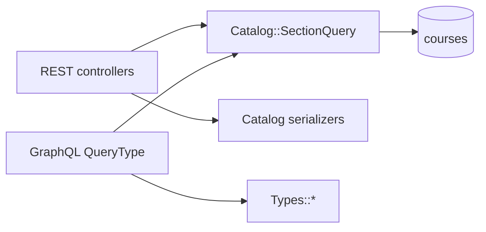
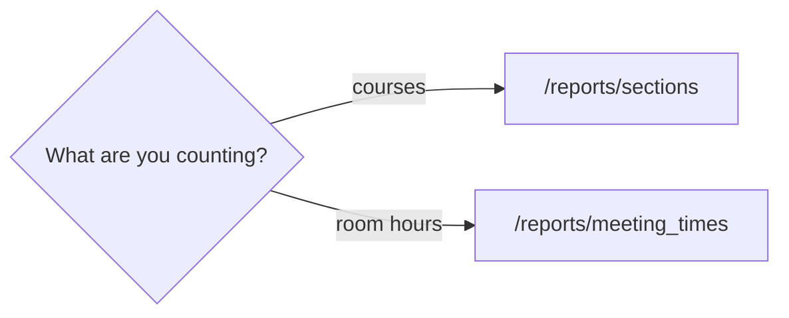
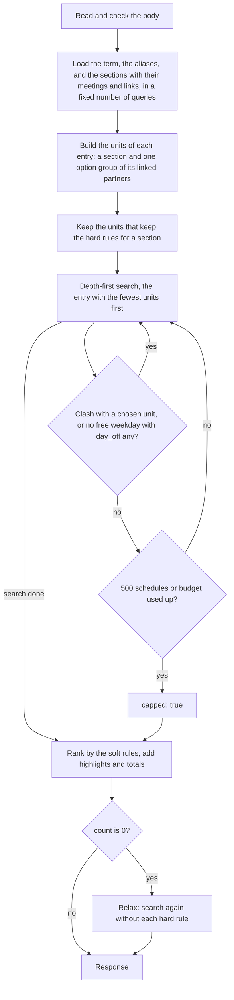

# WIT Calendar Course Catalog API

A read-only API for the WIT course schedule, published by WIT Calendar. It needs no authentication and no
API key.

This reference is also available as markdown at `/docs/api.md`. A client that
sends `Accept: text/markdown` to `/docs/api` gets the same markdown.
`/llms.txt` lists the main entry points for AI agents.

Machine descriptions of the API are also available:

| URL | Content |
| --- | --- |
| `/.well-known/api-catalog` | An [RFC 9727](https://www.rfc-editor.org/rfc/rfc9727) API catalog. It links each API to its description, this reference, and a health check. |
| `/docs/api/openapi.json` | An OpenAPI 3.1 description of the REST endpoints |
| `/docs/api/schema.graphql` | The GraphQL schema in SDL |

The API has three surfaces over the same data:

| Surface | Endpoint | Use it for |
| --- | --- | --- |
| REST | `GET /api/v1/catalog/...` | Simple requests, caching, curl |
| GraphQL | `POST /api/v1/graphql` | One request for nested data |
| CSV reports | `GET /reports/...` | Excel and Power BI, no code |

Both surfaces use the same filter object, `Catalog::SectionQuery`. A filter
gives the same result on both.

The diagram shows the path of a request. The REST controllers and the GraphQL
`QueryType` both send the filter to `Catalog::SectionQuery`, which reads the
courses table. REST formats the result with the catalog serializers. GraphQL
formats it with its `Types::*` classes.



## What the API contains

The API contains course schedule data only:

- Terms, subjects, and course sections
- Degree programs from the academic catalog, with their plans of study and
  elective lists, for each catalog year
- The elective lists that each school publishes for a term
- Meeting days, times, buildings, and rooms
- Instructors, with Rate My Professors scores
- Final exam times

The API contains no user data. It does not return student records, grades, or
enrollments. It does not return instructor email addresses, phone numbers, or
office locations.

## Limits

- `GET` responses are public and cacheable for 1 hour. Cloudflare caches
  them at the edge for the same hour. The `POST` routes of the schedule
  builder are not cached.
- Rate limit: 300 requests per minute per IP address. A response from the
  Cloudflare cache does not count. Its `RateLimit` fields are those of the
  request that filled the cache.
- The schedule builder has its own limits too: 30 searches and 90 counts
  per minute per IP address. A request with a token counts against the user. See [Schedule builder](#schedule-builder).
- REST page size: 50 by default, 200 maximum.
- GraphQL page size: 50 by default, 200 maximum.
- GraphQL query depth: 12 maximum. Query cost: 500 maximum. See
  [Cost and limits](#cost-and-limits).
- GraphQL has no mutations.

### Rate limit headers

Every API response sends two headers from the IETF draft
[RateLimit header fields for HTTP](https://datatracker.ietf.org/doc/draft-ietf-httpapi-ratelimit-headers/).
Each list item is one policy:

```http
RateLimit-Policy: "req/ip";q=3000;w=300, "catalog/ip";q=300;w=60
RateLimit: "req/ip";r=2999;t=180, "catalog/ip";r=299;t=42
```

- In `RateLimit-Policy`, `q` is the number of requests allowed in a window of
  `w` seconds.
- In `RateLimit`, `r` is the number of requests left, and `t` is the number of
  seconds until the window resets.

When `r` reaches 0, wait `t` seconds. A client that goes over a limit gets HTTP
429 with the `RATE_LIMITED` error code. Wait for the number of seconds in the
`Retry-After` header before the next request.

## Versioning and deprecation

- The major version of the REST API is in the path: `/api/v1`.
- Version 1 only gets changes that do not break a client: a new field, a new
  endpoint, a new filter, or a new error code. A client must ignore fields that
  it does not know.
- A change that breaks a client gets a new path, such as `/api/v2`.
- Before an endpoint or a field is removed, its responses send a `Deprecation`
  header ([RFC 9745](https://www.rfc-editor.org/rfc/rfc9745)) with the date of
  the deprecation. They also send a `Sunset` header
  ([RFC 8594](https://www.rfc-editor.org/rfc/rfc8594)) with the date of the
  removal.
- The removal comes at least 90 days after the first `Deprecation` header.
- A GraphQL field gets `@deprecated` with a reason at least 90 days before it
  is removed.
- No endpoint and no field is deprecated now.

## CSV reports

Three URLs answer with a CSV body. Open one in Excel with **Data > From Web**,
or point Power BI at it. They need no code and no key, and they refresh in
place. They carry the same cache headers as the rest of the API. They also
send `Access-Control-Allow-Origin: *`, so a web page on any site can fetch
them with `fetch()`.

| Report | Grain | One row is |
| --- | --- | --- |
| `GET /reports/sections?term_uid=<uid>` | section | one course section |
| `GET /reports/meeting_times?term_uid=<uid>` | meeting time by room | one meeting, in one room, on one day |
| `GET /reports/terms` | term | one term that has schedule data |

`term_uid` is optional on the first two. Omit it to get every term at once.
`GET /reports/terms` lists the valid values.

### Which grain do I want?

Start with `sections`. It is the grain most people expect: a section appears
once, the way it appears on a schedule.

```
crn    subject            course_number  section_number  meeting_days  meeting_times  room
16036  Mathematics (MATH)  2300          3               TR            10:00-11:45    WENTW 214
17309  Mathematics (MATH)  1525          1A              MW            08:00-09:15    WENTW 206
```

Use `meeting_times` when the question is about a room or an hour, such as
"what is in WENTW 206 on Tuesday at 08:00". There, a section that meets twice
a week is two rows, one per day. That is the right shape for a room question
and the wrong shape for a course list: a reader scanning it sees each course
more than once and reads the extra rows as duplicates.

The diagram shows how to choose a report. To count courses, use
`/reports/sections`. To count room hours, use `/reports/meeting_times`.



`meeting_count` on a section row says how many `meeting_times` rows collapsed
into it, so the two reports reconcile.

### Reading the meeting columns

`meeting_days` uses Banner's day codes, starting on Monday. `R` is Thursday
and `U` is Sunday, because `T` and `S` are already taken.

| Code | M | T | W | R | F | S | U |
| --- | --- | --- | --- | --- | --- | --- | --- |
| Day | Mon | Tue | Wed | Thu | Fri | Sat | Sun |

Most sections meet on one pattern, so `meeting_days` reads as `MW` and
`meeting_times` as `08:00-09:15`. A section with more than one pattern, such
as a lecture that also has a Friday lab in another room, lists one part per
pattern separated by `; `. The parts line up across every meeting column:

```
meeting_days  meeting_times                room
MW; F         09:00-10:15; 13:00-14:50     ANX 305; DOB 005
```

Faculty names inside a single cell are separated by `, `, so the two
separators never collide.

`room_capacity` on a section row is the largest room the section is scheduled
into. It comes from 25Live and is blank when 25Live has no capacity for the
room. It is not an official seat count for the room.

## REST

### Response shape

A collection returns `data` and `meta`:

```json
{
  "data": [ ... ],
  "meta": { "page": 1, "per_page": 50, "total_count": 1174, "total_pages": 24 }
}
```

A single record returns `data` only.

An error returns `error` and `code`:

```json
{ "error": "Unknown day \"funday\"", "code": "INVALID_FILTER" }
```

Every 4xx and 5xx response has this body. Branch on `code`, not on the
message:

| Code | HTTP status | Meaning |
| --- | --- | --- |
| `INVALID_FILTER` | 400 | A filter value is not valid |
| `NOT_FOUND` | 404 | No record matches |
| `RATE_LIMITED` | 429 | The client went over a rate limit. The body also has `retry_after`. |
| `SCHEDULE_BUILDER_BUSY` | 503 | Every schedule search slot is in use. The body also has `retry_after`. Wait that many seconds, then try again. Only the schedule builder sends it |
| `INTERNAL_ERROR` | 500 | An unexpected server error |

### Endpoints

| Method and path | Description |
| --- | --- |
| `GET /api/v1/catalog/terms` | All terms, newest first. `?active=true` lists only the terms in session today |
| `GET /api/v1/catalog/terms/current` | The current term. 404 when there is none |
| `GET /api/v1/catalog/terms/next` | The term after the current term. 404 when there is none |
| `GET /api/v1/catalog/terms/:uid` | One term by its Banner code, e.g. `202710` |
| `GET /api/v1/catalog/terms/:uid/electives` | The elective lists that each school publishes for the term |
| `GET /api/v1/catalog/subjects` | Subjects with section counts |
| `GET /api/v1/catalog/sections` | Sections, with filters |
| `GET /api/v1/catalog/sections/:crn` | One section by CRN |
| `GET /api/v1/catalog/instructors` | Faculty who teach at least one section |
| `GET /api/v1/catalog/sections/:crn/similar` | Sections like this one |
| `GET /api/v1/catalog/instructors/:pub_id` | One instructor |
| `GET /api/v1/catalog/instructors/:pub_id/similar` | Instructors like this one |
| `GET /api/v1/catalog/reviews` | Rate My Professors reviews |
| `GET /api/v1/catalog/courses` | Courses (not sections), by code or title words |
| `GET /api/v1/catalog/courses/:code` | One course: description, prerequisites, corequisites, restrictions, mutual exclusions, catalog entry, fees, learning objectives, what it unlocks |
| `GET /api/v1/catalog/schedule_check` | Check a set of sections taken together |
| `POST /api/v1/catalog/schedule_options` | Build and rank schedules for a list of courses. See [Schedule builder](#schedule-builder) |
| `POST /api/v1/catalog/schedule_options/count` | Count the schedules for the same input |
| `GET /api/v1/catalog/programs` | Degree programs of one catalog year |
| `GET /api/v1/catalog/programs/:slug` | One program: its plans of study and elective lists |

`GET /api/v1/catalog/subjects` accepts `term_uid`.

`GET /api/v1/catalog/schedule_check` needs `term_uid` and `crn`, a
comma-separated list of at most 30 CRNs, labs included. It returns time
conflicts (the same day, overlapping times, overlapping dates), linked
lecture and lab pairs that are missing a partner, the same course chosen
twice, and totals: credit hours, days, earliest start, latest end, and the
number of meetings before 9:00. Credit hours use Banner's credits for linked
sections, where a lab is 0.

`GET /api/v1/catalog/instructors` accepts `term_uid`, `q`, `semantic`, `page`,
and `per_page`. Without `semantic`, each word of `q` must match the first, last,
or display name, so `q=ada lovelace` finds Ada Lovelace.

`GET /api/v1/catalog/courses` accepts `q` (a code such as `COMP 2350`, or title
words), `subject`, `term_uid` (only courses with a section in that term), `page`,
and `per_page`.

`GET /api/v1/catalog/courses/:code` takes `COMP2350` or `COMP 2350`, and an
optional `term_uid` that adds the course's sections in that term. The
prerequisites are an and/or tree of courses and placement tests. Each course in
the tree has its `title` and `linked: true` when WIT Calendar knows the course.
`unlocks` lists the courses that name this one as a prerequisite.
`mutual_exclusions` lists the courses that block this one: a student who
completed one of them cannot take it. The course also has its `college`,
`division`, `department`, `levels`, `grading_modes`, `fees` (each with
`amount_cents`), and `learning_objectives` from Banner's syllabus page. The data
comes from Banner and is refreshed every night. Each section also has a `course`
object with the description, the prerequisites, and `typically_offered`.

A section has its `part_of_term` (`1` for the full term, a code such as `FA1` or
`FA2` for one half), its `campus`, and its `cross_list`: the sections of other
courses that meet with it, with the seats of the whole group. `cross_list` is
null when the section is not cross-listed.

`GET /api/v1/catalog/programs` accepts `catalog_year` (`2024-2025`, `2024-25`,
`2024`, or a term name such as `Spring 2024`, which is in 2023-2024),
`kind` (`associate`, `bachelor`, `master`, `minor`, `concentration`,
`certificate`, `exploratory`), `level` (`undergraduate`, `graduate`), `q`
(words in the name), and `parent_program` (the slug of a major, for its
concentrations). Without `catalog_year`, it uses the newest catalog year.
`meta.catalog_years` lists the catalog years the API has, newest first. The data
starts with 2013-2014. The years before 2019-2020 come from the PDF catalogs, and
the program endpoint gives `needs_review: true` for a plan that a person has not
checked yet. The list leaves out a program that the catalog no longer lists. The
program endpoint still returns it, with `listed: false`.

`GET /api/v1/catalog/programs/:slug` takes the slug from the list, such as
`computer-science-bs`, or the exact program name, and the same `catalog_year`. Each plan of study lists
its terms by `year` and `season`. Each item is a `course`, a `choice` between
the courses in `options`, or a `placeholder` such as "Computer Science
Elective", with the name of the `elective_list` it draws from. The data comes
from catalog.wit.edu and is refreshed each month. It is the published catalog,
not a degree audit.

`GET /api/v1/catalog/terms/:uid/electives` returns one item for each elective
list PDF on the Registrar's "Technical, Major, and HSS Electives" page: the
`school` (`SCDS`, `HSS`, `SOM`, `ARCH`, `SOE`, `SOS`, or null), the `title`, the `url` of the
PDF, `fetched_at`, the `courses`, and the full `text` of the PDF. Each course has
its `code`, its Banner `title`, and the `heading` above it in the PDF, such as
"Computer Science Elective". The text has the rules that name no course, such
as "Any 2000-Level courses in BIOE, BIOL, ...". It accepts `school` (one code or
a comma-separated list), `course` (a code such as `COMP2000`), and `q` (words
that must all be in the heading). With a filter, each list keeps only the
matching courses, and a list with no match is left out. The data is refreshed
each night.

`GET /api/v1/catalog/instructors/:pub_id` also returns the Rate My Professors
rating distribution, the top tags, and the newest reviews. Add `term_uid` to list
the sections the instructor teaches in that term.

`GET /api/v1/catalog/sections/:crn` accepts `term_uid`. Use it when one CRN
occurs in more than one term. This endpoint also returns cancelled sections, so
a saved CRN does not disappear without an explanation.

### Section filters

All filters are optional. Give a list as a comma-separated value, for example
`subject=COMP,MATH`.

| Filter | Example | Effect |
| --- | --- | --- |
| `term_uid` | `202710` | Keep sections in this term |
| `subject` | `COMP` | Match the code or the full label |
| `course_number` | `1000` | Keep these course numbers |
| `crn` | `10001,10002` | Keep these CRNs |
| `pub_id` | `crs_kw7coe30` | Keep these sections by public id |
| `q` | `algorithms` | Search the title, subject, and number |
| `semantic` | `true` | Rank `q` by meaning instead of by the literal words |
| `schedule_type` | `lecture` or `LEC` | Keep these schedule types |
| `credit_hours` | `4` | Keep these credit hours |
| `instructor` | `byron` | Match the instructor name |
| `meets_on` | `monday,friday` | Keep sections that meet on any of these days |
| `free_days` | `friday` | Drop sections that meet on any of these days |
| `begins_after` | `10:00` | Drop sections with any meeting before this time |
| `ends_before` | `16:00` | Drop sections with any meeting after this time |
| `include_cancelled` | `true` | Add cancelled sections |
| `open_only` | `true` | Keep sections with a free seat (`seats.available` > 0) |
| `include_waitlist` | `true` | With `open_only`, also keep full sections whose waitlist has room (`waitlist.available` > 0) |
| `page`, `per_page` | `2`, `100` | Page through the result |

`begins_after` and `ends_before` accept `HH:MM` or `HHMM`. Both are inclusive at
the boundary.

`free_days`, `begins_after`, and `ends_before` apply to the whole section. A
section is dropped if **any** of its meetings breaks the rule. This is what a
student wants: one Friday afternoon lab still ruins a free Friday.

An unknown filter value returns HTTP 400. An unknown query parameter is ignored.

### Open seats

`open_only=true` keeps the sections that have a free seat. Add
`include_waitlist=true` to also keep full sections whose waitlist has room.

```bash
curl "https://calendar.witcc.dev/api/v1/catalog/sections?term_uid=202720&subject=PHIL&open_only=true&include_waitlist=true"
```

Points to know:

- Seat counts can be up to 30 minutes old during registration, and up to a
  day old outside it. The response cache adds at most one more hour. See
  [Notes on the data](#notes-on-the-data). Do not show the result as a
  real-time seat count.
- `open_only` leaves out a section with no seat data (`seats.available` is
  `null`), because the API does not know that the section is open.
- A section with `seats.available` of 0 or less is full. With
  `include_waitlist`, a full section stays only when `waitlist.available` is
  more than 0.
- `include_waitlist` has no effect without `open_only`.
- Both filters accept `true`, `false`, `1`, or `0`. Any other value returns
  HTTP 400.
- The filter reads the seats of the section itself, not the seats of its
  `cross_list` group.
- `meta.filters` gives both values as booleans, for example
  `"open_only": true`.

### Schedule builder

`POST /api/v1/catalog/schedule_options` builds the schedules for a list of
courses in one term, and ranks them by the student's preferences.
`POST /api/v1/catalog/schedule_options/count` takes the same body and returns
only `{ "data": { "count": 12, "capped": false } }`, so a client can show
"12 schedules" while the student changes an answer. Both are public, like the
other catalog routes. This is not a registration check: holds, restrictions,
and registration times are Banner's.

The schedule builder is behind the `schedule_builder` feature flag while it is
tested. While the flag is off, both routes answer 404 `NOT_FOUND`. The routes
need no token. When the request has a valid extension token, the flag can also
be on for that one user. A bad or ended token is the same as no token. Apart
from that 404, the answer is the same for every caller.

One server process runs a fixed number of searches at the same time: one
fewer than its threads, at least one (`Catalog::ScheduleOptions::Slots`). A
request that finds every slot in use does not wait. It gets 503
`SCHEDULE_BUILDER_BUSY` with `Retry-After: 1`. The body also has
`retry_after`, and a browser on another origin can read the header.

```json
{
  "term_uid": 202720,
  "courses": [
    { "codes": ["COMP 3350"] },
    { "codes": ["MATH 2300", "MATH 2860"] },
    { "codes": ["COMP 2280"], "crns": ["20230", "20231"] }
  ],
  "preferences": {
    "blocked": [{ "days": ["friday"], "after": "13:00" }],
    "avoid": [{ "days": ["monday", "wednesday"], "before": "10:00" }],
    "earliest": "09:00",
    "latest": "18:00",
    "day_off": "any",
    "open_only": true,
    "days": "fewer",
    "breaks": "lunch"
  },
  "limit": 6
}
```

The request:

| Field | Meaning |
| --- | --- |
| `term_uid` | The term. Required. |
| `courses` | 1 to 10 course entries. Each entry has `codes`: one code, or 2 to 5 codes for "one of". A code is `COMP 3350` or `COMP3350`. An old or new code that a person checked (a course code alias) finds the sections of the other code. At most 20 codes in all. Two entries with the same codes return 400. |
| `courses[].crns` | Optional. CRNs that the student already picked for the entry. Each schedule keeps every pinned CRN. A pinned CRN must be a section of one of the entry's codes in the term, or a section that Banner links to one, and not cancelled. When the pinned CRNs are not linked to each other (a lecture and a lab with no Banner pair), they stay together as one choice if they keep the `schedule_check` rules. At most 30 CRNs in all. |
| `preferences` | Optional. See the table below. |
| `limit` | How many schedules to return: 1 to 20, 6 by default. |

The preferences. A hard rule removes a schedule. A soft rule only changes the
order.

| Preference | Kind | Values | Effect |
| --- | --- | --- | --- |
| `blocked` | hard | up to 10 ranges | No meeting in any range |
| `earliest` | hard | `HH:MM` | No meeting starts before this time |
| `latest` | hard | `HH:MM` | No meeting ends after this time |
| `day_off` | hard | `none` (default), `any`, or a list of days | `any`: at least one weekday (Monday to Friday) has no class. A list: no class on those days |
| `open_only` | hard | `true` or `false` | Only sections with a free seat, by the rule of the `open_only` section filter. A section with no seat data is left out. A pinned CRN stays when it is full, because the student already picked it |
| `avoid` | soft | up to 10 ranges | Fewer meetings in the ranges rank higher |
| `days` | soft | `fewer`, `spread`, or `any` (default) | `fewer`: fewer days with classes. `spread`: classes on more weekdays, with days of a more even length |
| `breaks` | soft | `tight`, `lunch`, or `any` (default) | `tight`: shorter gaps between classes. `lunch`: a free 30 minutes from 11:00 to 14:00 on each class day |

A range is `{ "days": [...], "after": "HH:MM", "before": "HH:MM" }`. It covers
a meeting on one of its days that overlaps the time from `after` to `before`.
Without `after`, the range starts at midnight. Without `before`, it runs to the
end of the day. Without `days`, it is on every day. A range needs at least one
of the three keys.

The response:

```json
{
  "data": {
    "term": { "uid": 202720, "name": "Spring 2027" },
    "count": 12,
    "capped": false,
    "schedules": [
      {
        "rank": 1,
        "score": 0.92,
        "crns": ["20410", "20411", "20520", "20230", "20231"],
        "courses": [
          { "code": "COMP 3350", "crns": ["20410", "20411"] },
          { "code": "MATH 2300", "crns": ["20520"] },
          { "code": "COMP 2280", "crns": ["20230", "20231"] }
        ],
        "highlights": ["Fridays off", "Lunch break every day", "Done by 4 PM"],
        "avoid_hits": 0,
        "totals": { "credit_hours": 12, "days": ["monday", "tuesday", "wednesday", "thursday"], "earliest_start": "10:00", "latest_end": "15:50", "meetings_before_nine": 0 }
      }
    ],
    "relax": [],
    "not_offered": []
  }
}
```

- `count` is the number of schedules that keep the hard rules. The search
  stops at 500 schedules, and also when it reaches its work budget. In both
  cases `capped` is `true`, and `count` is the lowest possible count. A capped
  search ranks only the schedules that it found.
- Each schedule has one section of each entry, with the lab or other linked
  sections that Banner pairs with it (the stored section links, not the link
  identifiers when Banner's pairs are there). A schedule never has a time
  conflict, a missing linked partner, a cancelled section, or the same course
  two times: the same rules as `schedule_check`. Two sections conflict only
  when their days, times, and dates overlap, so half-term sections in
  different halves can share a time.
- A lab alone does not stand for a course that has an active lecture or
  another kind of section, unless the student pinned it.
- An entry for a lab with its own code, such as `PHYS 1251` next to
  `PHYS 1250`, joins the entry of the lecture that Banner links it to. The
  lab is then part of the lecture's choice, not a second course.
- `crns` and the `crns` of each course are strings, in the order of the
  request's entries. `totals` has the same fields as in `schedule_check`.
  Sections with no meeting time (online, arranged) take up no time and add
  no day.
- `score` is from 0 to 1. It is the mean of one part for each soft rule that
  the request sets. With no soft rule, every schedule scores 1. The higher
  score comes first, then fewer `avoid_hits`, then the lower CRN list, so the
  same request gives the same order. Only a server that is too slow to finish
  the search budget in time can stop a search earlier.
- The search tries the sections that look best for the soft rules first, so
  when it is capped, the schedules it found are likely the best ones.
- `avoid_hits` is the number of meetings in an `avoid` range.
- `highlights` are up to 4 short statements that are true of the schedule:
  the free weekdays ("Fridays off"), "Lunch break every day", "Done by 4 PM"
  (when the last class ends by 17:00), "No classes before 10 AM" (when the
  first class starts at 10:00 or later), and "No classes in times to avoid".
- `not_offered` lists each requested code with no active section in the term.
  This is not an error. An entry with no offered code is left out of the
  search, and the other entries still get schedules.
- `relax` is empty unless `count` is 0. Then it lists each hard rule that the
  request sets, with the count that the search gives without that one rule,
  the higher count first. A rule whose removal still gives 0 is left out. The
  relax searches share a second budget, in equal parts, so the main search
  cannot use up their budget.
  `preference` is `day_off`, `earliest`, `latest`, `blocked`, or `open_only`,
  and `label` says what the student allows, such as "Allow classes every
  weekday".

```json
{ "data": { "count": 0, "capped": false, "schedules": [], "relax": [
  { "preference": "day_off", "label": "Allow classes every weekday", "count": 4 },
  { "preference": "earliest", "label": "Allow classes before 9 AM", "count": 2 }
] } }
```

Errors: an unknown course code, term, preference key, or preference value
returns 400 `INVALID_FILTER`, the same as the other catalog routes. So does a
pinned CRN that is not a section of its entry's codes (or of a section linked
to one), or that is cancelled.
Unknown keys at the top level of the body are ignored.

How the search works:



The work of one request is bounded: the limits on the input above, the cap of
500 schedules, and a budget of 30,000 search steps or 0.25 seconds. The relax
step gets one more budget of the same size, split between its rules. The code is `Catalog::ScheduleOptions`
(`app/services/catalog/schedule_options/`). `Catalog::ScheduleRules` holds the
rules that it shares with `schedule_check`.

### Search by meaning

`q` matches the literal words. Add `semantic=true` to rank by meaning instead,
so `intro to programming` reaches `Computer Science I`. The same switch works
on `/api/v1/catalog/instructors`.

```bash
curl "https://calendar.witcc.dev/api/v1/catalog/sections?q=learn+to+program&semantic=true&term_uid=202710"
```

Points to know:

- Results come back ranked, nearest first, not sorted by subject and number.
- Every other filter still applies. The ranking covers what the filters left.
- A section stays out until it has been embedded, which happens nightly.
- Semantic requests are limited to 30 per minute per IP. The keyword search
  keeps the standard 300 per minute. A GraphQL query that runs a semantic
  search uses the same 30 per minute.
- A GraphQL query can run one semantic search. A query that asks for more gets
  the error code `TOO_MANY_SEMANTIC_SEARCHES` and runs nothing.
- The server falls back to the keyword search when semantic search is off. The
  request never fails because of it.

### Reviews

`GET /api/v1/catalog/reviews` returns Rate My Professors reviews of WIT
instructors, newest first. Only reviews that carry a comment are returned.

| Filter | Example | Effect |
| --- | --- | --- |
| `instructor` | `fac_kw7coe30` | Keep one instructor's reviews |
| `q` | `group projects` | Search the comment and the course name |
| `semantic` | `true` | Rank `q` by meaning instead of by the literal words |
| `sentiment` | `positive` | Keep only positive or only negative reviews |
| `page`, `per_page` | `2`, `50` | Page through the result. 25 by default, 100 at most |

```bash
curl "https://calendar.witcc.dev/api/v1/catalog/reviews?q=lots+of+group+projects&semantic=true"
```

The text of a review belongs to the student who wrote it on
ratemyprofessors.com. Every review, and the `meta` of every page, names that
source. Credit it and link back when you show this text.

### What is like this one?

`/similar` ranks the records closest in meaning to one record, nearest first.

```bash
curl "https://calendar.witcc.dev/api/v1/catalog/sections/17294/similar?limit=5"
curl "https://calendar.witcc.dev/api/v1/catalog/instructors/fac_kw7coe30/similar"
```

Points to know:

- `limit` is 10 by default and 50 at most.
- Similar sections stay inside the section's own term, and the other sections
  of the same course are left out.
- Similar instructors are people who teach at least one section.
- The list is empty until the record has been embedded, which happens nightly.

### Example

Find Computer Science sections in Fall 2026 that keep Friday free and do not
start before 10:00:

```bash
curl "https://calendar.witcc.dev/api/v1/catalog/sections?term_uid=202710&subject=COMP&free_days=friday&begins_after=10:00"
```

## GraphQL

Send a POST request to `/api/v1/graphql` with a JSON body:

```bash
curl -X POST https://calendar.witcc.dev/api/v1/graphql \
  -H "Content-Type: application/json" \
  -d '{"query": "{ terms { uid name sectionCount } }"}'
```

Send variables as JSON, not as strings. A form-encoded request turns every
value into a string, and GraphQL then rejects booleans and numbers.

### Queries

| Query | Arguments | Returns |
| --- | --- | --- |
| `terms` | — | All terms, newest first |
| `term` | `uid` | One term |
| `subjects` | `termUid` | Subjects with section counts |
| `sections` | `filter`, plus Relay arguments | A connection of sections |
| `section` | `crn`, `termUid` | One section, cancelled ones included |
| `instructors` | `termUid`, `q`, `semantic`, plus Relay arguments | A connection of faculty |
| `reviews` | `instructor`, `q`, `semantic`, `sentiment`, plus Relay arguments | A connection of reviews |

`SectionType.similar(limit:)` and `InstructorType.similar(limit:)` return the
records closest in meaning to that record. Both cost more than a plain field,
because each one runs its own search.

`sections` and `instructors` are Relay connections. Both add `totalCount`, so a
client can show "50 of 1174" without a second request.

### Cost and limits

The schema describes the cost of a query and its limits with directives. A
client can read them from `/docs/api/schema.graphql` and check a query before
it sends it.

| Directive | Where | Meaning |
| --- | --- | --- |
| `@cost(weight: "1")` | Every field | The field adds 1 to the cost of a query. |
| `@listSize(slicingArguments: ["first", "last"], sizedFields: ["edges", "nodes"], assumedSize: 200, requireOneSlicingArgument: false)` | `sections`, `instructors` | `first` or `last` sets the length of `edges` and `nodes`. A page never has more than 200 items. |
| `@queryLimits(maxCost: 500, maxDepth: 12, defaultPageSize: 50, maxPageSize: 200)` | The schema | The server rejects a query that costs more than `maxCost` or nests deeper than `maxDepth`. |
| `@rateLimit(max: 300, window: 60)` | The schema | One IP address can send at most 300 requests in 60 seconds. REST and GraphQL share this limit. |

`@cost` and `@listSize` come from the
[IBM GraphQL Cost Directives specification](https://ibm.github.io/graphql-specs/cost-spec.html).
No published standard defines `@queryLimits` or `@rateLimit`.

The server computes the cost of each query:

- Each field adds 1.
- In a connection, each field inside `edges` and `nodes` counts once for each
  item on the page. The page size is `first` or `last`, or 50 when the query
  gives neither.
- A plain list, such as `terms` or `meetingTimes`, counts its fields once.
- `__typename` adds 0.

The directives do not describe the cost of an introspection query (`__schema`
or `__type`).

A cost analysis that reads `@cost` and `@listSize` gets the server's cost or a
higher one. Without `first` or `last`, the analysis must assume a page of 200
items. Give `first` to get a closer estimate.

The `filter` argument takes the same filters as REST, in camelCase. Days and
schedule types are enums, for example `FRIDAY` and `LECTURE`, so a wrong value
fails at validation time.

### Example

One request for a section and everything attached to it:

```graphql
{
  section(crn: 17294) {
    courseCode
    title
    creditHours
    term { uid name }
    meetingTimes {
      day
      beginTime
      endTime
      durationMinutes
      location { display building { abbreviation name } rooms { number floor } }
    }
    instructors { name rmp { avgRating numRatings } }
    linked { required identifier crns pubIds }
    finalExam { date startTime endTime location }
  }
}
```

Filter with variables:

```graphql
query Sections($filter: SectionFilterInput) {
  sections(filter: $filter, first: 50) {
    totalCount
    pageInfo { hasNextPage endCursor }
    nodes { crn courseCode title }
  }
}
```

```json
{ "filter": { "termUid": 202710, "subject": ["COMP"], "freeDays": ["FRIDAY"] } }
```

## Notes on the data

- `seats.capacity` and `seats.available` come from Banner. The catalog import
  sets them, and a nightly job refreshes them for every active term. From the
  time a term's sections are listed until 7 days after its classes start, a job
  also refreshes them every 30 minutes. Outside that window they can be up to a
  day old. Do not show them as a real-time seat count.
- `waitlist.capacity` and `waitlist.available` are the section's waitlist places
  and the places still open, from the same Banner data and jobs as `seats`. A
  section with no waitlist has a capacity of 0. Responses also
  carry `Cache-Control: public, max-age=3600`, which adds at most one more hour.
  Either field is `null` when Banner did not return enrollment data for the CRN.
- `linked` says which sections a student must register together, most often a
  lecture and its lab. When `linked.source` is `banner`, the pairs come from
  Banner's own linked sections, fetched for each linked section. Before that,
  `source` is `link_identifier`: a guess that pairs a lecture `A1` with every
  lab `B1` of the same course. The guess can be wrong. `linked.options` lists
  the sets of partners: take every CRN of any one set. `linked.crns` lists all
  partners, and `linked.pub_ids` names them by public id, in the same order.
  `linked.required` is `false` and the lists are empty for a section that
  stands alone.
- `pub_id` is the id to store. It is unique across every term and it never
  changes, so it is the key to use when you join this catalog to another system.
  A CRN is only unique inside one term, and the registrar reuses it. Both are
  filters: `pub_id` needs no term, `crn` normally does. A `pub_id` that does not
  decode is a 400, not an empty result.
- `location` is `null` when a section has no room, as with online sections.
  `location.display` is `null` when the room is a placeholder "TBD" record.
- `rmp` is `null` when an instructor has no ratings. Rate My Professors reports
  "no data" as `0` for an average and `-1` for a percentage. The API removes
  these sentinel numbers so a client never shows them as real scores.
- Duplicate meeting rows from a repeated import are collapsed. The copy with a
  real room wins.

## Dump the GraphQL schema

`/docs/api/schema.graphql` returns the schema. To dump it from a checkout:

```bash
bin/rails runner 'puts CatalogSchema.to_definition' > catalog.graphql
```
