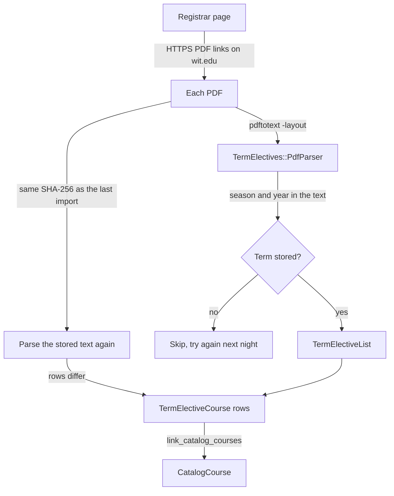
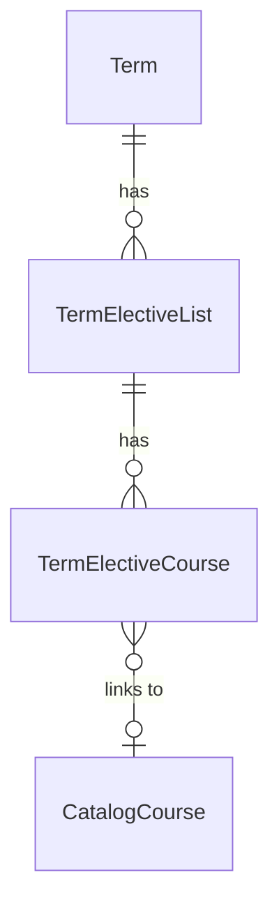

# Term elective lists

Each school publishes its elective lists for a term as PDFs. The Registrar's [Technical, Major, and HSS Electives](https://wit.edu/academics/registrar/how-to/technical-major-and-huss-electives) page links them. `TermElectives::ImportJob` imports them each night at 3:30am (`config/recurring.yml`). To queue the import now, run `bin/rails term_electives:import`. The job holds a lock, so two runs do not overlap.

These lists are not the catalog elective lists in `docs/degree-requirements.md`. A catalog list is for a catalog year. A term list names the courses that a school accepts as electives in one term.

## API and MCP

`GET /api/v1/catalog/terms/:uid/electives` and the MCP tool `list_term_electives` give the lists of one term. Both use `Catalog::TermElectiveQuery` and `Catalog::TermElectiveListSerializer`. `docs/public-catalog-api.md` gives the filters. The tool's advisory names the `term_electives` source (`Catalog::Freshness`).

## Flow

## Tables

| Model | One row is |
|---|---|
| `TermElectiveList` | One PDF. `school` comes from the file name (`SCDS`, `HSS`, `SOM`, `ARCH`). `body_text` is the full text of the PDF. `sha256` is the digest of the PDF. `fetched_at` is when the import last read the file, changed or not. |
| `TermElectiveCourse` | One course code in a PDF, with the nearest heading above it. The same code can occur under more than one heading. |

## Parser

Each school uses a different layout, and a school can change its layout from one term to the next. Examples: bulleted lists for each program (SCDS), a table by area (HSS, Spring 2027), a table of CRNs (HSS, Fall 2026), and course descriptions (ARCH). So `TermElectives::PdfParser` does not read the layout. It reads these items:

- **Term:** the season and year in the first 8 lines of the text, such as "Spring 2027". The file name can name a different term, for example `SP26 ARCH Undergrad Electives.pdf` is for Spring 2027. A term further down is not read, because the body can name other terms. When the first lines name two different terms, the file gets no term and is skipped.
- **Courses:** each code such as `COMP2000`, `ECON 4102`, `ARCH3800-02`, or `Economics (ECON) 4102`. The importer keeps a code only when Banner knows its subject, because "FALL 2026" has the same shape as a code.
- **Headings:** a short line at the left margin with no digits. The line above it is blank or short, and the next line of content is a course or another heading. Examples: "Computer Science Elective", "Social Science". A heading is context only. It does not always name the list exactly.

The parser does not read rules that name no course, such as "Any 2000-Level courses in BIOE, BIOL, ...". `body_text` keeps them, and the API and the tool return it as `text`.

## Updates and removals

- A PDF with the same SHA-256 as the last import does not go through `pdftotext` again. The importer parses its stored `body_text` again and writes the course rows again only when they differ, for example when Banner adds a subject.
- Each run links course rows to a `CatalogCourse` that Banner added since the last import. `Catalog::CourseDetailsSync.link_degree_requirements` also links them when it adds a course.
- A changed PDF has its course rows written again.
- When the page links a term, the page is the source of truth for that term. A list of that term whose URL is no longer on the page is deleted, for example `FA26 HSS Electives V2.pdf` after V3 replaces it.
- When the page no longer links any file for a term, the lists of that term stay.
- A PDF that returns 404, or that names a term with no `Term` row, is skipped. The next run tries it again.
- A PDF that fails to download, convert, or save is reported with `Rails.error.report`. The import continues with the other files.
- A link with a raw space in its href is escaped. A link that is not HTTPS, or that is on another host, is skipped and logged.
